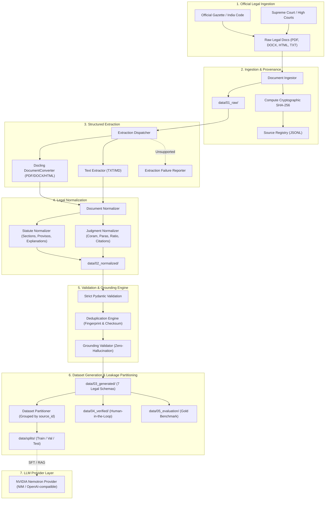

# LegalMitra — Indian Legal Dataset Engineering Architecture

## 1. System Vision and Objectives

**LegalMitra** is a source-grounded, sovereign data engineering and information retrieval platform tailored specifically for the Indian legal ecosystem. Its primary architectural objective is to establish an uncompromised chain of provenance from official primary legal sources (Parliamentary Acts, Gazette Notifications, High Court and Supreme Court judgments) to structured datasets engineered for Retrieval-Augmented Generation (RAG) and downstream Supervised Fine-Tuning (SFT).

---

## 2. Core Architectural Principles

### 2.1 Mechanical Validation vs. Legal Verification
Automated pipeline execution and Pydantic schema validation verify **syntactic integrity, structural completeness, and string matching**. They do **NOT** establish substantive legal correctness. Every record in LegalMitra carries an explicit `LegalReviewStatus`:
- `unverified_automated`: Ingested and mechanically normalized; pending review.
- `pending_legal_review`: Queued for human advocate or legal researcher review.
- `legal_expert_approved`: Certified by qualified Indian legal counsel.
- `legal_expert_rejected`: Rejected due to statutory misinterpretation, repealed law citation, or factual error.
- `flagged_unsupported`: Flagged by the `GroundingValidator` because an assertion or citation lacks grounding in source evidence passages.

### 2.2 Preservation of Indian Statutory & Judicial Nuances
Indian legislative drafting possesses distinct formal structures:
- **Hierarchical Statutory Subdivisions**: Sections (`Section 61`), Subsections (`(1)`), Clauses (`(a)`), Sub-clauses (`(i)`).
- **Provisos & Explanations**: `Provided that...`, `Provided further that...`, `Explanation.—`, `Explanation 1.—`, `Illustration (a)`. LegalMitra models these as first-class structured objects rather than flattening them into unindexed blocks.
- **Judgment Paragraph Integrity**: Indian High Courts and the Supreme Court enforce numbered paragraph judgments (`[1]`, `[2]`, `para 15`). LegalMitra preserves exact paragraph numbering and verbatim text.
- **Statutory Redaction Compliance**: Judgments involving sexual offences or minors require mandatory victim name masking under **Section 33(7) of the POCSO Act, 2012**, **Section 74 of the Juvenile Justice Act, 2015**, and **Section 72 of the Bharatiya Nyaya Sanhita, 2023**. Records explicitly track redaction notes.

---

## 3. Data Storage and Lifecycle Isolation

| Stage | Path | Purpose | Immutability |
|---|---|---|---|
| **Raw Documents** | `data/01_raw/` | Bit-for-bit identical copies of ingested legal files named by `<document_id>.<ext>`. | Immutable |
| **Normalized Docs** | `data/02_normalized/` | Schema-validated JSON representations (`StatuteDocument`, `JudgmentDocument`). | Versioned |
| **Generated Examples** | `data/03_generated/` | Synthetic Q&A, case analyses, procedural guides, drafting templates. | Versioned |
| **Verified Examples** | `data/04_verified/` | Records reviewed and certified by qualified legal professionals. | Append-only |
| **Evaluation Benchmarks**| `data/05_evaluation/` | Gold-standard benchmark questions, negative constraints, and golden citations. | Fixed |
| **Dataset Splits** | `data/splits/` | Train, validation, and test sets partitioned strictly by source ID. | Deterministic |
| **Source Registry** | `registry/source_registry.jsonl` | Append-only ledger of document metadata, checksums, and states. | Append-only |

---

## 4. Multi-Schema Architecture

The platform defines 7 domain-specific Pydantic schemas:
1. `StatuteDocument` & `StatuteSection`: Preserves Act number, chapter, section number, title, subsections, provisos, explanations, and verbatim text.
2. `JudgmentDocument`: Preserves cause title, court, coram bench, neutral citations, numbered paragraphs, holdings, and ratio decidendi.
3. `LegalQADocument`: Source-grounded Q&A with mandatory `evidence_passages`, `supporting_source_ids`, legal domain, and statutory disclaimer.
4. `CaseAnalysisDocument`: Doctrinal brief including factual matrix, framed issues, ratio decidendi, obiter dicta, and precedential status under Article 141.
5. `ProceduralGuidanceDocument`: Step-by-step procedural workflows before Indian courts, statutory rules (e.g. BNSS s.482), limitation periods, and mandatory forms.
6. `DraftingExampleDocument`: Pleading and affidavit templates with statutory justifications for mandatory clauses and standardized bracketed placeholders.
7. `EvaluationQuestionDocument`: Benchmark evaluation questions with golden citations, rubric weights, and forbidden terms (e.g. repealed IPC/CrPC sections).

---

## 5. Zero Data Leakage Partitioning

To avoid data leakage across training and test splits during model training or RAG evaluation, `DatasetPartitioner` operates on entire source document clusters:
- All sections, Q&A pairs, and drafting examples originating from a source document (or case family) are allocated to **exactly one partition** (Train, Validation, or Test).
- Partitioning asserts `len(train_sources ∩ test_sources) == 0`.

---

## 6. Interchangeable LLM Provider & NVIDIA Nemotron

`NemotronLLMProvider` implements `BaseLLMProvider`:
- Configurable via environment variables without hardcoded endpoints:
  - `NEMOTRON_API_KEY`: Secret Bearer token.
  - `NEMOTRON_BASE_URL`: Base URL (defaults to NVIDIA NIM: `https://integrate.api.nvidia.com/v1`).
  - `NEMOTRON_MODEL_NAME`: Target model (e.g. `nvidia/llama-3.1-nemotron-70b-instruct`).
  - `NEMOTRON_API_FORMAT`: `openai_compatible` or `nvidia_nim`.
- Offline reproducible tests utilize `MockLLMProvider` to run continuous integration without external network dependencies.
