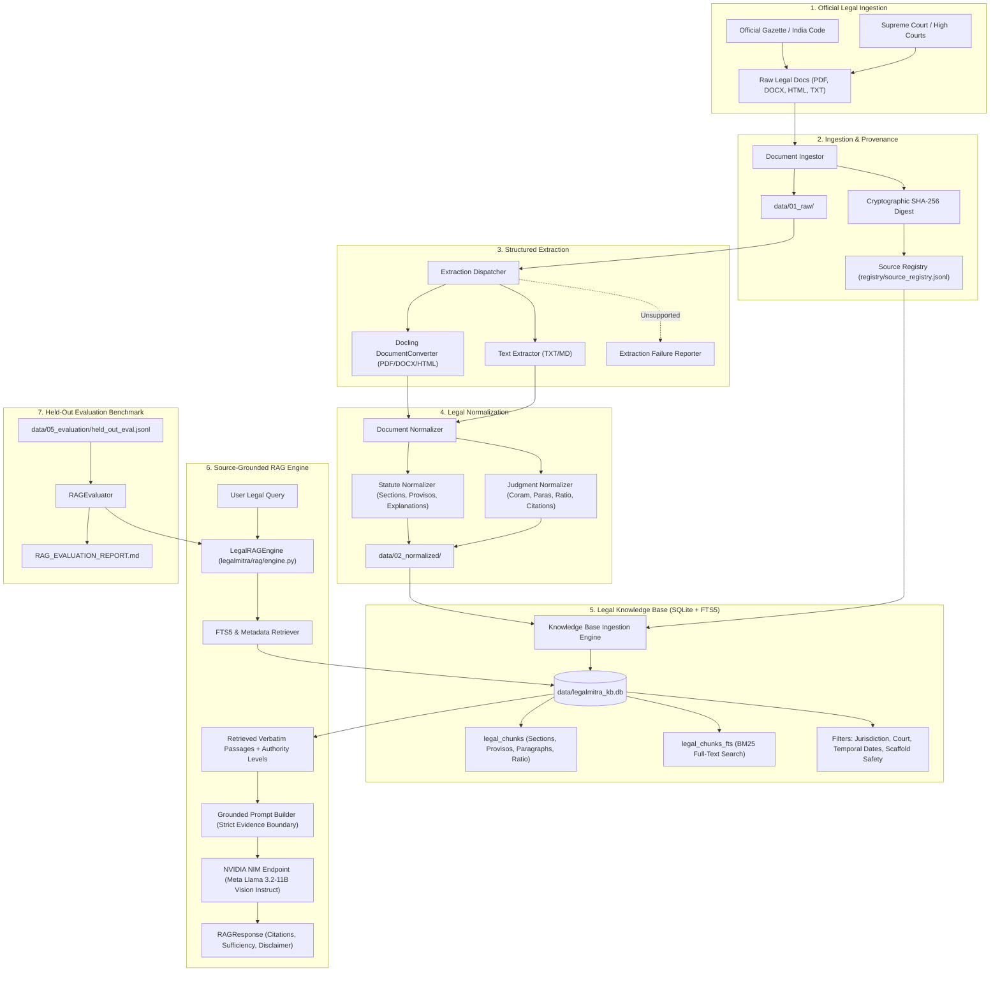

# LegalMitra — Indian Legal Dataset Engineering & RAG Architecture
**Document Version**: 0.4.0 (Phase 4 — Legal Knowledge Base & Source-Grounded RAG)  
**Status**: ACTIVE / ARCHITECTURALLY VERIFIED  

---

## 1. System Vision and Objectives

**LegalMitra** is a source-grounded, sovereign legal data engineering and information retrieval platform tailored specifically for the Indian legal ecosystem. Its primary architectural objective is to establish an uncompromised chain of provenance from official primary legal sources (Parliamentary Acts, Gazette Notifications, High Court and Supreme Court judgments) to structured datasets and high-precision Retrieval-Augmented Generation (RAG) engines.

---

## 2. Core Architectural Principles

### 2.1 Mechanical Validation vs. Legal Verification
Automated pipeline execution and Pydantic schema validation verify **syntactic integrity, structural completeness, and string matching**. They do **NOT** establish substantive legal correctness. Every record in LegalMitra carries an explicit `LegalReviewStatus`:
- `unverified_automated`: Ingested and mechanically normalized; pending advocate review.
- `pending_legal_review`: Queued for human advocate or legal researcher review.
- `legal_expert_approved`: Certified by qualified Indian legal counsel enrolled under the Advocates Act, 1961.
- `legal_expert_rejected`: Rejected due to statutory misinterpretation, repealed law citation, or factual error.
- `flagged_unsupported`: Flagged because an assertion, citation, or document lacks grounding in authentic sources.

### 2.2 Preservation of Indian Statutory & Judicial Nuances
Indian legislative drafting possesses distinct formal structures:
- **Hierarchical Statutory Subdivisions**: Sections (`Section 61`), Subsections (`(1)`), Clauses (`(a)`), Sub-clauses (`(i)`).
- **Provisos & Explanations**: `Provided that...`, `Provided further that...`, `Explanation.—`, `Explanation 1.—`, `Illustration (a)`. LegalMitra indexes these as first-class searchable chunk units.
- **Judgment Paragraph Integrity**: Indian High Courts and the Supreme Court deliver numbered paragraph judgments (`[1]`, `[2]`, `para 15`). LegalMitra indexes each numbered paragraph separately while preserving bench coram and ratio decidendi.
- **Precedential Stare Decisis (Article 141)**: Supreme Court rulings are classified as `binding_precedent` across all Indian courts. High Court decisions outside their state are classified as `persuasive_precedent`.
- **Synthetic Scaffold Isolation**: Any test mockup (such as `IND-JUD-DEL-2024-BAIL`) is classified as `unverified_scaffold` and excluded from default retrieval queries.
- **Statutory Redaction Compliance**: Judgments involving sexual offences or minors require mandatory victim name masking under **Section 33(7) of the POCSO Act, 2012**, **Section 74 of the Juvenile Justice Act, 2015**, and **Section 72 of the Bharatiya Nyaya Sanhita, 2023**.

---

## 3. Data Storage and Lifecycle Isolation

| Stage | Path | Purpose | Immutability |
|---|---|---|---|
| **Raw Documents** | `data/01_raw/` | Bit-for-bit identical copies of ingested legal files named by `<document_id>.<ext>`. | Immutable |
| **Normalized Docs** | `data/02_normalized/` | Schema-validated JSON representations (`StatuteDocument`, `JudgmentDocument`). | Versioned |
| **Knowledge Base** | `data/legalmitra_kb.db` | Local SQLite database with FTS5 virtual tables and relational metadata. | Indexed |
| **Generated Examples** | `data/03_generated/` | Synthetic Q&A, case analyses, procedural guides, drafting templates. | Versioned |
| **Verified Examples** | `data/04_verified/` | Records reviewed and certified by qualified legal professionals. | Append-only |
| **Evaluation Benchmarks**| `data/05_evaluation/` | Gold-standard benchmark questions (`held_out_eval.jsonl`), negative constraints, golden rubrics. | Fixed |
| **Dataset Splits** | `data/splits/` | Train, validation, and test sets partitioned strictly by source ID. | Deterministic |
| **Source Registry** | `registry/source_registry.jsonl` | Append-only ledger of document metadata, checksums, and states. | Append-only |

---

## 4. Multi-Schema Architecture

The platform defines domain-specific Pydantic schemas in `legalmitra/schemas/`:
1. `StatuteDocument` & `StatuteSection`: Preserves Act number, chapter, section number, title, subsections, provisos, explanations, and verbatim text.
2. `JudgmentDocument`: Preserves cause title, court, coram bench, neutral citations, numbered paragraphs, holdings, and ratio decidendi.
3. `LegalQADocument`: Source-grounded Q&A with mandatory `evidence_passages`, `supporting_source_ids`, legal domain, and statutory disclaimer.
4. `CaseAnalysisDocument`: Doctrinal brief including factual matrix, framed issues, ratio decidendi, obiter dicta, and precedential status under Article 141.
5. `ProceduralGuidanceDocument`: Step-by-step procedural workflows before Indian courts, statutory rules (e.g. BNSS s.482), limitation periods, and mandatory forms.
6. `DraftingExampleDocument`: Pleading and affidavit templates with statutory justifications for mandatory clauses and standardized bracketed placeholders.
7. `EvaluationQuestionDocument`: Benchmark evaluation questions with golden citations, rubric weights, and forbidden terms (e.g. repealed IPC/CrPC sections).

---

## 5. Zero Data Leakage Partitioning

To avoid data leakage across training and test splits during model training or RAG evaluation, `DatasetPartitioner` operates on entire source document clusters:
- All sections, Q&A pairs, and drafting examples originating from a source document (or case family) are allocated to **exactly one partition** (Train, Validation, or Test).
- Partitioning asserts `len(train_sources ∩ test_sources) == 0`.

---

## 6. Model Lineage, Provider Abstraction & NVIDIA NIM

### 6.1 Architectural Decoupling
The inference layer is decoupled through `BaseLLMProvider` (`legalmitra/llm/interface.py`).
- **Offline / CI Testing**: Utilizes `MockLLMProvider` ensuring 100% reproducible test suites with zero external network dependencies.
- **Production / Evaluation**: `NemotronLLMProvider` connects dynamically to OpenAI-compatible endpoints configured via environment variables.

### 6.2 Model Lineage Transparency
- **Configured Endpoint**: NVIDIA API Catalog / NIM (`https://integrate.api.nvidia.com/v1`).
- **Active Model Identifier**: `meta/llama-3.2-11b-vision-instruct`.
- **Architectural Clarification**: The active model belongs to **Meta AI's Llama 3.2 family** (multimodal vision-instruct) hosted on NVIDIA NIM infrastructure. It is **not** an NVIDIA-native Nemotron architecture (such as Nemotron-4-340B). All telemetry, logging, and documentation transparently record this model lineage.

---

## 7. Legal Knowledge Base (SQLite + FTS5 Architecture)

The Legal Knowledge Base (`legalmitra/knowledge/knowledge_base.py`) provides structured storage and hybrid BM25 full-text retrieval:

### 7.1 Relational Schema & Hierarchy
1. `sources`: Tracks document provenance, source URLs, enactment and commencement dates, repeal status, checksum, and verification status.
2. `legal_chunks`: Stores atomic legal units:
   - Statutes: Sections, Subsections, Provisos, Explanations, Illustrations.
   - Judgments: Ratio Decidendi, Holdings, Numbered Paragraphs.
   - Metadata: `authority_level` (`binding_statute`, `binding_precedent`, `persuasive_precedent`, `unverified_scaffold`), `is_synthetic_scaffold`, `is_historical`, `effective_date`.
3. `legal_chunks_fts`: SQLite FTS5 virtual table indexing verbatim text, section/para references, and titles using the `porter unicode61` tokenizer.

### 7.2 Safety & Metadata Filtering
The search interface (`SearchFilters`) supports:
- **Jurisdiction & Court Filter**: Restricting queries to Union (`IN`) or specific High Courts (`IN-DL`).
- **Temporal Validity (`as_of_date`)**: Evaluates `effective_date <= as_of_date`, correctly distinguishing pre-July 2024 law (Indian Evidence Act, 1872) from post-July 2024 law (Bharatiya Sakshya Adhiniyam, 2023).
- **Synthetic Scaffold Isolation**: Unverified scaffolds (`IND-JUD-DEL-2024-BAIL`) are filtered out by default (`include_synthetic = False`).

---

## 8. Source-Grounded RAG Engine

The RAG engine (`legalmitra/rag/engine.py`) coordinates retrieval and response generation:
1. **Evidential Boundary**: The prompt instructs the model to synthesize answers strictly from retrieved evidence passages. If evidence is lacking, it explicitly outputs:
   > *"The retrieved legal sources do not provide sufficient evidence to answer this question authoritatively under Indian law."*
2. **Authority Hierarchy Output**: Separates binding statutory and Supreme Court authorities from persuasive High Court precedents.
3. **Missing Facts Detection**: Detects temporal ambiguities (e.g. pre- vs post-July 2024 offences) or missing High Court jurisdictions and prompts the user for clarification.
4. **Mandatory Statutory Disclaimer**:
   > *"This response is an automated synthesis of Indian legal sources and does not constitute formal legal advice or create an advocate-client relationship. Substantive rights and procedural timelines should be verified with an advocate enrolled under the Advocates Act, 1961."*

---

## 9. Held-Out Legal Evaluation Framework

The evaluation engine (`legalmitra/rag/evaluator.py`) evaluates against a 12-case gold benchmark (`data/05_evaluation/held_out_eval.jsonl`):
- **Retrieval Recall @ K**: Verifies that authoritative statutory sections or judgment paragraphs are retrieved.
- **Citation Accuracy**: Verifies presence of golden citations.
- **Negative Constraint Compliance**: Detects and penalizes citations to repealed statutes (e.g. citing Evidence Act s.65B as current law) or fabricated provisions.
- **Unsupported Query Detection**: Tests whether out-of-corpus queries (e.g. maritime admiralty, direct tax) are truthfully rejected.
- **Temporal & Scaffold Discrimination**: Tests awareness of commencement dates and synthetic fixture warnings.
