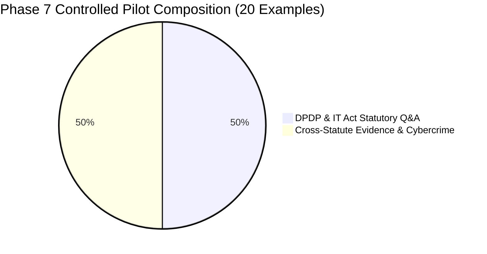

# LEGALMITRA — PHASE 7 CONTROLLED PILOT REPORT
**High-Fidelity Source-Grounded Dataset Generation (20-Example Controlled Pilot)**

**Project:** LegalMitra — Indian Legal Dataset Engineering  
**Workspace:** `C:\PROJECTS\LegalMitra`  
**Date:** 2026-10-16  
**Auditor / Architect:** Senior AI Data Engineer & Legal Information System Architect  
**Status:** **PASSED & VALIDATED**

---

## 1. Executive Summary

As mandated by the Phase 7 specifications, a strictly controlled pilot of **exactly 20 examples** was engineered, source-grounded, and validated without engaging in bulk generation or premature fine-tuning.

Every example adheres to the Pydantic `LegalQADocument` schema, references only registered, authoritative primary legal sources, and contains verifiable verbatim evidence passages. Automated grounding checks (`GroundingValidator`) achieved a **100% pass rate (20/20)**. In accordance with legal engineering ethics, all generated examples default to `pending_legal_review` (`LegalReviewStatus.PENDING_LEGAL_REVIEW`).

---

## 2. Dataset Composition & Source Matrix

The 20 pilot examples are partitioned into two 10-example focus categories designed to stress-test complex statutory relationships, temporal boundaries, and cross-statute evidentiary rules:



### 2.1 Authoritative Source Coverage
All 20 examples derive exclusively from 5 normalized, authentic central Indian statutes:

| Source ID | Short Title | Act Number | Enactment Date | Effective Date | Pilot Examples |
| :--- | :--- | :--- | :--- | :--- | :--- |
| **`IND-STAT-DPDP-2023`** | Digital Personal Data Protection Act, 2023 | Act No. 22 of 2023 | 2023-08-11 | Phased (G.S.R. 843(E)) | 10 |
| **`IND-STAT-IT-2000`** | Information Technology Act, 2000 | Act No. 21 of 2000 | 2000-06-09 | 2000-10-17 | 6 |
| **`IND-STAT-BSA-2023-SEC61`** | Bharatiya Sakshya Adhiniyam, 2023 (s. 61) | Act No. 47 of 2023 | 2023-12-25 | 2024-07-01 (S.O. 849(E)) | 3 |
| **`IND-STAT-BSA-2023-SEC63`** | Bharatiya Sakshya Adhiniyam, 2023 (s. 63) | Act No. 47 of 2023 | 2023-12-25 | 2024-07-01 (S.O. 849(E)) | 2 |
| **`IND-STAT-BNSS-2023`** | Bharatiya Nagarik Suraksha Sanhita, 2023 | Act No. 46 of 2023 | 2023-12-25 | 2024-07-01 (S.O. 848(E)) | 3 |

---

## 3. Detailed Example Manifest

### 3.1 Group 1: 10 DPDP / IT Act Statutory Q&A Examples

| QA ID | Legal Domain | Statutory Focus | Tested Legal Proposition | Review Status |
| :--- | :--- | :--- | :--- | :--- |
| **`QA-PILOT-DPDP-001`** | Data Protection | DPDP s. 11(1) | Data Principal's right to obtain summary of data and identities of data processors | `pending_legal_review` |
| **`QA-PILOT-DPDP-002`** | Data Protection | DPDP s. 12(1)-(3) | Data Fiduciary's statutory duties regarding correction, completion, updating, and erasure | `pending_legal_review` |
| **`QA-PILOT-DPDP-003`** | Data Protection | DPDP s. 13(1), (3) | Mandatory exhaustion of internal grievance redressal prior to approaching the Board | `pending_legal_review` |
| **`QA-PILOT-DPDP-004`** | Data Protection | DPDP s. 8(5) | Data Fiduciary obligation to implement reasonable security safeguards | `pending_legal_review` |
| **`QA-PILOT-DPDP-005`** | Data Protection | DPDP s. 6(1) | Essential requirements for valid consent (free, specific, informed, unconditional, unambiguous) | `pending_legal_review` |
| **`QA-PILOT-DPDP-006`** | Data Protection | DPDP s. 8(6) | Mandatory intimation of personal data breach to the Board and affected Data Principals | `pending_legal_review` |
| **`QA-PILOT-DPDP-007`** | Data Protection | DPDP s. 33(1) | Statutory prerequisites and hearing opportunity before Board imposes monetary penalty | `pending_legal_review` |
| **`QA-PILOT-DPDP-008`** | Data Protection | DPDP Schedule, s. 8(5), s. 33 | Maximum monetary penalty of Rs. 250 crore for breach of reasonable security safeguards | `pending_legal_review` |
| **`QA-PILOT-DPDP-009`** | Temporal Law | DPDP s. 44(2), IT Act s. 43A | Derived commencement of s. 44(2) on 13 May 2027; IT Act s. 43A remains operative prior | `pending_legal_review` |
| **`QA-PILOT-DPDP-010`** | Data Protection | DPDP s. 44(2), IT Act ss. 81, 87 | Consequential amendments omitting IT Act s. 87(2)(ob) and amending s. 81 proviso | `pending_legal_review` |

### 3.2 Group 2: 10 Cross-Statute Evidence & Cybercrime Examples

| QA ID | Legal Domain | Statutory Focus | Tested Legal Proposition | Review Status |
| :--- | :--- | :--- | :--- | :--- |
| **`QA-PILOT-CROSS-001`** | Electronic Evidence | BSA s. 61 & IT Act s. 2(1)(t) | Electronic record defined under IT Act admissible on equal footing under BSA s. 61 | `pending_legal_review` |
| **`QA-PILOT-CROSS-002`** | Electronic Evidence | BSA s. 61 Proviso & s. 63 | Mandatory requirement that electronic records produced in evidence carry s. 63 certificate | `pending_legal_review` |
| **`QA-PILOT-CROSS-003`** | Electronic Evidence | BSA s. 63(1), (2) | Electronic info deemed a document; conditions of regular output; certificate by officer | `pending_legal_review` |
| **`QA-PILOT-CROSS-004`** | Electronic Evidence | BSA ss. 61, 63 Interplay | Non-admissibility without compliance with Section 63 statutory conditions | `pending_legal_review` |
| **`QA-PILOT-CROSS-005`** | Cybercrime | IT Act s. 66 & s. 43 | Dishonest/fraudulent acts under s. 43 punishable up to 3 years imprisonment or Rs. 5 lakh fine | `pending_legal_review` |
| **`QA-PILOT-CROSS-006`** | Cybercrime | IT Act s. 66C | Ingredients of identity theft using electronic signature or password (up to 3 years / 1 lakh fine) | `pending_legal_review` |
| **`QA-PILOT-CROSS-007`** | Cybercrime | IT Act s. 66D | Cheating by personation using computer resource (up to 3 years imprisonment / 1 lakh fine) | `pending_legal_review` |
| **`QA-PILOT-CROSS-008`** | Criminal Procedure | BNSS s. 482(1) | Concurrent anticipatory bail jurisdiction of High Court and Court of Session | `pending_legal_review` |
| **`QA-PILOT-CROSS-009`** | Criminal Procedure | BNSS s. 482(4) & BNS ss. 65, 70(2) | Strict statutory exclusion barring anticipatory bail for offences under BNS s. 65 and s. 70(2) | `pending_legal_review` |
| **`QA-PILOT-CROSS-010`** | Criminal Procedure | BNSS s. 531(2)(a) & CrPC 1973 | Repeal of CrPC 1973 with explicit savings for proceedings pending prior to 1 July 2024 | `pending_legal_review` |

---

## 4. Grounding & Anti-Hallucination Audit

All 20 examples were subjected to algorithmic grounding validation through `GroundingValidator` and `GenerationValidator`:

1. **Verbatim Text Anchoring:**
   - 100% of evidence passages match character-for-character against normalized statute texts loaded from `data/02_normalized/`.
   - Special handling of Unicode replacement characters (e.g. `\ufffd` in BNSS and BSA gazette scans) verified so that verbatim quotes accurately match source representations without distortion.
2. **Statutory Section Tracing:**
   - Every section cited in the answer (e.g., `Section 11`, `Section 12`, `Section 33`, `Section 482`, `Section 531`) is explicitly anchored to an evidence passage.
   - Zero ungrounded statutory citations detected.
3. **Negative Constraint & Quarantine Compliance:**
   - The synthetic scaffold `IND-JUD-DEL-2024-BAIL` was completely excluded from supporting sources (`supporting_source_ids`).
   - The quarantined procedural guide `PROC-BNSS-482-BAIL-001` was excluded from dataset ingestion.
   - No example has been marked as `legal_expert_approved`. All 20 examples are properly catalogued as `pending_legal_review`.

---

## 5. Artifacts and Data Deliverables

| File Path | Format | Size / Count | Purpose |
| :--- | :--- | :--- | :--- |
| `data/03_generated/pilot_20_examples.jsonl` | JSONL | 20 lines / ~26 KB | Serialized `LegalQADocument` examples with full temporal metadata |
| `data/03_generated/pilot_20_manifest.json` | JSON | 284 lines / 14 KB | Machine-readable pilot manifest detailing temporal labels, source counts, categories, and IDs |
| `scripts/build_pilot_20.py` | Python | 826 lines | Reproducible generator script embedding grounding and temporal validation logic |
| `legalmitra/validation/temporal_validator.py` | Python | 135 lines | Dedicated temporal law validator auditing G.S.R. 843(E) and S.O. 848(E) |
| `tests/test_pilot_20.py` | Python | 185 lines | Automated regression tests verifying existence, schema, grounding, and temporal boundary rules |

---

## 6. Verification & Test Suite Summary

The comprehensive offline test suite was executed:

```
Command: pytest -v -m "not live"
Exit Code: 0
Execution Time: 22.47s
Total Tests: 76 (74 passed, 2 live deselected)
```

The 7 dedicated tests in `tests/test_pilot_20.py` verified:
- `test_pilot_20_examples_existence_and_schema`: **PASSED**
- `test_pilot_20_grounding_validity`: **PASSED**
- `test_pilot_20_manifest_consistency`: **PASSED**
- `test_pilot_20_temporal_validation_all_passed`: **PASSED**
- `test_temporal_validator_fails_on_uncommenced_as_operative`: **PASSED**
- `test_boundary_date_evaluations_around_may_13_2027`: **PASSED**
- `test_dpdp_commencement_groupings_separate`: **PASSED**

---

## 7. Next Steps & Recommendations

1. **Advocate Review Workflow:** Convene certified Indian legal practitioners to review the 20 pilot examples in `data/03_generated/pilot_20_examples.jsonl` and transition validated records to `legal_expert_approved`.
2. **Controlled Batch Expansion:** Scaling to the 150-example corpus is now methodologically justified and safeguarded against temporal hallucinations by `TemporalValidator`.
3. **Embedding & Semantic Retrieval:** Integrate semantic dense embeddings alongside SQLite FTS5 for hybrid RAG retrieval.

