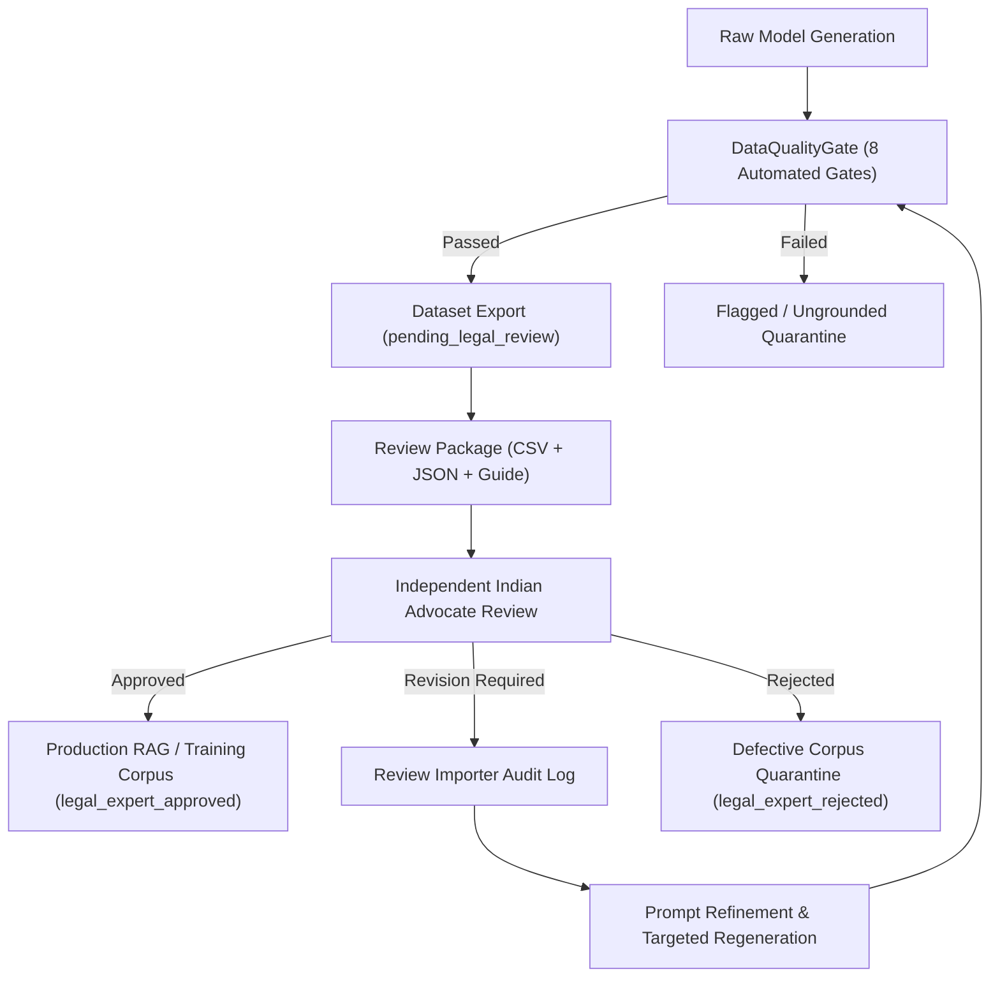

# LEGALMITRA — ADVOCATE FEEDBACK IMPORT & GOVERNANCE WORKFLOW
**Phase 8 Operational Manual**
*Document ID*: `WORKFLOW-2026-PHASE8-001`  
*Date*: 16 October 2026  
*Status*: ACTIVE / AUDITED  

---

## 1. Purpose and Architecture

This operational guide specifies the end-to-end governance and technical workflow for capturing, validating, and importing human legal advocate feedback into LegalMitra datasets.

LegalMitra enforces an institutional principle: **Automated validation never establishes legal correctness.** Automated quality gates verify schema conformity, verbatim grounding, and temporal consistency; however, only a certified Indian legal advocate can grant legal approval.

---

## 2. Review Artifacts & Distribution

Advocates are provided with the review package located in `data/06_review/`:
1. **`ADVOCATE_REVIEW_GUIDE.md`**: Legal background, statutory timeline under G.S.R. 843(E) and S.O. 848(E), and the 1–5 scoring rubric.
2. **`pilot_20_review_sheet.csv`**: Review spreadsheet containing questions, answers, verbatim evidence spans, citations, URLs, and specific advocate questions.
3. **`pilot_20_source_bundle.json`**: Machine-readable JSON linking every record to official source records and checksums.
4. **`pilot_20_open_issues.md`**: Analytical memorandum on the six prioritized legal ambiguities.

---

## 3. Reviewer Decisions and Data Dictionary

In `pilot_20_review_sheet.csv`, the advocate fills in the following fields for each record:

| Field Name | Type | Mandatory? | Permitted Values & Description |
| :--- | :---: | :---: | :--- |
| `record_id` | String | **Yes** | Stable ID (e.g., `QA-PILOT-DPDP-001`). Pre-populated. Must not be altered. |
| `review_decision` | Enum | **Optional** | `APPROVED`, `REVISION_REQUIRED`, `REJECTED`, or blank. |
| `legal_accuracy_score_1_to_5` | Integer | Optional | 1 (Erroneous) to 5 (Exemplary). Evaluates Indian legal correctness. |
| `temporal_accuracy_score_1_to_5` | Integer | Optional | 1 (Temporal error) to 5 (Flawless). Evaluates in-force vs uncommenced claims. |
| `grounding_accuracy_score_1_to_5` | Integer | Optional | 1 (Ungrounded/hallucinated) to 5 (Strictly grounded). |
| `reviewer_comments` | String | **Conditional** | **Mandatory** if decision is `REVISION_REQUIRED` or `REJECTED`. Instructions for dataset revision. |
| `reviewer_name_initials` | String | Optional | Name or initials of reviewing counsel (e.g. `Adv. R.K. Sharma`). |
| `review_date` | Date | Optional | Date of review in `YYYY-MM-DD` ISO format. |

---

## 4. Validation Rules Enforced by `ReviewImporter`

The import engine (`legalmitra/review/import_review.py`) enforces strict validation prior to applying any update:

### Rule 1: Strict Decision Whitelist
The import engine recognizes only three decision strings:
- `APPROVED` $\rightarrow$ transitions `legal_review_status` to `LegalReviewStatus.LEGAL_EXPERT_APPROVED`.
- `REVISION_REQUIRED` $\rightarrow$ transitions `legal_review_status` to `LegalReviewStatus.REVISION_REQUIRED`.
- `REJECTED` $\rightarrow$ transitions `legal_review_status` to `LegalReviewStatus.LEGAL_EXPERT_REJECTED`.
Any unrecognized string (such as `ACCEPTED`, `PASS`, or `MAYBE`) triggers immediate validation failure.

### Rule 2: Non-Inference from Blank Fields
If `review_decision` is left blank, the record **must remain in `pending_legal_review` status**. The system strictly forbids inferring approval from a blank field, a passing test, or an exact source match.

### Rule 3: Mandatory Comments for Revision or Rejection
If a reviewer marks a record as `REVISION_REQUIRED` or `REJECTED`, a non-empty `reviewer_comments` is legally mandatory. The pipeline rejects any unexplained rejection to maintain transparency and actionable feedback for prompt engineering.

### Rule 4: Atomic Execution Guarantee
The importer parses and validates all rows in the CSV before modifying any target dataset files. If row 19 contains an error, rows 1 through 18 are **not** applied, and the dataset on disk remains completely untouched.

### Rule 5: Immutable Audit Ledger
Whenever reviews are imported, the system records an immutable JSONL audit ledger in `data/06_review/audit/review_audit_log_<TIMESTAMP>.jsonl`. Each entry stores:
- Precise timestamp (UTC).
- Record ID.
- Previous review status.
- New review status.
- Reviewer identity and date.
- Reviewer comments.
- Scores.
- **Original record snapshot** (capturing the full prior state for rollbacks).

### Rule 6: Separation of Automated Validation and Legal Review
Automated validation attributes (such as `temporal_validation_status`, `is_valid_grounding`, and `flagged_unsupported`) are maintained independently from `legal_review_status`. A record with verified automated status remains unapproved until counsel review.

---

## 5. CLI Execution Guide

### Dry-Run Validation (Pre-Check)
To validate a completed review sheet without making any changes to the dataset:
```bash
python scripts/import_advocate_review.py --csv data/06_review/pilot_20_review_sheet.csv --dataset data/03_generated/pilot_20_examples.jsonl --dry-run
```

### Live Import with Audit Logging
To import completed reviews and update the dataset:
```bash
python scripts/import_advocate_review.py --csv data/06_review/pilot_20_review_sheet.csv --dataset data/03_generated/pilot_20_examples.jsonl --output data/03_generated/pilot_20_reviewed.jsonl --audit-dir data/06_review/audit
```

---

## 6. Revision and Retraining Lifecycle



