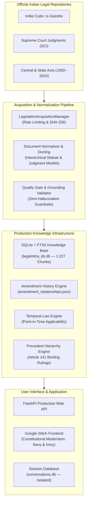

# LegalMitra — National Indian Legal AI Intelligence Platform

```text
====================================================================================================
                        LEGALMITRA — PROPRIETARY & CONFIDENTIAL SOFTWARE
====================================================================================================
  CLASSIFICATION : PROPRIETARY & CONFIDENTIAL — RESTRICTED ACCESS
  OWNED BY       : Team Shatrujeet
  AUTHORS & CORE : Amar Khera | Ananya Rout | Lucky Kumar | Omm Prakash Sahoo
  CREATED        : October 2026
  LICENSE        : Team Shatrujeet Proprietary Software License (All Rights Reserved)
  NOTICE         : STRICTLY PRIVATE. NOT FOR PUBLIC RELEASE. NOT TO BE COPIED OR DISTRIBUTED.
====================================================================================================
```

[](https://www.python.org/)
[](LICENSE)
[]()
[]()
[]()
[]()

> [!CAUTION]
> **PROPRIETARY NOTICE**: This software, including its source code, architecture, algorithms, datasets, schemas, and design tokens, is the exclusive proprietary intellectual property of **Team Shatrujeet** (Amar Khera, Ananya Rout, Lucky Kumar, Omm Prakash Sahoo). It is strictly private software created in October 2026 and is not authorized for public release, duplication, scraping, unauthorized execution, or commercial exploitation.

> [!IMPORTANT]
> **LEGAL ACCREDITATION & ETHICS DISCLAIMER**: LegalMitra is an advanced legal knowledge engineering platform designed for legal researchers, jurists, advocates, and judicial data engineers. Automated extraction, quality gates, and model inference verify **evidential grounding, structural hierarchy, and statutory provenance**; they do **not** substitute for formal representation or legal advice by a licensed advocate enrolled with the Bar Council of India.

---

## 1. Project Legends & Ownership Attribution

- **Organization / Team:** `Team Shatrujeet`
- **Core Engineers & Authors:**
  - **Amar Khera**
  - **Ananya Rout**
  - **Lucky Kumar**
  - **Omm Prakash Sahoo**
- **Creation Date:** October 2026
- **Repository URI:** `https://github.com/DebugDroid-15/LegalMitra`
- **Legal License:** `Team Shatrujeet Proprietary & Confidential Software License` ([LICENSE](file:///c:/PROJECTS/LegalMitra/LICENSE))

---

## 2. Platform Architecture & Core Systems

LegalMitra transforms unstructured Indian legislative and judicial records into a high-precision, source-grounded legal intelligence system:



---

## 3. Key Technical Capabilities

### 3.1 National Indian Legal Corpus (Batch 1: Central Legislation)
- **16 Primary Sources Indexed:** Constitution of India, Bharatiya Nyaya Sanhita (BNS 2023), Bharatiya Nagarik Suraksha Sanhita (BNSS 2023), Bharatiya Sakshya Adhiniyam (BSA 2023), Code of Civil Procedure (CPC 1908), Indian Contract Act (ICA 1872), Specific Relief Act (SRA 1963), Arbitration and Conciliation Act (ARB 1996), Limitation Act (LIMIT 1963), Consumer Protection Act (CPA 2019), IT Act (2000), DPDP Act (2023), POCSO Act (2012), and Supreme Court Precedents (*Puttaswamy* (2017) 10 SCC 1).
- **1,227 Searchable Chunks:** Preserves sections, subsections, conditional provisos, explanations, and statutory illustrations.

### 3.2 Statutory Amendment History Engine
- Maps amending enactments (e.g. Specific Relief Amendment Act 2018, Arbitration Amendment Act 2015, IT Amendment Act 2008, Constitution 106th Amendment 2023).
- Records exact modification actions (`substitution`, `insertion`, `omission`, `repeal`), commencement dates, and prior vs. amended statutory texts.

### 3.3 Temporal Law & Transition Resolution
- **Criminal Regime:** Resolves offences against 1 July 2024 (S.O. 849(E)), protecting Article 20(1) *ex post facto* rights under IPC 1860 while saving pending trials under BNSS Section 531(2)(a).
- **Specific Performance:** Models the 1 October 2018 shift from discretionary remedy to mandatory rule and Section 20A infrastructure bar.
- **Arbitration Challenges:** Models the 23 October 2015 amendment restricting Section 34 patent illegality to domestic arbitrations and instituting Section 29A 12-month award timelines.
- **Data Protection:** Preserves IT Act Section 43A corporate liability as operative law pending formal Gazette notification under DPDP Act Section 44(2).

### 3.4 Google Stitch Constitutional Modernism Interface
- Authentic implementation of Stitch Project `8831007758695300394`.
- Palette: Deep Constitutional Navy (`#172B4D`), Constitutional Ivory (`#FAF8F2`), Saffron Gold accents (`#C8872A`).
- Accessible FastAPI server serving landing, chat, disclaimer, and citation inspector interfaces.

---

## 4. Repository Layout & File Arrangement

```text
c:\PROJECTS\LegalMitra\
├── LICENSE                          # Proprietary License (Team Shatrujeet, Oct 2026)
├── README.md                        # Platform documentation & team legends
├── ARCHITECTURE.md                  # Comprehensive architectural specification
├── pyproject.toml                   # Packaging & environment configuration
├── run_server.py                    # Production FastAPI server entrypoint (Uvicorn)
├── run_pipeline.py                  # Pipeline CLI runner
│
├── config/                          # Application settings & logging setup
│   ├── default_config.yaml
│   └── settings.py
│
├── data/                            # Physical storage segregation
│   ├── legalmitra_kb.db             # Read-only Knowledge Base (1,227 chunks, 16 sources)
│   ├── 01_raw/                      # Raw legal documents
│   ├── 02_normalized/               # Normalized StatuteDocument / JudgmentDocument JSONs
│   ├── 03_generated/                # Pilot 20 frozen review artifacts
│   ├── 06_review/                   # Advocate review sheets, source bundle, freeze manifest
│   ├── 07_batches/                  # Batch 01 candidate examples
│   └── 08_corpus/                   # Inventory, amendment relationships, checkpoints
│
├── docs/                            # Formal engineering & audit reports
│   ├── PHASE15_COMPLETION_REPORT.md # Batch 1 Central Acts expansion completion report
│   ├── PHASE15_CENTRAL_ACTS_BATCH_REPORT.md
│   ├── PHASE15_AMENDMENT_HISTORY.md
│   ├── PHASE15_PROVISION_PARSING.md
│   ├── PHASE15_TEMPORAL_VALIDATION.md
│   ├── PHASE15_RETRIEVAL_VALIDATION.md
│   ├── PHASE15_COVERAGE_REPORT.md
│   ├── DEPLOYMENT_GUIDE.md
│   ├── OPERATIONS_RUNBOOK.md
│   └── SECURITY_AUDIT.md
│
├── legalmitra/                      # Core platform modules
│   ├── caselaw/                     # Case law precedent hierarchy (Art. 141)
│   ├── corpus/                      # Taxonomy, inventory, discovery, amendments
│   ├── extraction/                  # IBM Docling & text statutory extractors
│   ├── ingestion/                   # Acquisition pipeline & Central Acts parser
│   ├── knowledge/                   # SQLite + FTS5 BM25 retrieval engine
│   ├── rag/                         # Source-grounded RAG & evaluation
│   ├── review/                      # Advocate review import & transactional rollback
│   ├── temporal/                    # Point-in-time statutory lifecycles
│   ├── validation/                  # 8 Quality gates & grounding validator
│   └── web/                         # FastAPI application & Stitch templates
│
├── scripts/                         # Operational verification utilities
│   ├── corpus_coverage_report.py    # Generates coverage dashboard metrics
│   ├── export_amendment_history.py  # Exports amendment relationship graph
│   ├── run_central_acts_batch.py    # Central Acts ingestion runner
│   └── verify_freeze.py             # SHA-256 verification of Phase 9 freeze
│
└── tests/                           # 151 Unit & Integration Tests (22 modules)
    ├── test_corpus_scale.py         # Batch 1 Central Acts & amendment scale tests
    ├── test_corpus_pipeline.py      # Taxonomy, discovery, precedent tests
    ├── test_phase9_freeze.py        # Freeze snapshot hash verification tests
    ├── test_rag.py                  # RAG grounding & negative constraint tests
    ├── test_web_api.py              # FastAPI web endpoints & rate-limit tests
    └── ... (17 additional test suites)
```

---

## 5. Quickstart & Verification Guide

### 5.1 Environment Setup
```powershell
# Navigate to repository root
cd C:\PROJECTS\LegalMitra

# Create and activate virtual environment
python -m venv .venv
.venv\Scripts\Activate.ps1

# Install package in development mode
pip install -e .
pip install pytest pytest-cov uvicorn
```

### 5.2 Verify Freeze & Data Integrity
```powershell
# Confirm bitwise integrity of the Phase 9 advocate review snapshot
python scripts/verify_freeze.py
```
Output:
```text
[OK] pilot_20_examples.jsonl has exactly 20 unique records.
[OK] pilot_20_manifest.json matches all 20 record IDs.
[OK] pilot_20_review_sheet.csv matches all 20 record IDs.
[OK] pilot_20_source_bundle.json matches all 20 record IDs.
[OK] All 20 records remain strictly pending_legal_review.
[OK] All 6 snapshot SHA-256 checksums verified bitwise.
```

### 5.3 Run Full Automated Test Suite (151 Passed)
```powershell
python -m pytest -m "not live"
```
Output:
```text
===================== 151 passed, 2 deselected in 49.37s ======================
```

### 5.4 Launch the Production Web Application
```powershell
python run_server.py
```
Access the application at `http://localhost:8000`:
- **Landing Page:** `http://localhost:8000/`
- **Interactive Chat:** `http://localhost:8000/chat`
- **Health Check Probe:** `http://localhost:8000/api/health`
- **Readiness Probe:** `http://localhost:8000/api/ready`

---

## 6. Proprietary Software Notice & Team Sign-off

```text
====================================================================================================
This software is developed and owned by TEAM SHATRUJEET.
All rights reserved © October 2026.

Team Members:
  - Amar Khera
  - Ananya Rout
  - Lucky Kumar
  - Omm Prakash Sahoo

UNAUTHORIZED ACCESS, DUPLICATION, OR DISTRIBUTION IS STRICTLY PROHIBITED UNDER LAW.
====================================================================================================
```
