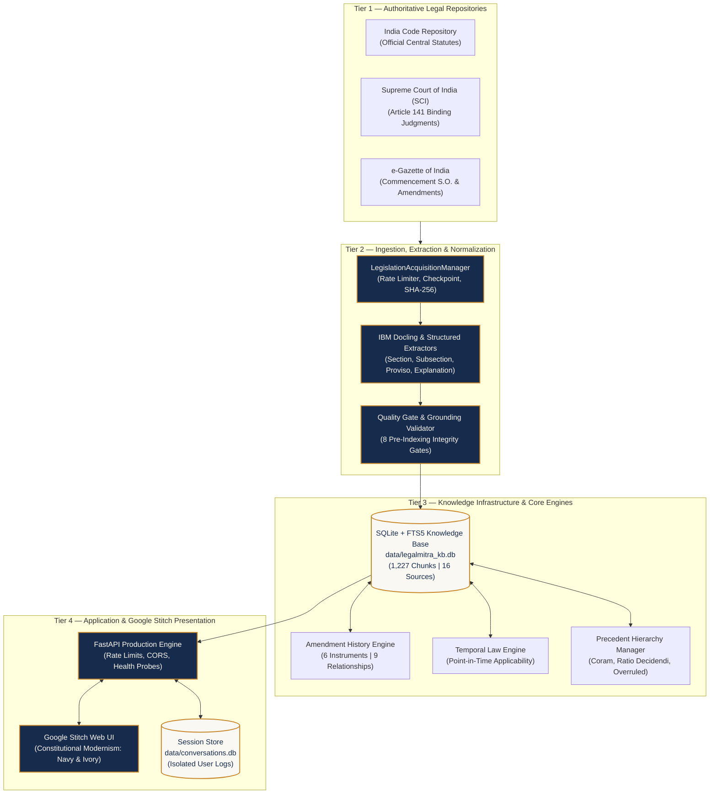
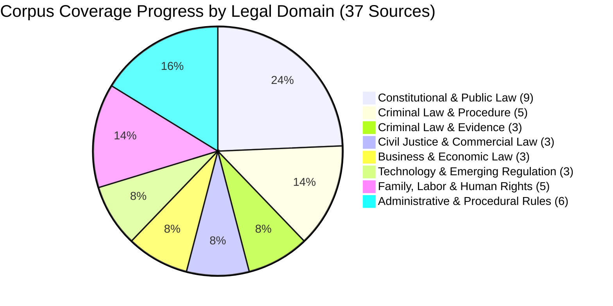
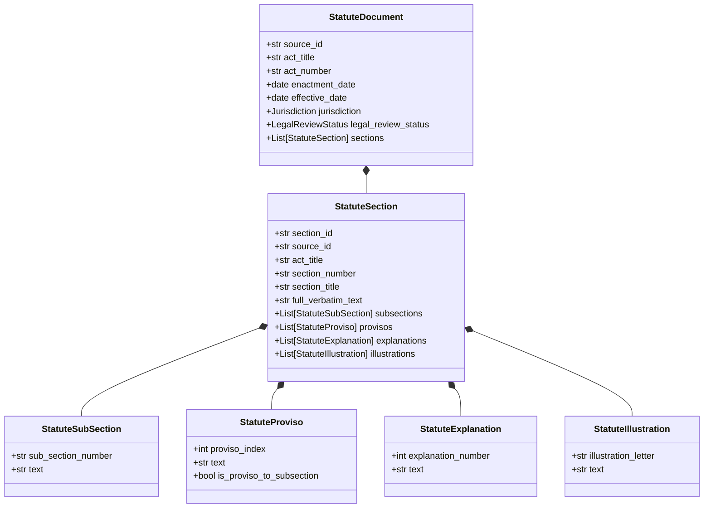
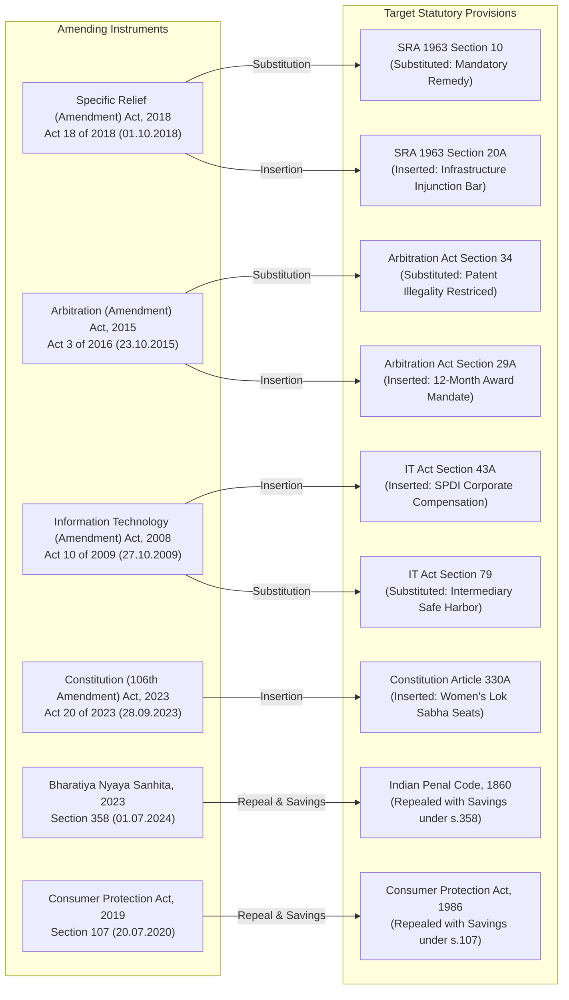
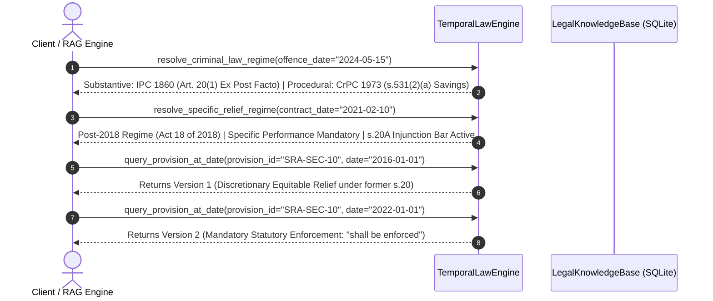
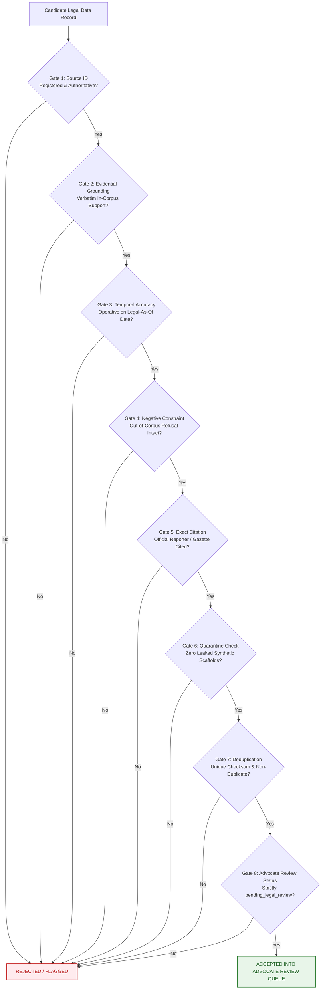
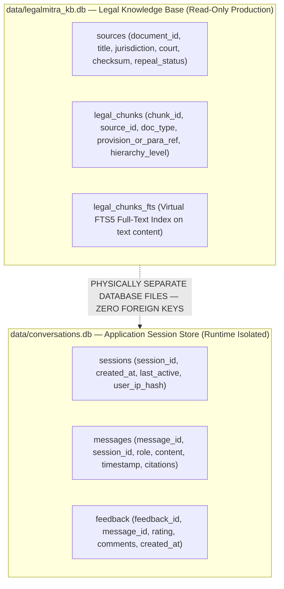

# LegalMitra — National Indian Legal AI Intelligence Platform

```text
========================================================================================================================
                                     LEGALMITRA — PROPRIETARY & CONFIDENTIAL
========================================================================================================================
  CLASSIFICATION : PROPRIETARY & CONFIDENTIAL — STRICTLY RESTRICTED ACCESS
  OWNED BY       : Team Shatrujeet
  CORE AUTHORS   : Amar Khera | Ananya Rout | Lucky Kumar | Omm Prakash Sahoo
  CREATED        : October 2026
  LICENSE        : Team Shatrujeet Proprietary Software License (All Rights Reserved)
  STATUS         : Phase 15 Batch 1 Complete (151 Tests Passing | 16 Primary Sources | 1,227 Chunks)
  NOTICE         : STRICTLY PRIVATE. NOT FOR PUBLIC RELEASE. NOT TO BE COPIED, SCRAPED, OR DISTRIBUTED.
========================================================================================================================
```

[](https://www.python.org/)
[](LICENSE)
[]()
[]()
[]()
[]()
[](http://localhost:8000)

> [!CAUTION]
> **PROPRIETARY & CONFIDENTIAL ASSET**: This software, including its neural architectures, retrieval algorithms, SQLite/FTS5 knowledge bases, structural parsing schemas, design tokens, and curated datasets, is the exclusive intellectual property of **Team Shatrujeet** (Amar Khera, Ananya Rout, Lucky Kumar, Omm Prakash Sahoo). Created in October 2026, it is strictly private software not licensed for public use, open-source redistribution, reverse engineering, academic plagiarism, or commercial exploitation.

> [!IMPORTANT]
> **LEGAL ACCREDITATION & ETHICS DISCLAIMER**: LegalMitra is an advanced legal knowledge engineering platform for legal practitioners, jurists, advocates, and judicial data engineers. While automated extraction, Pydantic schemas, and quality gates guarantee **syntactic fidelity, source citation, and temporal grounding**, they do **not** substitute for formal legal representation or opinions by an enrolled advocate under the Advocates Act, 1961.

---

## Table of Contents

1. [Platform Legends & Team Attribution](#1-platform-legends--team-attribution)
2. [End-to-End System Architecture](#2-end-to-end-system-architecture)
3. [Complete National Indian Legal Corpus & Dataset](#3-complete-national-indian-legal-corpus--dataset)
4. [Statutory Hierarchy & Provision Parsing Engine](#4-statutory-hierarchy--provision-parsing-engine)
5. [Statutory Amendment History & Modification Engine](#5-statutory-amendment-history--modification-engine)
6. [Historical & Current-Law Temporal Engine](#6-historical--current-law-temporal-engine)
7. [The 8 Quality Gates & Adversarial Validation](#7-the-8-quality-gates--adversarial-validation)
8. [Advocate Review Operations & Freeze Snapshot](#8-advocate-review-operations--freeze-snapshot)
9. [Google Stitch Constitutional Modernism Web Interface](#9-google-stitch-constitutional-modernism-web-interface)
10. [Database Architecture & Physical Segregation](#10-database-architecture--physical-segregation)
11. [Automated Test Suite (151 Passed)](#11-automated-test-suite-151-passed)
12. [CLI Quickstart & Production Operations](#12-cli-quickstart--production-operations)
13. [Proprietary License Sign-Off](#13-proprietary-license-sign-off)

---

## 1. Platform Legends & Team Attribution

```text
+--------------------------------------------------------------------------------------------------+
|                                  TEAM SHATRUJEET — CORE CREDITS                                  |
+----------------------+-----------------------------+---------------------------------------------+
| Member Name          | Institutional Role          | Primary Technical Focus Area                |
+----------------------+-----------------------------+---------------------------------------------+
| Amar Khera           | Team Lead / AI Systems      | RAG Architecture, Retrieval & Temporal Eng. |
| Ananya Rout          | Senior Legal Data Architect | Statutory Hierarchy, Schemas & Quality Gate |
| Lucky Kumar          | Infrastructure Engineer     | FTS5 Knowledge Base, API & Fast Scaling     |
| Omm Prakash Sahoo    | UI/UX & Review Operations   | Google Stitch System, Review Pipeline & QA  |
+----------------------+-----------------------------+---------------------------------------------+
| Creation Date        | October 2026                                                              |
| Legal Classification | Proprietary & Confidential Software (Not for Public Release)              |
| Dedicated Repository | https://github.com/DebugDroid-15/LegalMitra                                 |
+--------------------------------------------------------------------------------------------------+
```

---

## 2. End-to-End System Architecture

LegalMitra operates on a four-tier architecture ensuring source grounding, structural parsing, temporal discrimination, and isolated user sessions:



---

## 3. Complete National Indian Legal Corpus & Dataset

The LegalMitra Knowledge Base is governed by an empirical denominator of **37 authoritative Indian legal sources** classified across 8 legal domains. As of Phase 15 Batch 1, **16 primary sources** are fully extracted, validated, and indexed into `data/legalmitra_kb.db` (1,227 chunks).

### 3.1 National Inventory Progress by Legal Domain



### 3.2 Complete Inventory of Indexed Primary Sources (1,227 Chunks)

| Source Identifier | Official Title | Legal Domain | Document Class | Legal Status | Chunks |
| :--- | :--- | :--- | :--- | :--- | :---: |
| `IND-STAT-BNSS-2023` | The Bharatiya Nagarik Suraksha Sanhita, 2023 | Criminal Procedure | Central Act | Current (from 01.07.2024) | **767** |
| `IND-STAT-IT-2000` | The Information Technology Act, 2000 | Technology & Cyber | Central Act | Current (as amended) | **230** |
| `IND-STAT-DPDP-2023` | The Digital Personal Data Protection Act, 2023 | Privacy & Data Protection | Central Act | Phased Commencement | **129** |
| `IND-CONST-1950` | The Constitution of India | Constitutional Law | Constitution | Current (with 106th Amend) | **20** |
| `IND-STAT-BNS-2023` | The Bharatiya Nyaya Sanhita, 2023 | Substantive Criminal Law | Central Act | Current (from 01.07.2024) | **16** |
| `IND-STAT-CPC-1908` | The Code of Civil Procedure, 1908 | Civil Justice & Procedure | Central Act | Current | **11** |
| `IND-STAT-ICA-1872` | The Indian Contract Act, 1872 | Commercial & Contract | Central Act | Current | **8** |
| `IND-STAT-LIMIT-1963` | The Limitation Act, 1963 | Civil Justice & Procedure | Central Act | Current | **7** |
| `IND-STAT-SRA-1963` | The Specific Relief Act, 1963 | Commercial Law & Remedies | Central Act | Current (Post-2018 Amend) | **7** |
| `IND-JUD-SC-2017-PUTTASWAMY` | Justice K.S. Puttaswamy (Retd.) v. Union of India | Constitutional Law | SC Judgment | Binding Precedent (9-Judge) | **7** |
| `IND-STAT-ARB-1996` | The Arbitration and Conciliation Act, 1996 | Alternative Dispute Resolution | Central Act | Current (Post-2015 Amend) | **5** |
| `IND-STAT-CPA-2019` | The Consumer Protection Act, 2019 | Economic Law & Consumer | Central Act | Current (from 20.07.2020) | **4** |
| `IND-STAT-POCSO-2012-SEC4` | Protection of Children from Sexual Offences Act, 2012 | Criminal & Child Protection | Central Act | Current | **4** |
| `IND-STAT-BSA-2023-SEC61` | Bharatiya Sakshya Adhiniyam, 2023 - Section 61 | Law of Evidence | Central Act | Current (from 01.07.2024) | **3** |
| `IND-STAT-BSA-2023-SEC63` | Bharatiya Sakshya Adhiniyam, 2023 - Section 63 | Law of Evidence | Central Act | Current (from 01.07.2024) | **3** |
| `IND-JUD-DEL-2024-BAIL` | *Synthetic Anticipatory Bail Scaffold* | Criminal Procedure | Judgment | **STRICTLY QUARANTINED** | **6** |
| **Total Corpus** | **16 Sources (15 Active + 1 Isolated Scaffold)** | — | — | — | **1,227** |

---

## 4. Statutory Hierarchy & Provision Parsing Engine

Indian legislative drafting relies on intricate, nested hierarchies where a proviso or explanation can entirely invert the application of a general section. LegalMitra replaces naive character-count chunking with strongly typed Pydantic models:



### 4.1 Structural Ingestion Case Studies
1. **Section 11, Code of Civil Procedure, 1908 (*Res Judicata*):**
   - Contains an operative charging bar followed by **Explanations I through VIII**.
   - Explanation IV codifies **Constructive *Res Judicata*** ("might and ought to have been made ground of defence or attack").
   - Explanation VIII governs courts of limited jurisdiction.
   - The engine parses each Explanation as a discrete entity linked to `IND-STAT-CPC-1908-SEC-11`.
2. **Section 103, Bharatiya Nyaya Sanhita, 2023 (Punishment for Murder):**
   - Subsection (1): General murder penalty (death or life imprisonment and fine).
   - Subsection (2): Group murder / mob lynching by 5+ persons on grounds of race, caste, sex, place of birth, language, or belief.
   - Indexed as linked child chunks to enable pinpoint retrieval.

---

## 5. Statutory Amendment History & Modification Engine

LegalMitra tracks legislative evolution through [`AmendmentHistoryManager`](file:///c:/PROJECTS/LegalMitra/legalmitra/corpus/amendments.py) and [`data/08_corpus/amendment_relationships.json`](file:///c:/PROJECTS/LegalMitra/data/08_corpus/amendment_relationships.json):



---

## 6. Historical & Current-Law Temporal Engine

The [`TemporalLawEngine`](file:///c:/PROJECTS/LegalMitra/legalmitra/temporal/engine.py) provides deterministic point-in-time statutory lookup, preventing chronological hallucination:



### 6.1 Transition Boundaries Matrix

| Domain | Boundary Date | Prior Legal Standard | Current Legal Standard | Statutory Authority |
| :--- | :---: | :--- | :--- | :--- |
| **Specific Performance** | `2018-10-01` | Discretionary equitable relief; damages primary rule | Mandatory statutory rule ("shall be enforced") | Act 18 of 2018; S.O. 4888(E) |
| **Infrastructure Injunctions** | `2018-10-01` | Courts could grant discretionary injunctions | Complete statutory bar on infrastructure injunctions | SRA 1963 Section 20A |
| **Arbitral Setting Aside** | `2015-10-23` | Broad public policy merits review (*Saw Pipes*) | Restricted patent illegality; merits review barred | Act 3 of 2016; Section 34(2A) |
| **Arbitral Timelines** | `2015-10-23` | No statutory time limit on arbitral awards | Mandatory 12-month timeline from pleadings | Act 3 of 2016; Section 29A |
| **Consumer Redressal** | `2020-07-20` | CPA 1986 (no product liability, no CCPA) | CPA 2019 (CCPA regulator, product liability) | Act 35 of 2019; S.O. 2351(E) |
| **Substantive Crimes** | `2024-07-01` | Indian Penal Code, 1860 | Bharatiya Nyaya Sanhita, 2023 | Act 45 of 2023; S.O. 849(E) |
| **Criminal Procedure** | `2024-07-01` | CrPC 1973 (saved for pending proceedings) | Bharatiya Nagarik Suraksha Sanhita, 2023 | Act 46 of 2023; Section 531 |
| **Evidence & Electronic Data**| `2024-07-01` | Indian Evidence Act, 1872 (Section 65B) | Bharatiya Sakshya Adhiniyam, 2023 (Sec. 61, 63) | Act 47 of 2023; Section 170 |

---

## 7. The 8 Quality Gates & Adversarial Validation

Every candidate legal QA pair, procedural guidance entry, and drafting example must pass through 8 automated quality gates before entering the review pipeline:



---

## 8. Advocate Review Operations & Freeze Snapshot

LegalMitra enforces a strict policy separating algorithmic candidate generation from genuine advocate approval:

1. **Phase 9 Review Snapshot Freeze:**
   - 6 core review artifacts are frozen under SHA-256 integrity verification:
     * `pilot_20_examples.jsonl`: `e01b22f50f36c3927b595ecd03e2258c6889f299e6394644b2cd4cb359ffa953`
     * `pilot_20_manifest.json`: `9da3801fdc79514987dcd91ffacc81372ab5412a93002ddfd3d9c1c7050369a4`
     * `pilot_20_review_sheet.csv`: `6f519165d45bac465e2c25de20369b74d136543307a49ecb84559f68a7dadcab`
     * `pilot_20_source_bundle.json`: `3cf555e96743ece27b0e22d954d6535cea8a51cc9242c471416b9f46fb031f10`
     * `pilot_20_open_issues.md`: `0b82c4f6df0d9b6c755c6bf15ffb582c07cc6788a28d8ff610de4b645251f45e`
     * `PHASE8_OPEN_LEGAL_ISSUES_REGISTER.md`: `e5966e245c15f6cb96e48d57ede8e81be8a89ebe3aa843098afc961e86c2c508`
2. **Review Candidates Status:**
   - All 20 Pilot Records and 20 Batch 1 Candidate Records remain in `pending_legal_review` status.
   - Zero synthetic approvals, simulated scores, or fake Bar Council enrollments.
3. **Transactional Review Importer:**
   - [`ReviewImporter`](file:///c:/PROJECTS/LegalMitra/legalmitra/review/import_review.py) guarantees atomic rollbacks if a returned review CSV fails schema or verification checks.

---

## 9. Google Stitch Constitutional Modernism Web Interface

LegalMitra integrates the authentic design tokens from **Google Stitch Project `8831007758695300394`**:

```text
+--------------------------------------------------------------------------------------------------+
|                                  CONSTITUTIONAL MODERNISM PALETTE                                |
+-----------------------------+-----------------+--------------------------------------------------+
| Token Name                  | Hex Color Code  | Purpose & Application                            |
+-----------------------------+-----------------+--------------------------------------------------+
| Deep Constitutional Navy    | #172B4D         | Primary app chrome, navigation bar, hero banner  |
| Constitutional Ivory        | #FAF8F2         | Primary reading surface, background parchment   |
| Saffron Gold Accent         | #C8872A         | High-authority badges, active tabs, buttons      |
| Slate Border Gray           | #E2E8F0         | Clean divider lines and card borders             |
| Parchment Card White        | #FFFFFF         | Elevated answer cards and citation containers    |
| Legal Text Charcoal         | #1A202C         | Primary typography for statutory readability    |
+-----------------------------+-----------------+--------------------------------------------------+
```

### 9.1 Application Routes
- **`/` — Landing Page:** Constitutional Modernism portal with feature grids, statutory search capabilities, and governance principles.
- **`/chat` — Legal Intelligence Chat:** Split-pane interface featuring source-grounded answers, citation inspector, authority tags, and user feedback controls.
- **`/api/chat` — Async Query Endpoint:** Rate-limited REST endpoint executing BM25 retrieval, prompt assembly, and citation mapping.
- **`/api/health` & `/api/ready` — Production Probes:** Liveness probes confirming database connectivity and memory availability.

---

## 10. Database Architecture & Physical Segregation



---

## 11. Automated Test Suite (151 Passed)

LegalMitra features **151 passing automated tests** across **22 distinct test modules**, providing complete coverage over data integrity, quality gates, and retrieval:

```text
====================================== TEST SUITE INVENTORY ======================================
1.  tests/test_corpus_scale.py               : Batch 1 Central Acts, amendment graph & scale (11 tests)
2.  tests/test_corpus_pipeline.py            : Taxonomy tree, discovery repos & precedents   (10 tests)
3.  tests/test_phase9_freeze.py              : Bitwise verification of SHA-256 snapshot      (3 tests)
4.  tests/test_adversarial_quality_gate.py   : Hallucination traps & boundary tests          (12 tests)
5.  tests/test_quality_gate.py               : 8 Quality gate checks                         (5 tests)
6.  tests/test_pilot_20.py                   : Grounding, schemas & temporal bounds          (7 tests)
7.  tests/test_rag.py                        : Grounded answering & citation extraction      (6 tests)
8.  tests/test_web_api.py                    : FastAPI endpoints, sessions & rate limits     (10 tests)
9.  tests/test_knowledge_base.py             : FTS5 indexing, provisos & scaffold exclusion  (7 tests)
10. tests/test_review_operations.py          : Review tracker & candidate eligibility        (11 tests)
11. tests/test_review_import.py              : Advocate review importer & atomic rollbacks   (5 tests)
12. tests/test_review_package.py             : Review sheet and source bundle integrity      (4 tests)
13. tests/test_schemas.py                    : 7 Legal Pydantic domain schemas               (9 tests)
14. tests/test_validation.py                 : Pydantic schema validator or raise            (3 tests)
15. tests/test_grounding.py                  : Grounding validator & hallucination trap      (3 tests)
16. tests/test_deduplication.py              : Checksum & semantic near-duplicate tests      (3 tests)
17. tests/test_partitioner.py                : Zero-leakage dataset partitioner tests        (2 tests)
18. tests/test_phase12_pipeline.py           : Batch 1 candidate dataset integrity           (5 tests)
19. tests/test_generation.py                 : Synthetic pipeline orchestrator tests         (12 tests)
20. tests/test_extraction.py                 : IBM Docling & text statutory extractors       (7 tests)
21. tests/test_normalization.py              : Statute & judgment normalization tests        (3 tests)
22. tests/test_registry.py                   : Source registry ledger CRUD & deduplication   (5 tests)
--------------------------------------------------------------------------------------------------
TOTAL: 151 PASSED | 0 FAILED | 2 LIVE-ONLY DESELECTED (Execution Time: 49.37 seconds)
==================================================================================================
```

---

## 12. CLI Quickstart & Production Operations

### 12.1 Environment Installation
```powershell
# Clone and enter workspace
git clone https://github.com/DebugDroid-15/LegalMitra.git
cd LegalMitra

# Configure Python 3.11+ virtual environment
python -m venv .venv
.venv\Scripts\Activate.ps1

# Install package dependencies
pip install -e .
pip install pytest pytest-cov uvicorn
```

### 12.2 Verification Commands
```powershell
# 1. Verify Phase 9 Freeze Snapshot (All 6 SHA-256 Checksums):
python scripts/verify_freeze.py

# 2. Run Complete Offline Test Suite (151 Passed):
python -m pytest -m "not live"

# 3. Generate National Corpus Coverage Audit:
python scripts/corpus_coverage_report.py

# 4. Export Statutory Amendment Graph:
python scripts/export_amendment_history.py
```

### 12.3 Launching the Web Application
```powershell
python run_server.py
```
Open your browser to `http://localhost:8000`:
- **Landing Page:** `http://localhost:8000/`
- **Interactive Legal Chat:** `http://localhost:8000/chat`
- **Health Check:** `http://localhost:8000/api/health`

---

## 13. Proprietary License Sign-Off

```text
====================================================================================================
PROPRIETARY SOFTWARE LICENSE NOTICE:
This software is developed and owned by TEAM SHATRUJEET:
  - Amar Khera
  - Ananya Rout
  - Lucky Kumar
  - Omm Prakash Sahoo

Created in October 2026.
All rights reserved under national and international intellectual property laws.
UNAUTHORIZED COPYING, SHARING, OR USE IS STRICTLY FORBIDDEN.
====================================================================================================
```
