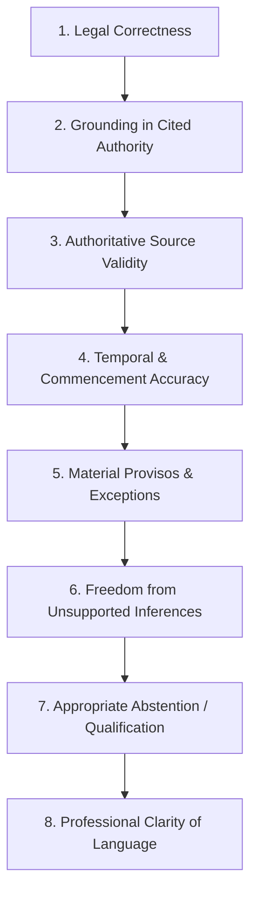

# LegalMitra Advocate Review Guide & Standard Operating Procedure

**Document ID:** `GUIDE-ADVOCATE-REVIEW-V2`  
**Effective Date:** 16 October 2026  
**Audience:** Qualified Indian Legal Practitioners (Advocates enrolled under the Advocates Act, 1961)  
**Scope:** Review and validation of LegalMitra question-answer datasets (Package A: Frozen Pilot 20, and Package B: Batch 1 Candidate Expansion).

---

## 1. Introduction & Mission

LegalMitra is an open-source, high-reliability Indian legal intelligence application designed to assist legal researchers and citizens with authoritative statutory information. 

> [!CAUTION]
> **Automated Quality Gates Do NOT Establish Legal Correctness.**  
> Although all examples have passed automated string-matching and schema checks, **only a qualified human advocate can determine whether an answer is legally correct, ethically appropriate, and sound in practice.** Automated systems cannot self-approve legal ground truth.

Your expert legal judgment is the foundation of this system. This guide explains how to evaluate candidate question-answer pairs, record decisions and scores, and propose precise statutory corrections.

---

## 2. Review Packages Overview

Reviewers are provided with two distinct evaluation packages:

### Package A: Frozen Pilot 20 (`data/06_review/`)
- **Review Sheet:** `data/06_review/pilot_20_review_sheet.csv`
- **Source Bundle:** `data/06_review/pilot_20_source_bundle.json`
- **Coverage:** Foundational criminal law (BNSS 2023, BSA 2023), cyber law (IT Act 2000), and privacy (DPDP Act 2023).
- **Immutability:** The pilot package is permanently frozen as a benchmark holdout.

### Package B: Batch 1 Candidate Expansion (`data/07_batches/review/`)
- **Review Sheet:** `data/07_batches/review/batch_01_review_sheet.csv`
- **Source Bundle:** `data/07_batches/review/batch_01_source_bundle.json`
- **Coverage:** Expanded provisions across DPDP Act 2023 (ss. 4, 5, 7, 9, 10), BNSS 2023 (ss. 35, 173, 479, 528, 531), BSA 2023 (ss. 61, 63), POCSO Act 2012 (s. 4), IT Act 2000 (ss. 43, 66E), and *Puttaswamy* (2017) 10 SCC 1.

---

## 3. The Eight Legal Review Criteria

When assessing each record, evaluate the question, proposed answer, and cited evidence against these 8 criteria:



### Criterion 1: Substantive Legal Correctness
- Is the statutory proposition or case ratio legally sound under prevailing Indian law?
- Does it accurately convey the true intent, scope, and judicial interpretation of the provision?

### Criterion 2: Grounding in Cited Authority
- Does the cited text passage directly support the proposition stated in the answer?
- Does the answer attribute statements to provisions that actually say something else?

### Criterion 3: Authoritative Source Validity
- Are the cited sources authentic official enactments (e.g., acts of Parliament, Gazette notifications, Supreme Court of India reports)?
- Are secondary opinions or unofficial summaries excluded?

### Criterion 4: Temporal & Commencement Accuracy
- **Designated Evaluation Date:** `2026-10-16` (16 October 2026).
- **In-Force Criminal Statutes:** The Bharatiya Nagarik Suraksha Sanhita, 2023 (BNSS) and Bharatiya Sakshya Adhiniyam, 2023 (BSA) came into force on **1 July 2024** (via S.O. 848(E) and S.O. 849(E)). They must be treated as contemporary, operative law.
- **Phased Data Protection Statutes:** Under Notification G.S.R. 843(E) dated 13 November 2025, substantive provisions of the Digital Personal Data Protection Act, 2023 (including ss. 3-17, 27-34, 44(2)) commence on **13 May 2027** (18 months from publication). **As of 16 October 2026, these provisions are enacted but NOT yet in force.** Answers citing them must explicitly state that they are scheduled for future commencement and must not describe them as current operational duties.
- **Repeal & Savings:** Note that BNSS s. 531(1) repealed the CrPC 1973, but s. 531(2)(a) saves pending investigations and trials commenced prior to 1 July 2024.

### Criterion 5: Material Provisos, Exceptions & Qualifications
- Does the answer omit mandatory statutory provisos?
- *Example:* BSA Section 61 provides that electronic records are admissible, but explicitly adds *"subject to the provisions of section 63"* and a proviso mandating a Section 63(4) certificate. An answer claiming electronic evidence is unconditionally admissible without a certificate is legally incomplete and defective.

### Criterion 6: Freedom from Unsupported Inferences
- Does the answer make speculative assumptions not warranted by the statutory language?
- Are factual hypotheticals treated as established law without judicial precedent?

### Criterion 7: Appropriate Abstention or Request for Facts
- Where a legal question depends on unresolved judicial controversy, jurisdictional variation (e.g. High Court differences), or missing factual details, does the answer properly qualify its conclusion?

### Criterion 8: Professional Clarity & Ethical Framing
- Is the language concise, objective, and legally precise?
- Does it maintain the required disclaimer that the information constitutes legal informational analysis rather than an advocate-client engagement?

---

## 4. Review Decisions & Schema

For each record in the review sheet CSV, enter your decision in the `review_decision` column:

| Decision Value | When to Select | Comment Requirement |
|---|---|---|
| `APPROVED` | The answer is legally accurate, temporally correct, fully grounded, and appropriately qualified. | Optional |
| `REVISION_REQUIRED` (or `APPROVED_WITH_CORRECTIONS`) | Substantially correct, but requires minor amendment, proviso addition, or rephrasing. | **MANDATORY**: Detail exact suggested text and statutory section. |
| `REJECTED` | Legally incorrect, factually misleading, temporally invalid, or based on false premises. | **MANDATORY**: Explain the specific legal defect. |
| `NEEDS_MORE_EVIDENCE` | The answer cannot be verified solely from the provided evidence passage; cross-referencing is required. | **MANDATORY**: Identify the missing statutory section or case report. |
| `DEFERRED` | Legal point is currently sub-judice before a Larger Bench or awaiting executive rule notification. | **MANDATORY**: Specify the pending reference or legal uncertainty. |

> [!IMPORTANT]
> **Mandatory Comments on Non-Approval:**  
> If you select any decision other than `APPROVED`, the import system will strictly reject the review sheet unless a clear, substantive explanation is provided in `reviewer_comments`.

---

## 5. Scoring Framework (1 to 5 Scale)

For each record, enter an integer score from 1 to 5 for each dimension:

| Score | Legal Accuracy | Temporal Accuracy | Grounding Accuracy |
|:---:|---|---|---|
| **5** | Flawless; captures nuances and provisos | Exact commencement date & status stated | 100% supported by cited verbatim text |
| **4** | Accurate; minor stylistic preference | Correct status; minor wording omission | Strongly supported; minor inferential step |
| **3** | Acceptable; misses a secondary proviso | Status correct but lacks Gazette citation | Broadly supported; needs better evidence span |
| **2** | Flawed; misapplies statutory threshold | Ambiguous temporal state (e.g. uncommenced treated as in force) | Weakly grounded; answer asserts facts outside text |
| **1** | Legally wrong or misleading | Blatantly incorrect temporal claim | Completely ungrounded / hallucinated |

---

## 6. How to Submit Proposed Corrections

When proposing revisions, format your entry in `reviewer_comments` as follows:
```text
ISSUE: [Describe specific statutory defect or missing proviso]
AUTHORITY: [Statute name, Section/Subsection number, or Official Gazette notification]
PROPOSED TEXT: [Exact suggested replacement wording for the answer]
```

*Example Correction:*
```text
ISSUE: Answer fails to mention the mandatory requirement of a certificate under BSA s.63(4).
AUTHORITY: Section 61 Proviso read with Section 63(4), Bharatiya Sakshya Adhiniyam, 2023.
PROPOSED TEXT: "Under Section 61 of the Bharatiya Sakshya Adhiniyam, 2023, electronic records are admissible subject to Section 63; provided that any electronic record produced in evidence must be accompanied by a certificate under Section 63(4)."
```

---

## 7. Submission Checklist for Advocates

Before returning your filled CSV sheet, verify:
- [ ] Every reviewed row has a decision from the allowed list: `APPROVED`, `REVISION_REQUIRED`, `REJECTED`, `NEEDS_MORE_EVIDENCE`, `DEFERRED`.
- [ ] All non-approved rows contain substantive notes in `reviewer_comments`.
- [ ] Scores (1-5) are entered for legal, temporal, and grounding accuracy.
- [ ] Your initials or identifier are entered in `reviewer_name_initials` (e.g., `ADV-RS`).
- [ ] The date of review is entered in `review_date` in `YYYY-MM-DD` format.
- [ ] Unreviewed rows are left completely blank (they will safely remain `pending_legal_review`).
- [ ] The file is saved as UTF-8 CSV without modifying the column header names or `record_id` values.

