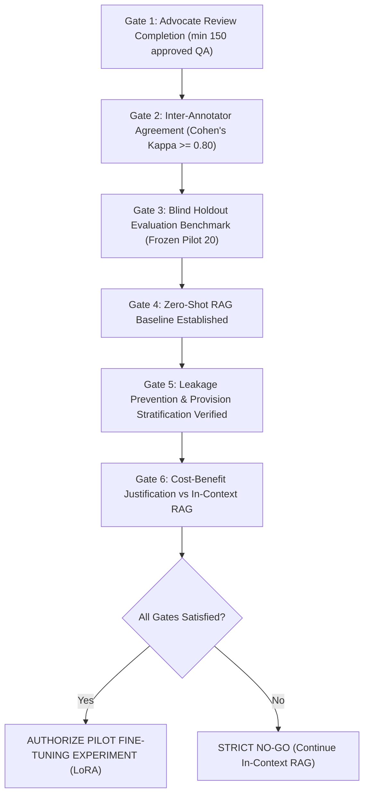

# LegalMitra Model Fine-Tuning Readiness & Decision Framework

**Document ID:** `DECISION-FRAMEWORK-FINETUNING-PHASE12`  
**Effective Date:** 16 October 2026  
**Status:** **NO-GO FOR FINE-TUNING** (Strict Policy Gate Enforced)  
**Audience:** Technical Steering Committee, Lead ML Architect, Legal Systems Evaluator

---

## 1. Executive Summary & Current Determination

### Current Status: **STRICT NO-GO**
Model fine-tuning of any base LLM (e.g., Llama 3, Mistral, Gemma, or Nemotron) on LegalMitra data is **strictly unauthorized** at Phase 12. 

The primary prerequisite for supervised fine-tuning (SFT) or Direct Preference Optimization (DPO) in the legal domain is the presence of an **empirically validated, advocate-approved ground truth dataset with verified inter-annotator agreement**. As of Phase 12:
- Exactly 20 pilot examples exist, and all 20 remain `pending_legal_review`.
- Exactly 20 Batch 1 expansion candidates exist, and all 20 remain `pending_legal_review`.
- **Zero** examples have been approved by a qualified Indian advocate.
- Automated quality gates cannot self-approve legal ground truth.

Attempting to fine-tune an LLM on unverified, candidate-only synthetic data runs an extreme risk of baking hallucinations, temporal confusions, and speculative statutory interpretations into model weights.

---

## 2. Fine-Tuning Decision Framework & Gates

To transition from **NO-GO** to **GO**, all six operational gates must be satisfied:

### Detailed Gate Requirements

| Gate ID | Criterion | Requirement | Current Status |
|---|---|---|:---:|
| **FT-GATE-01** | Minimum Approved Volume | $\ge 150$ unique QA pairs approved by $\ge 2$ licensed Indian advocates. | ❌ **0 / 150** |
| **FT-GATE-02** | Inter-Annotator Agreement | Cohen's Kappa ($\kappa$) or Fleiss' Kappa $\ge 0.80$ on sample overlap. | ❌ **Not Started** |
| **FT-GATE-03** | Frozen Holdout Benchmark | Immutable test benchmark untouched during training (Phase 9 Pilot). | ✅ **Ready** |
| **FT-GATE-04** | Baseline RAG Benchmark | Baseline RAG evaluation scores measured on the test benchmark. | ❌ **Pending** |
| **FT-GATE-05** | Leakage Auditing | Provision-level grouped split confirmed with 0% token leakage. | ✅ **Ready** |
| **FT-GATE-06** | In-Context RAG Deficit | Empirically documented failure of in-context retrieval to answer complex queries. | ❌ **Not Proven** |

---

## 3. Baseline Measurements: RAG vs. Fine-Tuning

In legal AI applications, Retrieval-Augmented Generation (RAG) offers substantial architectural advantages over fine-tuning:
1. **Dynamic Temporal Updates**: When the DPDP Act commences on 13 May 2027 or an amendment is enacted, RAG updates immediately via vector database chunk ingestion. Fine-tuned weights permanently store stale statutes unless continuously retrained.
2. **Deterministic Evidence Attribution**: RAG forces the generation layer to cite exact retrieved text chunks from `data/legalmitra_kb.db`.
3. **Zero Weight Drift**: Fine-tuning risks catastrophic forgetting of general reasoning, math, and code capabilities.

### Proposed Evaluation Metrics for Future Comparison
When fine-tuning readiness is evaluated, the fine-tuned model must be tested against the RAG baseline across:
- **Statutory Precision**: Exactness of cited section, subsection, and clause numbers.
- **Temporal Fidelity**: Correct identification of in-force vs uncommenced laws as of designated `legal_as_of_date`.
- **Hallucination Rate**: Percentage of statements unsupported by registered source texts (must be 0.0%).
- **Material Proviso Inclusion**: Rate of preserving statutory qualifications (e.g., BSA s.61 proviso requiring s.63 certificate).

---

## 4. Provider & Infrastructure Readiness Assessment

Should future phases clear all six gates, the following compute and provider targets have been evaluated:

### 4.1 NVIDIA Nemotron-4-340B / Nemotron-Nano
- **Pros**: Designed specifically for synthetic data generation and enterprise alignment; existing client integration in `legalmitra/generation/providers/nemotron.py`.
- **Cons**: Substantial VRAM requirements for full fine-tuning; requires parameter-efficient fine-tuning (LoRA / QLoRA) on dedicated H100/A100 instances.

### 4.2 Local HuggingFace / PEFT (LoRA)
- **Target Model**: `meta-llama/Llama-3.1-8B-Instruct` or `mistralai/Mistral-7B-Instruct-v0.3`.
- **Infrastructure**: Single NVIDIA RTX 4090 (24GB) or A10G (24GB) using 4-bit quantization (QLoRA) with rank $r=16$, alpha $\alpha=32$.
- **Cost**: Low staging cost; complete data privacy under local execution.

---

## 5. Conclusion & Actionable Directives

1. **Do not initiate fine-tuning routines.**
2. Focus engineering resources on distributing `data/07_batches/review/batch_01_review_sheet.csv` to qualified advocates.
3. Once advocate review decisions are imported via `ReviewImporter`, re-evaluate FT-GATE-01 and FT-GATE-02.
4. Continue operating LegalMitra in production-hardened RAG mode using `data/legalmitra_kb.db`.

