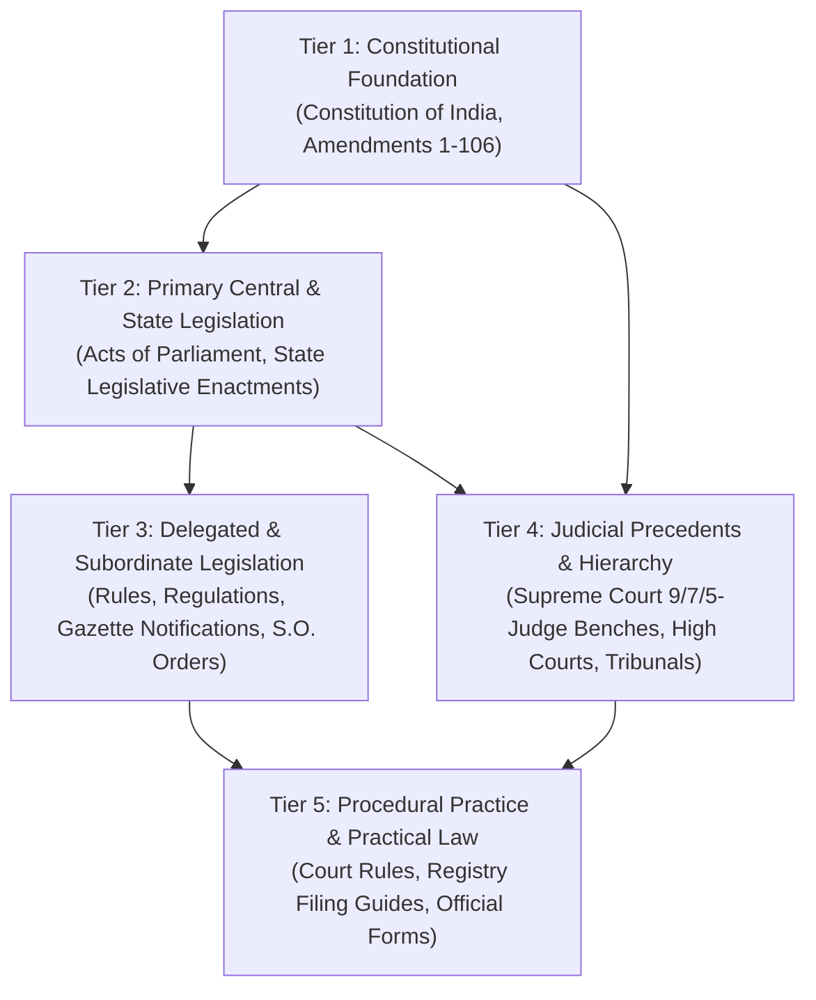
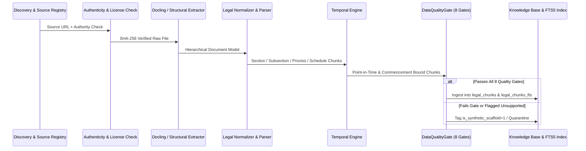

# LegalMitra: Indian Legal Corpus Architecture & Ingestion Engineering Blueprint

**System Architecture Specification — Phase 14**  
**Document Version:** 1.0.0  
**Workspace:** `C:\PROJECTS\LegalMitra`  
**Classification:** Core Data Infrastructure Blueprint

---

## 1. Vision & Core Principles

LegalMitra transforms from a prototype legal question-answering tool into a scalable, versioned, source-verifiable Indian legal knowledge platform. Its objective is to provide affordable, transparent, evidence-grounded legal research assistance across central and state legislation, judicial precedents, and subordinate rules, while rigorously respecting the boundaries of the legal profession.

### Non-Negotiable Architectural Principles:
1. **Verbatim Fidelity:** Statutory wording, section numbering, sub-clauses, provisos, explanations, and schedules are preserved verbatim. No semantic summarizing replaces authentic legislative text.
2. **Dual-Temporal Versioning:** Legal provisions change over time. The platform tracks law across chronological boundaries:
   - What did Section 43A of the IT Act state on 2024-01-01?
   - What is the operative criminal procedure for an offense committed on 2024-05-10 versus 2024-08-15?
3. **Traceable Provenance:** Every chunk in the knowledge base links to an authentic issuing authority, official gazette or court repository URL, cryptographic SHA-256 hash, and extraction date.
4. **Permanent Quarantine & Integrity Perimeter:** Synthetic fixtures and unverified documents are physically tagged (`is_synthetic_scaffold=1`) and excluded from active retrieval.
5. **Physical & Logical Isolation:** The public knowledge base (`legalmitra_kb.db`) is physically decoupled from private session data (`conversations.db`) and advocate review assets (`data/06_review/`, `data/07_batches/`).

---

## 2. Structural Hierarchy of the Indian Legal Corpus

The architecture models the Indian legal system in five distinct, interconnected tiers:



### Tier Specifications:
- **Tier 1 (Constitutional Foundation):** Preamble, Articles 1 to 395, Schedules 1 to 12, and all Constitutional Amendment Acts with commencement dates.
- **Tier 2 (Primary Legislation):** Principal Acts, Amending Acts, and Repealing Enactments across Central (List I), State (List II), and Concurrent (List III) jurisdictions.
- **Tier 3 (Delegated Legislation):** Subordinate instruments issued under rule-making powers (e.g., Central Government Rules, Statutory Regulatory Notifications, Commencement S.O. Orders).
- **Tier 4 (Judicial Precedents):** Supreme Court of India judgments (Constitution Benches, Division Benches) and High Court judgments, structured by ratio decidendi, obiter dicta, citations, and treatment history.
- **Tier 5 (Procedural & Registry Practice):** Official filing guidelines, limitation timelines, court fees, and prescribed statutory forms.

---

## 3. End-to-End Ingestion Pipeline Lifecycle

Every legal document ingested into LegalMitra passes through 15 auditable stages:



### Stage Breakdown:
1. **Source Discovery:** Automated or audited discovery of official legislative PDFs, gazette notifications, or Supreme Court decisions.
2. **Authenticity & Terms:** Verification of government source (e.g., `indiacode.gov.in`, `egazette.gov.in`, `sci.gov.in`) and adherence to GODL-India / Section 52(1)(q) Copyright Act.
3. **Cryptographic Checksum:** Calculation of SHA-256 digest on raw payload.
4. **Document Classification:** Categorization into DocumentClass (Act, Amendment, Rule, Judgment, etc.).
5. **Text & OCR Extraction:** Extraction using Docling parser with multi-page chunked processing for large documents.
6. **Structural Normalization:** Parsing into discrete legislative nodes (Section, Subsection, Clause, Sub-clause, Proviso, Explanation, Exception, Schedule).
7. **Temporal Metadata Linking:** Assigning enactment, assent, notification, and commencement dates.
8. **Deduplication:** Content fingerprinting to identify identical or amended provisions.
9. **Cross-Reference Resolution:** Mapping statutory cross-references (e.g., Section 61 referencing Section 63).
10. **Quality Gate Execution:** Execution of the 8 validation gates.
11. **Quarantine Handling:** Segregation of corrupted or synthetic test scaffolds.
12. **FTS5 Virtual Indexing:** Updating SQLite full-text search indexes with BM25 weights.
13. **Corpus Inventory Sync:** Incrementing chunk counts and updating `coverage_inventory.json`.
14. **Audit Logging:** Emitting reproducible ingestion logs.
15. **Rollback Safety:** Transactional isolation ensuring failed ingestion batches leave zero partial records.

---

## 4. Multi-Layer Search & Retrieval Architecture

LegalMitra utilizes a hybrid retrieval engine designed for Indian legal texts:

1. **Exact Statutory Lookup:** Fast direct lookups by `(statute_code, section_number, subsection)`.
2. **BM25 FTS5 Full-Text Search:** Full-text queries matching legal phrasing across statutory provisions and case holdings.
3. **Authority-Weighted Scoring:**
   - Central Statute: `score * 1.0`
   - Supreme Court Constitution Bench: `score * 1.0`
   - Supreme Court Division Bench: `score * 0.9`
   - High Court Reported Ruling: `score * 0.8`
   - Subordinate Rules / Notifications: `score * 0.75`
4. **Temporal Boundary Filtering:** Pre-filtering chunks based on the user's `legal_as_of_date` to ensure uncommenced provisions or repealed acts without savings clauses are not presented as currently operative law.
5. **Quarantine Exclusion:** Mandatory query predicate `WHERE is_synthetic_scaffold = 0`.

---

## 5. Storage Layout & Scalability

```
LegalMitra Workspace
├── data/
│   ├── 01_raw/                   # Immutable raw PDF/JSON/TXT files
│   ├── 02_normalized/            # Structured JSON documents (Docling/Pydantic)
│   ├── 03_generated/             # Frozen Phase 9 pilot generation artifacts
│   ├── 06_review/                # Frozen Phase 9 review sheets & open issues
│   ├── 07_batches/               # Batch 1 candidate expansion & review packages
│   ├── 08_corpus/                # National legal inventory, taxonomy & coverage metrics
│   ├── legalmitra_kb.db          # Public SQLite Knowledge Base (chunks + FTS5)
│   └── conversations.db          # Isolated User Sessions & Feedback Log
├── legalmitra/
│   ├── corpus/                   # Inventory, taxonomy, discovery & caselaw models
│   ├── temporal/                 # Historical point-in-time legal engine
│   ├── ingestion/                # Document ingestors & multi-part extractors
│   ├── knowledge/                # SQLite KB manager & BM25 ranker
│   ├── rag/                      # Grounded legal answer engine & prompt templates
│   └── validation/               # 8 DataQualityGates & temporal validators
└── docs/                         # Comprehensive architectural & operational manuals
```

