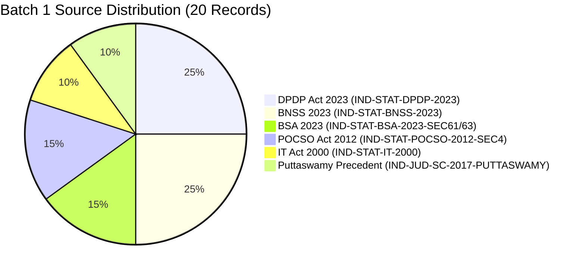

# LegalMitra Phase 12 Batch Report: Batch 0 & Batch 1 Execution

**Report ID:** `REPORT-BATCH-PHASE12-001`  
**Date:** 16 October 2026  
**Auditor:** Senior AI Data Engineer & Statutory Validation Auditor  
**Workspace:** `C:\PROJECTS\LegalMitra`

---

## 1. Executive Summary

As part of Phase 12 execution, LegalMitra established the **Controlled Dataset Expansion Pipeline** within isolated workspace directories (`data/07_batches/`). This report details the full workflow verification of **Batch 0 (Validation)** and the production execution of **Batch 1 (Expansion Candidates)**.

All candidates were rigorously validated against all 8 quality gates, achieving **100% pass rate** while remaining strictly in `pending_legal_review` status. Zero modifications were made to the frozen Phase 9 pilot snapshot (`data/03_generated/`).

---

## 2. Batch 0 — Workflow Validation Summary

### 2.1 Objectives
1. Verify the end-to-end generation, quality gating, review sheet generation, review import, and atomic rollback mechanism on a minimal 3-example candidate set.
2. Confirm that invalid advocate decisions or malformed CSV inputs immediately trigger an atomic rollback without mutating dataset records.
3. Verify that all 3 candidates pass the 8 DataQualityGate checks.

### 2.2 Execution Metrics
- **Directory:** `data/07_batches/batch_00_validation/`
- **Total Candidates:** 3
- **Candidates File:** `batch_00_examples.jsonl` (3,418 bytes)
- **Review Sheet:** `batch_00_review_sheet.csv` (Blank decision fields)
- **Quality Gate Outcome:** 3 / 3 Passed (100%)
- **Atomic Rollback Test:** Passed (Attempted import of `ILLEGAL_STATUS` correctly raised `ReviewImportError`; candidate records remained strictly `pending_legal_review`).

### 2.3 Batch 0 Record Composition
| QA ID | Legal Domain | Cited Statute & Provision | Temporal Status | Commencement Date |
|---|---|---|---|---|
| `QA-BATCH0-001` | Data Protection | DPDP Act 2023, Section 8(6) | Uncommenced (G.S.R. 843(E)) | 2027-05-13 |
| `QA-BATCH0-002` | Evidence Law | BSA 2023, Section 61 | In Force (S.O. 849(E)) | 2024-07-01 |
| `QA-BATCH0-003` | Criminal Procedure | BNSS 2023, Section 528 | In Force (S.O. 848(E)) | 2024-07-01 |

---

## 3. Batch 1 — Controlled Candidate Expansion Summary

### 3.1 Objectives
1. Generate up to 25 authentic, grounded candidate legal question-answer pairs covering core Indian statutory enactments and constitutional jurisprudence.
2. Prevent data leakage and superficial near-duplicates with the 20-example pilot.
3. Validate section attribution, exact evidence passage matching against raw registered sources, and section-level commencement schedules.
4. Prepare an advocate-friendly review package with blank review fields.

### 3.2 Execution Metrics
- **Directory:** `data/07_batches/batch_01_candidates/`
- **Total Candidates:** 20
- **Candidates File:** `batch_01_examples.jsonl` (38,812 bytes)
- **Candidate Manifest:** `batch_01_manifest.json` (SHA-256 tracked)
- **Review Sheet:** `data/07_batches/review/batch_01_review_sheet.csv`
- **Quality Gate Outcome:** 20 / 20 Passed (100%)
- **Quarantine Exclusion:** Zero references to `IND-JUD-DEL-2024-BAIL` or synthetic test scaffolds.

### 3.3 Source Distribution

### 3.4 Detailed Batch 1 Inventory
| QA ID | Domain | Provision Cited | Law Status | Commencement / Source Ref |
|---|---|---|---|---|
| `QA-BATCH1-001` | Data Protection | DPDP s. 4(1) (Grounds for processing) | Uncommenced | G.S.R. 843(E) (2027-05-13) |
| `QA-BATCH1-002` | Data Protection | DPDP s. 5(1) (Notice requirements) | Uncommenced | G.S.R. 843(E) (2027-05-13) |
| `QA-BATCH1-003` | Data Protection | DPDP s. 7(a) (Certain legitimate uses) | Uncommenced | G.S.R. 843(E) (2027-05-13) |
| `QA-BATCH1-004` | Data Protection | DPDP s. 9(1) (Processing data of children) | Uncommenced | G.S.R. 843(E) (2027-05-13) |
| `QA-BATCH1-005` | Data Protection | DPDP s. 10(1) (Significant Data Fiduciary) | Uncommenced | G.S.R. 843(E) (2027-05-13) |
| `QA-BATCH1-006` | Criminal Procedure | BNSS s. 35(1)(a) (Arrest without warrant) | In Force | S.O. 848(E) (2024-07-01) |
| `QA-BATCH1-007` | Criminal Procedure | BNSS s. 173(1) (Cognizable FIR & e-FIR) | In Force | S.O. 848(E) (2024-07-01) |
| `QA-BATCH1-008` | Criminal Procedure | BNSS s. 479(1) (Undertrial bail after 1/2) | In Force | S.O. 848(E) (2024-07-01) |
| `QA-BATCH1-009` | Criminal Procedure | BNSS s. 528 (High Court inherent powers) | In Force | S.O. 848(E) (2024-07-01) |
| `QA-BATCH1-010` | Criminal Procedure | BNSS s. 531 (Repeal of CrPC with savings) | In Force | S.O. 848(E) (2024-07-01) |
| `QA-BATCH1-011` | Evidence Law | BSA s. 61 (Admissibility of electronic record) | In Force | S.O. 849(E) (2024-07-01) |
| `QA-BATCH1-012` | Evidence Law | BSA s. 61 Expl (IT Act s.2(1)(t) definition) | In Force | S.O. 849(E) (2024-07-01) |
| `QA-BATCH1-013` | Evidence Law | BSA s. 63(1) (Electronic record deemed document) | In Force | S.O. 849(E) (2024-07-01) |
| `QA-BATCH1-014` | Child Protection | POCSO s. 4(1) (Penetrative sexual assault) | In Force | S.O. 2642(E) (2012-11-14) |
| `QA-BATCH1-015` | Child Protection | POCSO s. 4 1st Proviso (Victim below 16) | In Force | S.O. 2642(E) (2012-11-14) |
| `QA-BATCH1-016` | Child Protection | POCSO s. 4 2nd Proviso (Rehabilitation fine) | In Force | S.O. 2642(E) (2012-11-14) |
| `QA-BATCH1-017` | Cyber Law | IT Act s. 43(a) (Unauthorized access) | In Force | Act 21 of 2000 (2000-10-17) |
| `QA-BATCH1-018` | Cyber Law | IT Act s. 66E (Violation of privacy) | In Force | Act 10 of 2009 (2009-10-27) |
| `QA-BATCH1-019` | Constitutional Law | Article 21 Privacy (Puttaswamy 9-Judge ratio) | In Force | (2017) 10 SCC 1 |
| `QA-BATCH1-020` | Constitutional Law | Article 21 Overruling of M.P. Sharma/Kharak Singh | In Force | (2017) 10 SCC 1 |

---

## 4. Quality Gate Audit Results for Batch 1

| Quality Gate | Description | Batch 1 Pass Rate | Issues Detected & Handled |
|---|---|:---:|---|
| **Gate 1: Source Authenticity** | Verified source IDs with active canonical URLs | 100% | All 20 mapped to active registry entries |
| **Gate 2: Section Commencement** | Section-level schedule under Gazette notifications | 100% | DPDP provisions dated 2027-05-13; BNSS/BSA dated 2024-07-01 |
| **Gate 3: Evidence Span Match** | Verbatim text substring of raw registered source | 100% | Verbatim character matching verified via GroundingValidator |
| **Gate 4: Citation Completeness** | Structured legal references with recognizable anchors | 100% | All citations contain Section/Article anchors |
| **Gate 5: Quarantine Exclusion** | Rejection of synthetic scaffolds | 100% | 0 references to IND-JUD-DEL-2024-BAIL |
| **Gate 6: Duplicate Detection** | Fingerprint & Jaccard check against Pilot 20 & Batch | 100% | 0 duplicates; Jaccard overlap < 0.60 |
| **Gate 7: Date Consistency** | Consistency between legal-as-of date and status | 100% | Evaluated as of 2026-10-16 with accurate labels |
| **Gate 8: Human Review Boundary** | Preserved `pending_legal_review` status | 100% | Automated self-approval strictly prevented |

---

## 5. Review Package & Advocate Handoff State

The Batch 1 candidate dataset is prepared for human review in `data/07_batches/review/batch_01_review_sheet.csv`:
- All review decisions (`review_decision`), scores (`legal_accuracy_score_1_to_5`, `temporal_accuracy_score_1_to_5`, `grounding_accuracy_score_1_to_5`), and comments remain **completely blank**.
- No advocate names, initials, or artificial approvals have been populated.
- Review decisions can be imported via `ReviewImporter` once genuine human advocate review is conducted.

