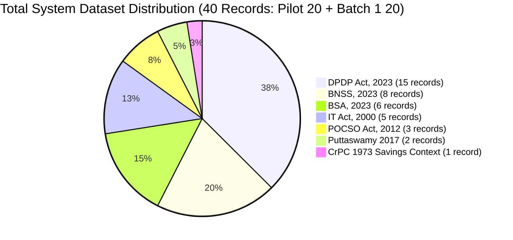

# LegalMitra Phase 12 Coverage Report: Statutory & Precedential Analysis

**Document ID:** `REPORT-COVERAGE-PHASE12-001`  
**Date:** 16 October 2026  
**Auditor:** Legal Information System Architect  
**Workspace:** `C:\PROJECTS\LegalMitra`

---

## 1. Statutory & Jurisprudential Coverage Overview

The LegalMitra dataset expansion focuses on modern Indian criminal procedure, statutory evidence law, child protection, cyber jurisprudence, data privacy, and foundational constitutional rights.

This report documents the current coverage across the **Frozen Pilot (20 records)** and the **Batch 1 Candidate Expansion (20 records)**, totaling **40 uniquely defined question-answer pairs**.

---

## 2. Comprehensive Provision-Level Coverage Matrix

### 2.1 Digital Personal Data Protection Act, 2023 (Act No. 22 of 2023)
*Enacted 11 August 2023; Phased commencement under Gazette Notification G.S.R. 843(E) dated 13 November 2025.*

| Section / Schedule | Topic | Temporal Status (as of 16-Oct-2026) | Commencement Date | In Pilot | In Batch 1 |
|---|---|---|:---:|:---:|:---:|
| **Section 4(1)** | Grounds for processing personal data | Uncommenced | 2027-05-13 | — | `QA-BATCH1-001` |
| **Section 5(1)** | Notice requirements for consent | Uncommenced | 2027-05-13 | — | `QA-BATCH1-002` |
| **Section 6(1)** | Legal requirements for consent | Uncommenced | 2027-05-13 | `QA-PILOT-DPDP-005` | — |
| **Section 7(a)** | Voluntary provision for legitimate uses | Uncommenced | 2027-05-13 | — | `QA-BATCH1-003` |
| **Section 8(5)** | Security safeguards against data breach | Uncommenced | 2027-05-13 | `QA-PILOT-DPDP-004` | — |
| **Section 8(6)** | Notice of personal data breach | Uncommenced | 2027-05-13 | `QA-PILOT-DPDP-006` | — |
| **Section 9(1)** | Consent for processing children's data | Uncommenced | 2027-05-13 | — | `QA-BATCH1-004` |
| **Section 10(1)** | Significant Data Fiduciary criteria | Uncommenced | 2027-05-13 | — | `QA-BATCH1-005` |
| **Section 11(1)** | Data Principal right to access | Uncommenced | 2027-05-13 | `QA-PILOT-DPDP-001` | — |
| **Section 12** | Right to correction and erasure | Uncommenced | 2027-05-13 | `QA-PILOT-DPDP-002` | — |
| **Section 13** | Grievance redressal exhaustion | Uncommenced | 2027-05-13 | `QA-PILOT-DPDP-003` | — |
| **Section 33(1)** | Monetary penalties inquiry prerequisite | Uncommenced | 2027-05-13 | `QA-PILOT-DPDP-007` | — |
| **Section 44(2)** | Consequential amendments to IT Act | Partial / Uncommenced | 2027-05-13 | `QA-PILOT-DPDP-009`, `QA-PILOT-DPDP-010` | — |
| **Schedule Item 1** | Penalty for s.8(5) breach (up to ₹250 Cr) | Uncommenced | 2027-05-13 | `QA-PILOT-DPDP-008` | — |

---

### 2.2 Bharatiya Nagarik Suraksha Sanhita, 2023 (Act No. 46 of 2023)
*In force w.e.f. 1 July 2024 pursuant to Ministry of Home Affairs Notification S.O. 848(E) dated 24 February 2024.*

| Section / Subsection | Topic | Temporal Status | In Pilot | In Batch 1 |
|---|---|:---:|:---:|:---:|
| **Section 35(1)(a)** | Arrest without warrant for cognizable offence | In Force | — | `QA-BATCH1-006` |
| **Section 173(1)** | Registration of FIR & e-FIR | In Force | — | `QA-BATCH1-007` |
| **Section 479(1)** | Bail for undertrial prisoner after one-half sentence | In Force | — | `QA-BATCH1-008` |
| **Section 482(1)** | High Court / Sessions Court anticipatory bail | In Force | `QA-PILOT-CROSS-008` | — |
| **Section 482(4)** | Bar on anticipatory bail for BNS ss. 65 / 70(2) | In Force | `QA-PILOT-CROSS-009` | — |
| **Section 528** | Inherent powers of High Court preserved | In Force | — | `QA-BATCH1-009` |
| **Section 531(1)** | Repeal of Code of Criminal Procedure, 1973 | In Force | `QA-PILOT-CROSS-010` | `QA-BATCH1-010` |
| **Section 531(2)(a)** | Savings of pending trials/investigations | In Force (CrPC Saved) | `QA-PILOT-CROSS-010` | `QA-BATCH1-010` |

---

### 2.3 Bharatiya Sakshya Adhiniyam, 2023 (Act No. 47 of 2023)
*In force w.e.f. 1 July 2024 pursuant to Ministry of Home Affairs Notification S.O. 849(E) dated 24 February 2024.*

| Section / Subsection | Topic | Temporal Status | In Pilot | In Batch 1 |
|---|---|:---:|:---:|:---:|
| **Section 61** | Electronic records admissibility principle | In Force | `QA-PILOT-CROSS-001` | `QA-BATCH1-011` |
| **Section 61 Expl** | Adoption of IT Act s. 2(1)(t) definition | In Force | `QA-PILOT-CROSS-001` | `QA-BATCH1-012` |
| **Section 61 Proviso** | Mandatory Section 63 certificate requirement | In Force | `QA-PILOT-CROSS-002`, `004` | — |
| **Section 63(1)** | Computer output deemed to be document | In Force | `QA-PILOT-CROSS-003` | `QA-BATCH1-013` |
| **Section 63(2)** | Regular use and input conditions | In Force | `QA-PILOT-CROSS-003` | — |

---

### 2.4 Protection of Children from Sexual Offences Act, 2012 (Act No. 32 of 2012)
*In force w.e.f. 14 November 2012 pursuant to Notification S.O. 2642(E).*

| Section / Subsection | Topic | Temporal Status | In Pilot | In Batch 1 |
|---|---|:---:|:---:|:---:|
| **Section 4(1)** | Penetrative sexual assault sentence (min 10 yrs to life) | In Force | — | `QA-BATCH1-014` |
| **Section 4 1st Proviso** | Child below 16: minimum 20 years to natural life | In Force | — | `QA-BATCH1-015` |
| **Section 4 2nd Proviso** | Fine to meet medical expenses and rehabilitation | In Force | — | `QA-BATCH1-016` |

---

### 2.5 Information Technology Act, 2000 (Act No. 21 of 2000, as amended)
*In force w.e.f. 17 October 2000; amendments in force w.e.f. 27 October 2009.*

| Section / Subsection | Topic | Temporal Status | In Pilot | In Batch 1 |
|---|---|:---:|:---:|:---:|
| **Section 2(1)(t)** | Statutory definition of "electronic record" | In Force | `QA-PILOT-CROSS-001` | — |
| **Section 43(a)** | Unauthorized access to computer system | In Force | — | `QA-BATCH1-017` |
| **Section 43A** | Compensation for failure to protect sensitive data | In Force (until 13 May 2027) | `QA-PILOT-DPDP-009` | — |
| **Section 66** | Computer related offences | In Force | `QA-PILOT-CROSS-005` | — |
| **Section 66C** | Identity theft | In Force | `QA-PILOT-CROSS-006` | — |
| **Section 66D** | Cheating by personation using computer resource | In Force | `QA-PILOT-CROSS-007` | — |
| **Section 66E** | Violation of privacy (capturing/publishing private images) | In Force | — | `QA-BATCH1-018` |

---

### 2.6 Constitutional Jurisprudence
*Supreme Court of India (Constitution Bench)*

| Case Citation | Topic / Ratio Decidendi | In Pilot | In Batch 1 |
|---|---|:---:|:---:|
| *(2017) 10 SCC 1* | Fundamental Right to Privacy under Article 21 | — | `QA-BATCH1-019` |
| *(2017) 10 SCC 1* | Express Overruling of *M.P. Sharma* and *Kharak Singh* | — | `QA-BATCH1-020` |

---

## 3. Gap Analysis & Future Recommendations for Batch 2

1. **Bharatiya Nyaya Sanhita, 2023 (BNS)**: Current registry lacks raw normalized text for BNS substantive penal offences (e.g., ss. 65, 70(2), 103, 111). Candidate Batch 2 should ingest and normalize BNS 2023.
2. **Supreme Court Practice & Procedure**: `IND-GUIDE-SCI-PROC-2025` is currently failed due to a 278-page limit in the extractor. Segmenting this document into chapters will enable practice and procedure QA.
3. **Puttaswamy 3-Pronged Proportionality Test**: While Batch 1 captures the Article 21 ratio and overruling, a candidate examining the legality, legitimate state aim, and proportionality test should be prioritized in Batch 2.

