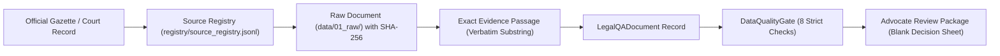

# LegalMitra Dataset Partitioning, Leakage Prevention & Provenance Policy

**Document ID:** `POLICY-DATASET-PHASE12`  
**Effective Date:** 16 October 2026  
**Status:** Approved & Enforced  
**Scope:** Dataset Generation, Storage, Review, Partitioning, and Model Training Pipelines

---

## 1. Executive Summary & Purpose

The LegalMitra application operates in a mission-critical domain: Indian statutory law, criminal procedure, evidence admissibility, and data privacy. Machine learning systems deployed in this domain must never present hallucinated statutory provisions, uncommenced laws as currently in force, or ungrounded assertions.

This policy governs the management, lifecycle, storage isolation, partitioning, and provenance tracking of all datasets created within the LegalMitra project.

---

## 2. Storage Architecture & Directory Isolation

To ensure that frozen evaluation benchmarks are never contaminated by iterative candidate generation or development experiments, strict physical directory boundaries are enforced:

| Directory Path | Purpose | Mutation Rules | Human Review State |
|---|---|---|---|
| `data/01_raw/` | Authoritative source documents (PDFs, HTML, TXT, JSON) | Append-only; checksum-verified | Raw source material |
| `data/02_extracted/` | Structured statutory text and markdown extractions | Regenerable via pipeline | Automated extraction |
| `data/03_generated/` | **Frozen Pilot Benchmark** (Phase 9 Snapshot) | **STRICTLY IMMUTABLE** (SHA-256 verified) | Pending Legal Review |
| `data/04_embeddings/` | Vector index embeddings for RAG retrieval | Regenerable from verified sources | Automated embeddings |
| `data/05_eval/` | Evaluation results and benchmark metrics | Append-only evaluation runs | Evaluation logs |
| `data/06_review/` | Frozen Advocate Review Package (Phase 9 Snapshot) | **STRICTLY IMMUTABLE** (SHA-256 verified) | Blank Review Sheets |
| `data/07_batches/` | **Controlled Expansion Batches** (Batch 0, Batch 1...) | Batched workflow directories | Pending Legal Review |
| `data/07_batches/review/` | Advocate review sheets for expansion batches | Reviewer editable only | Pending Advocate Input |

> [!IMPORTANT]
> The Phase 9 review snapshot in `data/03_generated/` and `data/06_review/` is permanently frozen under SHA-256 manifest verification (`scripts/verify_freeze.py`). All candidate expansion and new dataset generation must operate strictly within `data/07_batches/`.

---

## 3. Dataset Partitioning Strategy & Leakage Prevention

When preparing datasets for eventual model evaluation or fine-tuning, data leakage (where test provisions, phrasing, or facts leak into the training split) produces deceptively inflated evaluation scores while severely degrading real-world legal reliability.

### 3.1 Provision-Level Stratification
Splitting records purely randomly results in severe data leakage because multiple questions cite the exact same statutory section or sub-section. LegalMitra enforces **Provision-Level Grouped Splitting**:

1. **Section Grouping**: All question-answer pairs referencing a specific statutory provision (e.g., BNSS Section 482 anticipatory bail or DPDP Section 8 notice/security obligations) must reside entirely within either the **Training Set** or the **Holdout Evaluation Set**.
2. **Statute-Level Balance**: Each split must maintain balanced coverage across legal domains (Criminal Procedure, Evidence, Data Protection, Child Protection, Cyber Law, and Constitutional Jurisprudence).
3. **Temporal Status Stratification**: Uncommenced provisions (e.g., DPDP 2023 under G.S.R. 843(E)), in-force contemporary provisions (BNSS 2023 under S.O. 848(E)), and repealed-with-savings provisions (CrPC 1973 under BNSS s. 531) must be represented across splits according to strict ratio quotas.

### 3.2 Target Partition Ratios
For any approved production dataset intended for model training:
- **Training Partition (Train):** 70% of provision groups.
- **Validation Partition (Val):** 15% of provision groups (hyperparameter tuning and early stopping).
- **Test / Benchmark Partition (Test):** 15% of provision groups (blind holdout evaluation).

The **Phase 9 Frozen 20-Example Pilot** is designated as the **Primary Blind Holdout Benchmark (Test)** and will NEVER be incorporated into any model training partition.

### 3.3 Leakage Prevention Auditing
Prior to any partition export, the automated partitioner runs:
1. **Content Fingerprint Deduplication**: Jaccard similarity across questions in train and test splits must remain below 0.50.
2. **Exact Evidence Span Boundary**: Verbatim evidence passages used in test records are verified to ensure zero verbatim overlap with training question prompt contexts.
3. **Quarantine Exclusion Check**: 100% elimination of quarantined scaffolds (`IND-JUD-DEL-2024-BAIL`).

---

## 4. Source Provenance & Lineage Policy

Every example in any LegalMitra dataset must exhibit complete, unbroken legal provenance:

### 4.1 Mandatory Provenance Fields
No record can be saved without:
1. `supporting_source_ids`: Listed in `registry/source_registry.jsonl` with an authentic official URL (`indiacode.gov.in`, `egazette.gov.in`, or `main.sci.gov.in`).
2. `commencement_source_id`: Exact Gazette notification reference (e.g., `IND-NOTIF-MHA-SO-848E-2024`, `IND-NOTIF-MEITY-GSR-843E-2025`).
3. `legal_as_of_date`: Designated evaluation date (e.g., `2026-10-16`).
4. `evidence_passages`: At least one verbatim text span that is a verifiable substring of the source document text.

---

## 5. Advocate Review Boundary & Status Transitions

Automated systems can propose questions, answers, and preliminary quality validations, but **can never self-approve legal advice or dataset ground truth**.

### 5.1 Permitted Status Values (`LegalReviewStatus`)
- `pending_legal_review`: The sole allowable state for newly generated candidates.
- `legal_expert_approved`: Assigned strictly via advocate review import.
- `legal_expert_rejected`: Assigned strictly via advocate review import.
- `needs_more_evidence`: Assigned when evidence passage is insufficient or ambiguous.
- `deferred`: Assigned when pending higher court ruling or executive notification.
- `flagged_unsupported`: Assigned when source or claim is erroneous or synthetic.

### 5.2 Atomic Review Import Rules
1. All decisions imported via `ReviewImporter` are validated before any write occurs.
2. If any record contains an unknown decision, invalid score (<1 or >5), or missing comments on non-approved records, the entire transaction is rolled back with zero modifications to the candidate file.
3. Review decisions are preserved in an append-only audit directory with timestamped changelogs.

---

## 6. Compliance & Enforcement

Any modification to `data/03_generated/` or `data/06_review/` constitutes a critical policy violation. Continuous integration tests enforce `python scripts/verify_freeze.py` on every commit and build.

