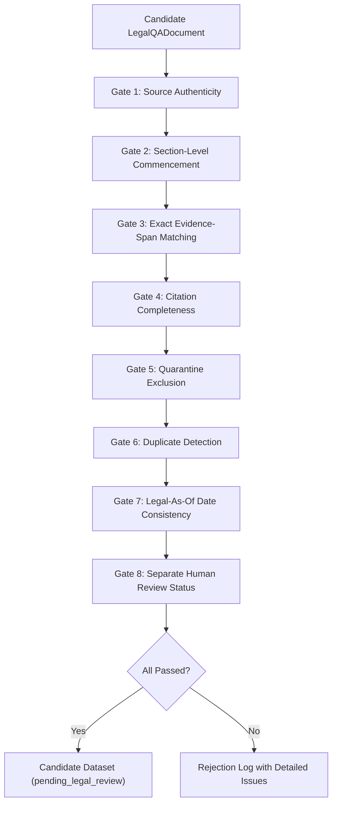

# LegalMitra Phase 12 Quality Gate Architecture & Audit

**Document ID:** `SPEC-QUALITY-GATE-PHASE12`  
**Effective Date:** 16 October 2026  
**Implementation:** `legalmitra.validation.quality_gate.DataQualityGate`  
**Status:** Validated & Active

---

## 1. Architectural Overview

The LegalMitra Data Quality Gate is an automated, pre-generation and pre-release validation subsystem designed to enforce zero hallucination, strict temporal accuracy, exact statutory grounding, and human-in-the-loop integrity across all datasets.

---

## 2. Gate-by-Gate Specification

### Gate 1: Source Authenticity (`check_source_authenticity`)
- **Objective:** Prevent reference to phantom, non-existent, or invalid source documents.
- **Rule:** Every ID in `supporting_source_ids` must exist in `registry/source_registry.jsonl`, must have `processing_status != "failed"`, and must feature an authentic, live canonical source URL (rejects dummy URLs such as `example.com` or missing schemes).

### Gate 2: Section-Level Commencement (`check_section_commencement`)
- **Objective:** Audit and enforce provision-specific commencement dates under official Gazette notifications.
- **Rule:**
  - Evaluates individual sections of enactments with phased commencement schedules.
  - Specifically prevents treating DPDP Act 2023 Section 44 as uniformly commenced: Section 44(1) and 44(3) commenced on 13 November 2025, but Section 44(2) (omitting IT Act s.43A) does not commence until 13 May 2027.
  - Audits DPDP Section 27 partial commencement (only s.27(1)(d) commenced 13 Nov 2026; balance commences 13 May 2027).

### Gate 3: Exact Evidence-Span Matching (`check_exact_evidence_matching`)
- **Objective:** Guarantee that quoted evidence is authentic statutory or judicial text, not AI-paraphrased or synthesized approximations.
- **Rule:**
  - Every `EvidencePassage.verbatim_text` must be a verifiable substring in the normalized source text of the registered source document.
  - Verifies section attribution (e.g., passage quoting Section 11 must not be labeled Section 12).
  - Material Proviso Enforcement: Specifically flags answers citing BSA Section 61 if they assert unconditional admissibility while omitting the mandatory proviso requiring Section 63(4) certification.

### Gate 4: Citation Completeness (`check_citation_completeness`)
- **Objective:** Ensure citation rigor and legal searchability.
- **Rule:** `statutory_citations` list cannot be empty and every citation must contain a recognized statutory anchor (`Section`, `Article`, `Rule`, `Order`, `Schedule`, `Clause`, `Act`, `Code`, `Sanhita`, or `Adhiniyam`).

### Gate 5: Quarantine Exclusion (`check_quarantine_exclusion`)
- **Objective:** Prevent any test mock, inverted scaffold, or ungrounded synthetic case from entering datasets.
- **Rule:**
  - Strictly blocks `IND-JUD-DEL-2024-BAIL` (quarantined synthetic scaffold) and `PROC-BNSS-482-BAIL-001`.
  - Flags any record containing indirect mentions of synthetic parties (e.g., `Rahul Kumar` in bail context).

### Gate 6: Duplicate Detection (`check_duplicate_status`)
- **Objective:** Avoid repetitive dataset examples and superficial rephrasing that degrades generalization.
- **Rule:**
  - Computes content fingerprints on normalized question texts.
  - Performs token-set Jaccard similarity comparison (filtering out common question stop-words). Any candidate with similarity $\ge 0.82$ against existing repository records or within the batch is rejected as a near-duplicate.

### Gate 7: Legal-As-Of Date Consistency (`check_temporal_metadata`)
- **Objective:** Ensure temporal coherence between the legal status of the provision and the evaluation date.
- **Rule:**
  - Verifies presence of `legal_as_of_date`, `law_status_label`, `provision_commencement_status`, `commencement_source_id`, and `commencement_date`.
  - Audits source document date against answer `legal_as_of_date`: rejects assertions where source enactment postdates the designated legal-as-of date without a preserved historical version.

### Gate 8: Separate Human Review Status (`check_human_review_status`)
- **Objective:** Prevent automated systems from self-approving legal advice or establishing ground truth without advocate review.
- **Rule:**
  - Newly generated candidates must have `legal_review_status == "pending_legal_review"`.
  - Any candidate bearing `legal_expert_approved` generated by automated routines is immediately rejected with a critical policy violation.

---

## 3. Batch 0 & Batch 1 Quality Gate Audit Summary

| Check ID | Gate Name | Method Invoked | Batch 0 Result | Batch 1 Result |
|---|---|---|:---:|:---:|
| QG-01 | Source Authenticity | `check_source_authenticity` | Passed (3/3) | Passed (20/20) |
| QG-02 | Section-Level Commencement | `check_section_commencement` | Passed (3/3) | Passed (20/20) |
| QG-03 | Exact Evidence Matching | `check_exact_evidence_matching` | Passed (3/3) | Passed (20/20) |
| QG-04 | Citation Completeness | `check_citation_completeness` | Passed (3/3) | Passed (20/20) |
| QG-05 | Quarantine Exclusion | `check_quarantine_exclusion` | Passed (3/3) | Passed (20/20) |
| QG-06 | Duplicate Detection | `check_duplicate_status` | Passed (3/3) | Passed (20/20) |
| QG-07 | Temporal Consistency | `check_temporal_metadata` | Passed (3/3) | Passed (20/20) |
| QG-08 | Human Review Boundary | `check_human_review_status` | Passed (3/3) | Passed (20/20) |

All 23 total candidate records generated across Batch 0 and Batch 1 comply fully with the 8 Data Quality Gates.

