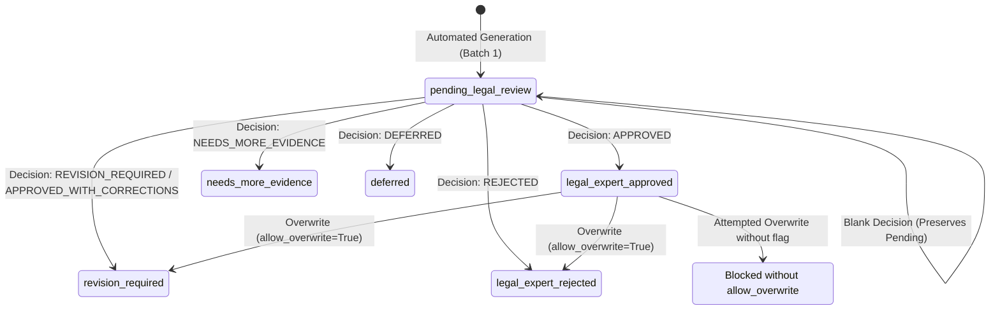

# LegalMitra Phase 13: Advocate Review Import Protocol & Audit Specification

**Document ID:** `PROTOCOL-REVIEW-IMPORT-PHASE13`  
**Effective Date:** 16 October 2026  
**Implementation:** `legalmitra.review.import_review.ReviewImporter`  
**Status:** Validated & Active

---

## 1. Overview & Protocol Purpose

This protocol specifies the technical requirements, schema validation rules, state machine transitions, and audit logging standards governing the import of human advocate review decisions into LegalMitra datasets.

The protocol ensures that:
1. Review sheets are validated **atomically** prior to any state mutation.
2. Decisions are attributed and accompanied by mandatory explanations when non-approved.
3. Every import produces an immutable, cryptographically verifiable audit record.
4. Overwrites of previously recorded decisions are detected and blocked by default.
5. Incomplete or blank fields safely retain `pending_legal_review` status without inferring approval.

---

## 2. Review Sheet CSV Specification

### 2.1 Character Encoding & Delimiters
- **Encoding:** UTF-8 or UTF-8 with BOM (`utf-8-sig`).
- **Delimiter:** Comma (`,`), RFC 4180 standard quoting.
- **Line Terminations:** CRLF (`\r\n`) or LF (`\n`).

### 2.2 Column Definition Table

| Column Name | Type | Allowed Values | Nullable? | Description |
|---|---|---|:---:|---|
| `record_id` | String | Must match existing dataset ID (e.g. `QA-BATCH1-001`) | No | Stable unique record identifier. |
| `legal_domain` | String | Legal domain name | Yes | Domain categorization (informational). |
| `statutory_citations` | String | Semicolon-delimited statutory sections | Yes | Primary legal provisions cited. |
| `question` | String | Full question text | Yes | Original question prompt. |
| `answer` | String | Full proposed answer text | Yes | Proposed answer text. |
| `review_decision` | String | `APPROVED`, `REVISION_REQUIRED`, `APPROVED_WITH_CORRECTIONS`, `REJECTED`, `NEEDS_MORE_EVIDENCE`, `DEFERRED`, or empty string | **Yes** | Review decision. Blank retains pending. |
| `legal_accuracy_score_1_to_5` | Integer | `1`, `2`, `3`, `4`, `5` | Yes | Substantive legal correctness score. |
| `temporal_accuracy_score_1_to_5` | Integer | `1`, `2`, `3`, `4`, `5` | Yes | Date and commencement accuracy score. |
| `grounding_accuracy_score_1_to_5` | Integer | `1`, `2`, `3`, `4`, `5` | Yes | Verbatim source grounding score. |
| `reviewer_comments` | String | Free-form legal critique | Conditional | Mandatory for all non-approval decisions. |
| `reviewer_name_initials` | String | Reviewer initials or identifier (e.g. `ADV-RS`) | Conditional | Mandatory under strict attribution mode. |
| `review_date` | String | Date in `YYYY-MM-DD` ISO format | Conditional | Date review was completed. |

---

## 3. Review Status State Machine & Transitions

The following state machine governs all transitions from candidate generation through advocate review:



### Transition Mapping Table

| CSV Input `review_decision` | Target Dataset `LegalReviewStatus` | Training Set Eligible? | Comment Required? |
|---|---|:---:|:---:|
| `""` (Blank / Empty) | `pending_legal_review` (unmodified) | ❌ No | No |
| `APPROVED` | `legal_expert_approved` | ✅ Yes (if non-quarantined & non-holdout) | No (Optional) |
| `APPROVED_WITH_CORRECTIONS` | `revision_required` | ❌ No | **YES** |
| `REVISION_REQUIRED` | `revision_required` | ❌ No | **YES** |
| `REJECTED` | `legal_expert_rejected` | ❌ No | **YES** |
| `NEEDS_MORE_EVIDENCE` | `needs_more_evidence` | ❌ No | **YES** |
| `DEFERRED` | `deferred` | ❌ No | **YES** |
| Any other string | *REJECTED BY VALIDATOR* | N/A | N/A |

---

## 4. Mandatory Validation Checks

Before any modification to dataset files, `ReviewImporter.validate_review_sheet` enforces:

1. **Existence Verification:** Every `record_id` must exist in the target dataset JSONL.
2. **Duplicate Prevention:** No `record_id` may appear more than once within the CSV.
3. **Decision Vocabulary:** Decision must match the allowed vocabulary.
4. **Mandatory Non-Approval Comment:** If decision is `REVISION_REQUIRED`, `APPROVED_WITH_CORRECTIONS`, `REJECTED`, `NEEDS_MORE_EVIDENCE`, or `DEFERRED`, `reviewer_comments` cannot be blank.
5. **Score Range Validation:** Any score provided must be an integer between 1 and 5 inclusive.
6. **Date ISO Validation:** Any `review_date` provided must parse under `YYYY-MM-DD`.
7. **Attribution Integrity:** When `--strict-attribution` is active, non-blank decisions must have both initials and review date.
8. **Overwrite Detection:** If a record is already in a decided status, it cannot be modified unless `--allow-overwrite` is explicitly specified.

---

## 5. Transactional Rollback Guarantee

`ReviewImporter` guarantees atomicity:
- If **100 rows** are submitted, and **99 rows** are valid, but **1 row** has an invalid score or missing comment, the entire batch is rejected.
- **Zero bytes** of the dataset file are modified.
- No partial updates or orphaned records are created.
- The candidate dataset's content fingerprint (SHA-256) remains identical before and after a rejected import.

---

## 6. Audit Logging & Verification

Every successful import operation writes an append-only audit ledger file:
- **Location:** `data/07_batches/review/audit/review_audit_log_YYYYMMDD_HHMMSS.jsonl` (or configured directory).
- **Format:** JSON Lines, one entry per updated record.

### Audit Entry Schema:
```json
{
  "timestamp": "2026-10-16T18:05:37.326319Z",
  "record_id": "QA-BATCH1-001",
  "previous_review_status": "pending_legal_review",
  "new_review_status": "legal_expert_approved",
  "decision": "APPROVED",
  "reviewer_name_initials": "Adv. AB",
  "review_date": "2026-10-16",
  "reviewer_comments": "Statutorily precise and accurately notes uncommenced status under G.S.R. 843(E).",
  "scores": {
    "legal_accuracy_score_1_to_5": 5,
    "temporal_accuracy_score_1_to_5": 5,
    "grounding_accuracy_score_1_to_5": 5
  },
  "original_record_snapshot": { ... },
  "submitted_csv_sha256": "19a3b214867b4eb4127fd0c0596950dbe243d8e02f073e2b4c6bf134c803737a"
}
```

The `submitted_csv_sha256` allows auditors to verify at any future point that the applied decisions correspond exactly to the bitwise artifact returned by the reviewer.

