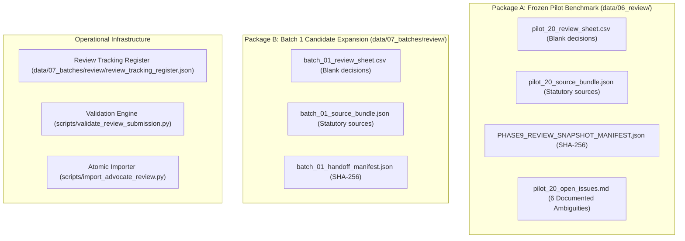

# LegalMitra Phase 13: Advocate Review Operations Manual

**Document ID:** `MANUAL-REVIEW-OPERATIONS-PHASE13`  
**Effective Date:** 16 October 2026  
**Audience:** Data Engineers, System Operators, Quality Assurance Auditors  
**Workspace:** `C:\PROJECTS\LegalMitra`

---

## 1. Purpose & Core Philosophy

The purpose of Phase 13 Review Operations is to establish an auditable, secure, and reproducible operational workflow for distributing review packages to licensed Indian advocates, tracking review progress, verifying returned review sheets, and atomically importing valid legal judgments.

### Non-Negotiable Operational Principles:
1. **Separation of Roles:** Automated tools generate candidates and verify string grounding; only qualified human advocates evaluate and approve legal advice.
2. **Immutability of the Benchmark:** The 20-example pilot snapshot in `data/03_generated/` and `data/06_review/` is permanently frozen under SHA-256 manifest verification.
3. **No Phantom Approvals:** Missing, malformed, or ambiguous decisions remain strictly pending. Automated tests passing does not equal legal approval.
4. **Leakage Protection:** Evaluation benchmark records (Pilot 20) can never be exported into model training partitions.
5. **Human-Controlled Transmission:** External distribution remains strictly manual and under user control. No automated email dispatch or third-party cloud uploads occur without explicit authorization.

---

## 2. Review Package Architecture

LegalMitra provides two segregated review packages:



### Package A: Frozen Pilot 20
- **Storage:** `data/06_review/` and `data/03_generated/pilot_20_examples.jsonl`
- **Role:** Primary Blind Holdout Evaluation Benchmark.
- **Rules:** Never edit frozen files. If returned with advocate reviews, decisions can be imported into an isolated evaluation directory or staging branch without mutating the frozen baseline.

### Package B: Batch 1 Candidate Expansion
- **Storage:** `data/07_batches/review/` and `data/07_batches/batch_01_candidates/batch_01_examples.jsonl`
- **Role:** Controlled training expansion candidates.
- **Rules:** All 20 candidates (`QA-BATCH1-001` through `QA-BATCH1-020`) remain `pending_legal_review` until advocate reviews are imported.

---

## 3. Review Tracking Lifecycle & Register

Review progress is tracked through `legalmitra/review/tracker.py` and persisted in `data/07_batches/review/review_tracking_register.json`.

### Tracking States:
1. **INITIALIZED:** Record is generated, quality gated, and registered with status `pending_legal_review`.
2. **DISPATCHED:** Package has been provided to a designated advocate reviewer (`sent_to_advocate: true`, `sent_date: YYYY-MM-DD`).
3. **RECEIVED:** Reviewer has returned the CSV (`response_received: true`, `response_date: YYYY-MM-DD`).
4. **VALIDATED:** CSV has passed dry-run schema and integrity validation (`validation_passed: true`, `validation_report_ref: REPORT_ID`).
5. **IMPORTED:** Decisions have been atomically committed with an immutable audit log (`imported: true`, `import_audit_reference: LOG_PATH`).

### Tracker CLI Usage:
To inspect current review status across all packages:
```powershell
python scripts/review_status_summary.py
```

---

## 4. Pre-Import Validation Procedure

Before any returned review sheet is imported into candidate datasets, it must pass standalone validation:

```powershell
python scripts/validate_review_submission.py `
    --csv path/to/returned_review.csv `
    --dataset data/07_batches/batch_01_candidates/batch_01_examples.jsonl `
    --report-out reports/validation_report.md
```

### Validation Gates Checked:
1. **Source Authenticity:** All `record_id` values exist in the target dataset.
2. **Duplicate Detection:** No duplicate record IDs exist within the CSV.
3. **Decision Vocabulary:** Every decision is one of `APPROVED`, `REVISION_REQUIRED`, `APPROVED_WITH_CORRECTIONS`, `REJECTED`, `NEEDS_MORE_EVIDENCE`, `DEFERRED`.
4. **Non-Approval Comment Requirement:** Decisions other than `APPROVED` must include substantive comments in `reviewer_comments`.
5. **Score Bounds:** Accuracy scores must be integers between 1 and 5.
6. **Date Formatting:** Dates must follow `YYYY-MM-DD`.
7. **Attribution:** If `--strict-attribution` is active, reviewer initials and review date are mandatory for decided rows.
8. **Overwrite Protection:** Cannot overwrite an already decided record unless `--allow-overwrite` is explicitly passed.

---

## 5. Atomic Import & Audit Logging

Once validation succeeds, import is executed via `scripts/import_advocate_review.py`:

```powershell
python scripts/import_advocate_review.py `
    --csv path/to/verified_review.csv `
    --dataset data/07_batches/batch_01_candidates/batch_01_examples.jsonl `
    --audit-dir data/07_batches/review/audit
```

### Safety Guarantees:
- **Bitwise SHA-256 Audit Trail:** The hash of the submitted CSV is permanently stamped into the audit ledger and import summary.
- **Transactional Rollback:** Any validation failure halts execution before a single byte of the dataset is changed.
- **Original Snapshot Ledger:** Prior record snapshots are preserved in append-only JSONL files in the audit directory.

---

## 6. Training Dataset Eligibility & Leakage Prevention

No record can be exported into a training split without passing the `DatasetEligibilityFilter` (`legalmitra/review/eligibility.py`):

```python
from legalmitra.review.eligibility import DatasetEligibilityFilter
filter_engine = DatasetEligibilityFilter()
eligible_docs, audit = filter_engine.filter_training_dataset(all_docs)
```

### Eligibility Rejection Reasons:
- **Review Status != `legal_expert_approved`:** Unreviewed, pending, rejected, or deferred examples are rejected.
- **Holdout Partition Member:** The 20 frozen pilot records are permanently blocked from training sets.
- **Quarantined Scaffolds:** Any record referencing `IND-JUD-DEL-2024-BAIL` or synthetic bail cases is strictly blocked.
- **Missing Reviewer Attribution:** Records lacking advocate initials or dates cannot be certified as ground truth.

---

## 7. Operational Checklist for Operators

- [ ] Execute `python scripts/verify_review_packages.py` before distributing any review materials.
- [ ] Deliver review sheets accompanied by `docs/ADVOCATE_REVIEW_GUIDE.md`.
- [ ] On receiving a returned review sheet, run `python scripts/validate_review_submission.py` in dry-run mode.
- [ ] Inspect the generated validation report for any rejected or malformed rows.
- [ ] If valid, execute `python scripts/import_advocate_review.py`.
- [ ] Verify that `scripts/review_status_summary.py` reflects the updated import.
- [ ] Verify that `scripts/verify_freeze.py` confirms 100% preservation of the frozen pilot.

