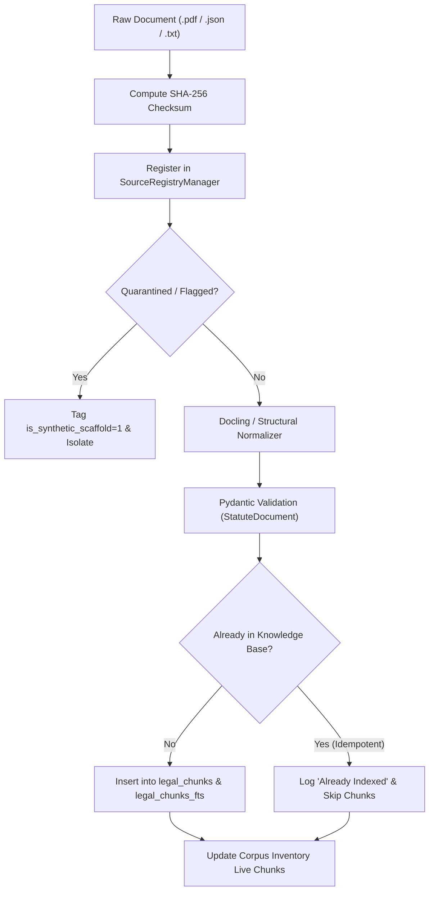

# LegalMitra Statutory and Delegated Legislation Ingestion Pipeline

**System Architecture Specification — Phase 14E**  
**Version:** 1.0.0  
**Engine Implementation:** `legalmitra/ingestion/corpus_ingestor.py`  
**CLI Runner:** `scripts/run_corpus_ingestion.py`  
**Classification:** Core Ingestion Architecture & Idempotency Specification

---

## 1. Overview & Idempotency Guarantees

The Corpus Ingestion Pipeline provides a robust, reproducible mechanism for parsing and indexing Indian legislative instruments into the SQLite knowledge base (`legalmitra_kb.db`).

### Non-Negotiable Guarantees:
1. **Zero Duplicate Ingestion:** If a document ID is already present in the knowledge base, re-running ingestion skips re-indexing unless `force_reindex=True` is explicitly specified.
2. **Quarantine Segregation:** Any document with `verification_status == FLAGGED_UNSUPPORTED` (such as the synthetic test scaffold `IND-JUD-DEL-2024-BAIL`) is automatically intercepted, reported as quarantined, and excluded from active indexing.
3. **Hierarchy Preservation:** Statutes are not flattened into arbitrary token chunks. Every chunk preserves its exact legislative level:
   - `SECTION`: Full section text with title and chapter.
   - `SUBSECTION`: Sub-provisions (e.g., Section 43A(1)).
   - `PROVISO`: Exceptions and provisos (e.g., Section 438 Proviso 1).
   - `EXPLANATION`: Statutory clarifications.
4. **Live Inventory Synchronization:** Ingestion runs update chunk counts and validation statuses in `data/08_corpus/coverage_inventory.json` and `data/08_corpus/coverage_inventory.csv`.

---

## 2. Ingestion Execution Flow



---

## 3. Command Usage & Verification

To run ingestion across all candidate normalized files:

```powershell
python scripts/run_corpus_ingestion.py
```

### Verified Execution Metrics:
- **Total Candidates Evaluated:** 8
- **Skipped (Already Indexed / Idempotent):** 7
- **Quarantined:** 1 (`IND-JUD-DEL-2024-BAIL`)
- **Failures:** 0
- **Total Verified Knowledge Base Chunks:** 1,149

