# LegalMitra Comprehensive Indian Legal Taxonomy

**Specification Document — Phase 14B**  
**Version:** 1.0.0  
**Target File:** `data/08_corpus/legal_taxonomy.json`  
**Engine Implementation:** `legalmitra/corpus/taxonomy.py`  
**Classification:** Core System Taxonomy & Classification Rules

---

## 1. Architectural Purpose

The Indian Legal Taxonomy establishes a normalized, machine-readable conceptual tree covering all central, state, and judicial branches of Indian jurisprudence. It solves three critical retrieval challenges:
1. **Multi-Topic Provision Mapping:** A single statutory provision (e.g., BNSS s.531(2)(a) or POCSO s.4) can belong to multiple subject areas (e.g., Criminal Procedure, Evidence, and Child Protection).
2. **Jurisdictional Segregation:** Central enactments (List I), State statutes (List II), and Concurrent codes (List III) are distinguished from local regulations and court-specific practice manuals.
3. **Normalized Search Terminology:** Official statutory nomenclature is linked to practitioner search terms and citizen plain-language queries.

---

## 2. Taxonomy Schema Specification

Every taxonomy node is structured with:
- `code`: Unique identifier (e.g. `TAX-CRIM-PROC`).
- `name`: Human-readable legal domain or sub-domain title.
- `description`: Scope of substantive or procedural coverage.
- `parent_code`: Parent domain reference (null for the 8 root domains).
- `jurisdiction_scope`: `"CENTRAL"`, `"STATE"`, or `"ALL"`.
- `aliases`: Recognized colloquial or shorthand titles (e.g., `["BNSS", "CrPC"]`).
- `key_statutes`: Core codified Acts within the domain.
- `search_keywords`: Token set for automated text tagging and classification.

---

## 3. The Eight Legal Domains

```mermaid
graph TD
    Root["Indian Legal Taxonomy (32 Nodes)"]
    D1["TAX-CONST: Constitutional & Public Law"]
    D2["TAX-CRIM: Criminal Law & Procedure"]
    D3["TAX-CIVIL: Civil Justice & ADR"]
    D4["TAX-BIZ: Business & Economic Law"]
    D5["TAX-LABOUR: Employment & Social Protection"]
    D6["TAX-TECH: Technology & Digital Law"]
    D7["TAX-ENV: Environment, Land & Infrastructure"]
    D8["TAX-SPEC: Specialized Public Regulation"]

    Root --> D1
    Root --> D2
    Root --> D3
    Root --> D4
    Root --> D5
    Root --> D6
    Root --> D7
    Root --> D8

    D1 --> D1A["TAX-CONST-FR (Fundamental Rights)"]
    D1 --> D1B["TAX-CONST-FED (Federalism)"]
    D1 --> D1C["TAX-CONST-ADMIN (Administrative Review)"]

    D2 --> D2A["TAX-CRIM-SUB (BNS / IPC)"]
    D2 --> D2B["TAX-CRIM-PROC (BNSS / CrPC)"]
    D2 --> D2C["TAX-CRIM-EVID (BSA / IEA Electronic Evidence)"]
    D2 --> D2D["TAX-CRIM-SPEC (POCSO, NDPS, PMLA)"]

    D3 --> D3A["TAX-CIVIL-PROC (CPC, Injunctions)"]
    D3 --> D3B["TAX-CIVIL-LIMIT (Limitation Act)"]
    D3 --> D3C["TAX-CIVIL-CONT (Contracts, SRA)"]
    D3 --> D3D["TAX-CIVIL-ADR (Arbitration, Mediation)"]
    D3 --> D3E["TAX-CIVIL-PROP (Transfer of Property)"]

    D4 --> D4A["TAX-BIZ-CORP (Companies Act, NCLT)"]
    D4 --> D4B["TAX-BIZ-IBC (Insolvency CIRP)"]
    D4 --> D4C["TAX-BIZ-CONS (Consumer Protection, CCPA)"]
    D4 --> D4D["TAX-BIZ-TAX (Direct Tax, GST)"]

    D5 --> D5A["TAX-LABOUR-POSH (Workplace Harassment)"]
    D5 --> D5B["TAX-LABOUR-WAGES (Wages & Social Security)"]

    D6 --> D6A["TAX-TECH-DPDP (Data Protection Board)"]
    D6 --> D6B["TAX-TECH-CYBER (IT Act, Safe Harbour)"]

    D7 --> D7A["TAX-ENV-RERA (Real Estate Homebuyers)"]
    D7 --> D7B["TAX-ENV-POLLUTION (NGT, Air/Water)"]

    D8 --> D8A["TAX-SPEC-IP (Patents, Copyright, TM)"]
    D8 --> D8B["TAX-SPEC-ELECTION (Representation of the People)"]
```

---

## 4. Jurisdiction & Classification Engine

The module `legalmitra/corpus/taxonomy.py` exposes:
- `build_default_indian_legal_taxonomy()`: Factory returning the full hierarchy.
- `classify_text(text: str) -> List[str]`: Maps an arbitrary user query or statutory passage to relevant taxonomy codes.
- `search_by_keyword(keyword: str) -> List[TaxonomyNode]`: Resolves legal concepts to official codes.
- `export_json(target_path: Path)`: Serializes the taxonomy for frontend search filters and API consumption.

