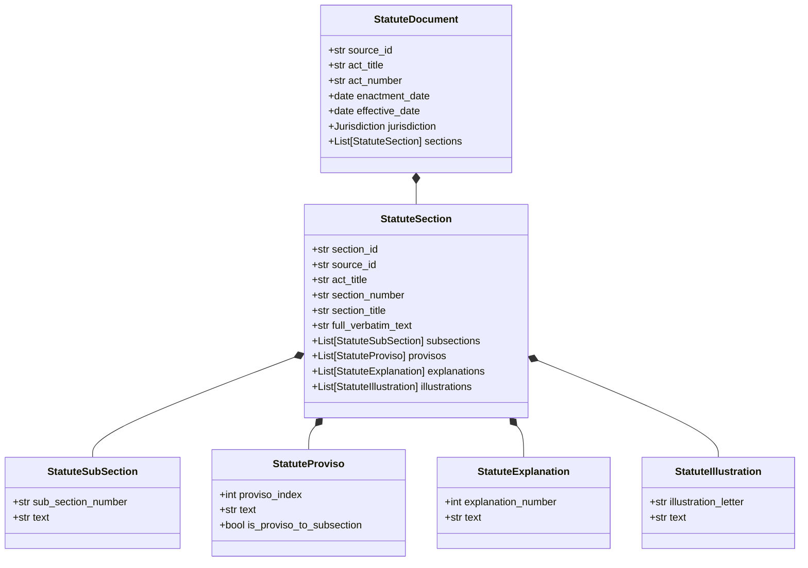

# LegalMitra Phase 15 — Provision-Level Structure & Hierarchical Parsing

**Document ID:** `docs/PHASE15_PROVISION_PARSING.md`  
**System:** LegalMitra Statutory Normalization & Ingestion Engine  
**Module:** `legalmitra/ingestion/central_acts.py` & `legalmitra/schemas/statute.py`  
**Target Repository:** `c:\PROJECTS\LegalMitra`

---

## 1. The Challenge of Indian Statutory Provisions

Indian legislative drafting employs complex, nested provision hierarchies:
1. **Parts / Schedules / Chapters** (High-level organizing divisions).
2. **Sections / Articles** (Primary statutory units).
3. **Subsections / Clauses** (Numbered `(1)`, `(2)` or lettered `(a)`, `(b)`).
4. **Provisos** ("Provided that...", "Provided further that..."): carve out exceptions, limitations, conditions precedent, or jurisdictional bars.
5. **Explanations** ("Explanation.—", "Explanation 1.—"): clarify definitions, remove ambiguities, or expand meanings.
6. **Illustrations**: concrete factual examples codified directly into the statute (e.g. Indian Contract Act, Indian Penal Code, Specific Relief Act).

Naive chunking (such as splitting by character count or paragraph break) severs provisos from their parent operative sections, reverses the legal meaning of the provision, or loses the statutory context of an Explanation.

---

## 2. Provision Structure Schema Architecture

LegalMitra preserves every level of statutory hierarchy using strongly typed Pydantic models in `legalmitra/schemas/statute.py`:

---

## 3. Implementation of the `make_section` Factory

The factory function `make_section(...)` in `legalmitra/ingestion/central_acts.py` constructs validated, auditable `StatuteSection` instances:

1. **Deterministic Unique Identifier (`section_id`):**  
   Constructed as `{source_id}-SEC-{sanitized_section_number}`. Special characters like dots, parentheses, and spaces are sanitized (e.g., `IND-CONST-1950-SEC-ARTICLE-21A` or `IND-STAT-SRA-1963-SEC-20A`).
2. **Provenance Preservation:**  
   Carries `source_id`, `act_title`, `act_number`, `chapter_number`, and `chapter_title` with every section, ensuring that extracted chunks never lose their parent legislative context.
3. **Verbatim Text Integrity:**  
   `full_verbatim_text` contains the complete official gazette text of the section, while `subsections`, `provisos`, `explanations`, and `illustrations` are separately parsed and structured for fine-grained retrieval.
4. **Legal Review Status:**  
   Tagged as `LegalReviewStatus.UNVERIFIED_AUTOMATED` upon programmatic generation, ready for advocate inspection without false claims of certified review.

---

## 4. Case Studies in Provision Parsing

### 4.1 Section 11 of the Code of Civil Procedure, 1908 (*Res Judicata*)
Section 11 contains an operative charging clause followed by **8 separate Explanations** that govern:
- Explanation I: Former suit defined.
- Explanation II: Competence of court of appeal.
- Explanation III: Matter directly and substantially in issue.
- Explanation IV: Constructive *res judicata* (might and ought to have been made ground of defence or attack).
- Explanation V: Relief claimed but not expressly granted deemed refused.
- Explanation VI: Representative suits.
- Explanation VII: Applicability to execution proceedings.
- Explanation VIII: Decisions of courts of limited jurisdiction.

By modeling each Explanation as a discrete entity linked to the parent `IND-STAT-CPC-1908-SEC-11`, LegalMitra enables retrieval queries to target specific doctrines (such as constructive *res judicata*) without losing the overarching statutory bar of Section 11.

### 4.2 Section 103 of Bharatiya Nyaya Sanhita, 2023 (Punishment for Murder)
Section 103 contains two distinct subsections:
- Subsection (1): General punishment for murder (death or imprisonment for life, and fine).
- Subsection (2): Murder committed by a group of five or more persons acting in concert on grounds of race, caste, sex, place of birth, language, or personal belief (each person punished with death or imprisonment for life, and fine).

In LegalMitra, Section 103 is indexed as a parent chunk, while subsection (2) is indexed with hierarchy level `subsection` and citation `Section 103(2)`, enabling pinpoint retrieval for mob lynching questions.

### 4.3 Section 10 & 20A of the Specific Relief Act, 1963
Section 10 contains mandatory language referencing sections 11(2), 14, and 16, while Section 20A contains a substantive sub-section (1) barring injunctions, followed by sub-section (2) classifying infrastructure categories, and an Explanation referencing the Department of Economic Affairs notification. The parser maintains this complete tree without truncating the cross-references.

---

## 5. Chunking Strategy in Knowledge Base (`LegalKnowledgeBase`)

When `index_statute_document()` indexes a `StatuteDocument` into `data/legalmitra_kb.db`:
1. It indexes the primary section chunk with `hierarchy_level="section"`.
2. For each subsection, it indexes a child chunk with `hierarchy_level="subsection"` and provision reference `Section {sec_num}({subsec_num})`.
3. For each proviso, explanation, and illustration, distinct searchable chunks are registered when substantive content exists.
4. All child chunks inherit the exact jurisdictional, temporal (`document_date`, `effective_date`), and authority level (`binding_statute`) metadata from the parent statute.

