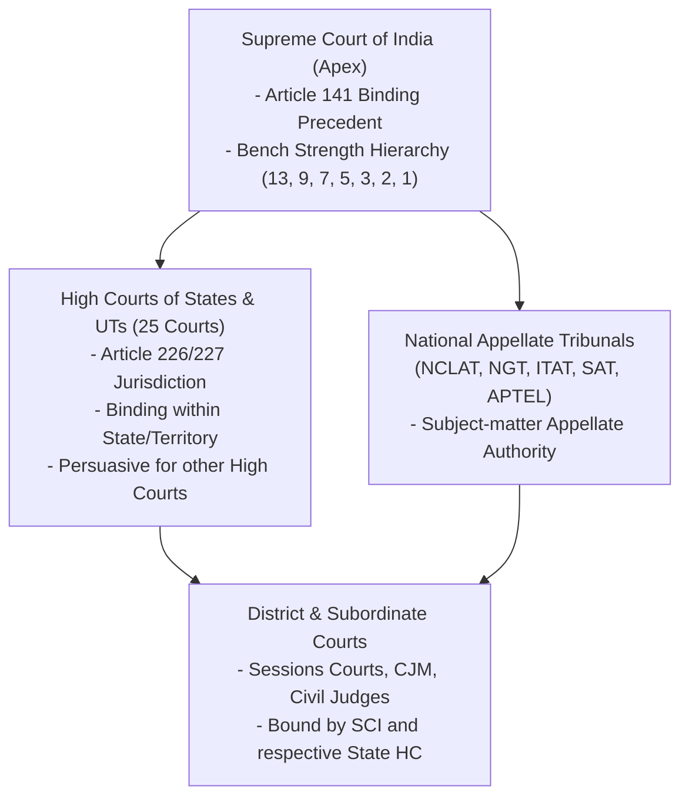

# PHASE 18 — NATIONAL JUDICIAL CORPUS & CASE-LAW EXPANSION STRATEGY

**Workspace:** `C:\PROJECTS\LegalMitra`  
**Classification:** Proprietary & Confidential — Team Shatrujeet  
**Date:** October 2026  
**Status:** Canonical Strategy

---

## 1. Executive Summary

In the Indian common-law system, statutory provisions cannot be understood in isolation from judicial interpretation. Under Article 141 of the Constitution of India, *"The law declared by the Supreme Court shall be binding on all courts within the territory of India."* 

LegalMitra's judicial corpus expansion strategy is designed to construct an authentic, source-verified, temporally accurate case-law knowledge repository. It strictly rejects the fabrication of judgments, synthetic case citations, or unverified headnotes. Every judicial record in LegalMitra traces to genuine official law reports (SCR, e-SCR, AIR, SCC) or authorized High Court publication benches.

---

## 2. Judicial Hierarchy & Binding Precedent Rules

### 2.1 The Bench Strength Rule
Under Indian jurisprudence (e.g., *Union of India v. Raghubir Singh* (1989) 2 SCC 754; *Central Board of Dawoodi Bohra Community* (2005) 2 SCC 673):
1. A decision rendered by a bench of larger strength binds benches of smaller strength.
2. A bench of coordinate strength (e.g., 2 judges vs 2 judges) cannot overrule an earlier decision of equal strength. If it disagrees, it must refer the matter to a larger bench.
3. A Constitution Bench of 5 or more judges is required under Article 145(3) for questions involving substantial interpretation of the Constitution.
4. *Kesavananda Bharati* (1973) 4 SCC 225, decided by a 13-judge bench, stands as the largest bench in Indian legal history and cannot be overruled by any smaller bench.

---

## 3. Precedent Treatment Taxonomy

To prevent outdated or overruled case law from misleading users, LegalMitra tags precedent relationships with a precise 15-category treatment taxonomy:

| Treatment Code | Canonical Meaning | Operational Effect in RAG |
| :--- | :--- | :--- |
| `FOLLOWED` | Principle affirmed and applied directly to facts | High authority weight |
| `APPLIED` | Statutory principle extended to analogous scenario | High authority weight |
| `APPROVED` | Superior court affirms a High Court or lower court reasoning | Elevated authority |
| `AFFIRMED` | Specific decree/judgment affirmed on appeal | Conclusive finality |
| `DISTINGUISHED` | Precedent held inapplicable due to material factual difference | Excluded from direct application |
| `DOUBTED` | Soundness questioned but not formally overruled | Caveat alert displayed to user |
| `REFERRED_TO_LARGER_BENCH` | Coordinate bench doubts precedent and sends to Chief Justice | Pending adjudication warning |
| `OVERRULED` | Explicitly declared bad law by larger bench or Constitution bench | **STRICT NEGATIVE FILTER: Excluded from active citation** |
| `PARTIALLY_OVERRULED` | Certain propositions invalidated while remainder intact | Partial warning; tagged by proposition |
| `REVERSED` | High Court / Lower court decision overturned in same case | Nullified for the parties |
| `SET_ASIDE` | Order quashed on procedural or jurisdictional grounds | Nullified |

---

## 4. Controlled Judicial Ingestion Batches

Case-law expansion proceeds through four verified batches:

1. **Batch J1: Foundational Constitutional & Criminal Benchmarks (Completed)**
   - *Kesavananda Bharati v. State of Kerala* (1973) 4 SCC 225 (Basic Structure).
   - *Maneka Gandhi v. Union of India* (1978) 1 SCC 248 (Article 21 Procedure Established by Law).
   - *Justice K.S. Puttaswamy (Retd.) v. Union of India* (2017) 10 SCC 1 (Right to Privacy).
   - *Lalita Kumari v. Govt. of U.P.* (2014) 2 SCC 1 (Mandatory Registration of FIR).
2. **Batch J2: Criminal Procedure, Arrest & Bail Intelligence (Active Ingestion)**
   - *D.K. Basu v. State of West Bengal* (1997) 1 SCC 416 (Arrest guidelines).
   - *Arnesh Kumar v. State of Bihar* (2014) 8 SCC 273 (Notice under 41A, arrest checks).
   - *Satender Kumar Antil v. CBI* (2022) 10 SCC 51 (Bail categories & compliance).
   - *Gurbaksh Singh Sibbia v. State of Punjab* (1980) 2 SCC 565 (Anticipatory Bail).
3. **Batch J3: Commercial, Arbitration & IBC Landmarks (Roadmap)**
   - *Vidya Drolia v. Durga Trading Corp.* (2021) 2 SCC 1 (Arbitrability framework).
   - *Swiss Ribbons Pvt. Ltd. v. Union of India* (2019) 4 SCC 17 (IBC constitutionality).
   - *Cox and Kings Ltd. v. SAP India Pvt. Ltd.* (2024) 4 SCC 1 (Group of Companies doctrine).
4. **Batch J4: State High Court Landmark Decisions (Roadmap)**
   - Leading full bench judgments of High Court of Delhi and High Court of Judicature at Bombay on local rent and revenue disputes.

---

## 5. Strict Data Quality & Quarantine Policy

- **Quarantine Enforced**: Scaffold records (such as `IND-JUD-DEL-2024-BAIL`) must maintain `is_synthetic_scaffold = 1` and never be included in legal citation exports or benchmark evaluations.
- **Verification of Full Official Text**: Summaries, headnotes, or AI-generated synopses are never treated as the primary judgment chunk. All indexed text is extracted from authentic court PDF transcripts.

