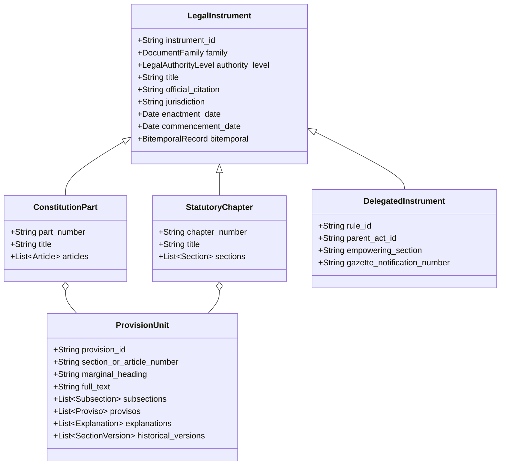

# PHASE 18 — CONSTITUTION AND LEGISLATION ONTOLOGICAL DATA MODEL

**Workspace:** `C:\PROJECTS\LegalMitra`  
**Classification:** Proprietary & Confidential — Team Shatrujeet  
**Date:** October 2026  
**Status:** Canonical Reference

---

## 1. Overview

Indian statutory and constitutional architecture requires a deep, hierarchical ontological data model capable of representing:
1. **Constitutional Structure**: Preamble, 25 Parts, 448 Articles, 12 Schedules, Appendices, and 106 Constitutional Amendment Acts.
2. **Statutory Hierarchy**: Central and State Acts subdivided into Parts, Chapters, Sections, Subsections, Clauses, Sub-clauses, Provisos, and Explanations.
3. **Amendment Versioning**: Explicit tracking of insertions, substitutions, omissions, and repeal actions.
4. **Subordinate Legal Instruments**: Rules, Regulations, Orders, Bye-laws, and Notifications linked directly to their parent statutory empowering sections.

---

## 2. Ontological Hierarchy

---

## 3. Constitutional Versioning & Basic Structure Protection

### 3.1 Articles and Constitutional Amendments
Every Article in the Constitution is modeled with:
- `original_1950_text`: Baseline text adopted by the Constituent Assembly on 26 November 1949 (commenced 26 January 1950).
- `amendment_history`: Sequence of Constitutional Amendment Acts (CAAs 1st through 106th) modifying the Article.
- `basic_structure_implication`: Tagged if the provision forms part of the Basic Structure Doctrine under *Kesavananda Bharati v. State of Kerala* (1973) 4 SCC 225, *Minerva Mills*, or *Indira Nehru Gandhi*.

### 3.2 Amendment Operations
- **`INSERTION`**: Introduction of new articles (e.g., Article 21A inserted by 86th CAA 2002; Article 51A inserted by 42nd CAA 1976).
- **`SUBSTITUTION`**: Complete rewording of an existing provision (e.g., Article 19(2) substituted by 1st CAA 1951; Article 338 substituted by 65th CAA 1990).
- **`OMISSION / DELETION`**: Removal of a provision (e.g., Article 31 omitted by 44th CAA 1978; Article 19(1)(f) omitted by 44th CAA 1978).

---

## 4. Statutory Structural Elements

To eliminate information loss when ingesting lengthy statutes, LegalMitra provisions are decomposed into canonical sub-elements:

1. **Marginal Heading**: Summary descriptor at the head of the provision (e.g., "Punishment for murder").
2. **Subsections**: Enacted numbered divisions `(1)`, `(2)`, `(3)`.
3. **Clauses & Sub-clauses**: Lettered and Roman numeral sub-items `(a)`, `(b)`, `(i)`, `(ii)`.
4. **Provisos**: Conditional qualifications beginning with *"Provided that..."* or *"Provided further that..."*. Provisos must be retained in direct proximity to the operative clause.
5. **Explanations**: Clarifications appended to provisions beginning with *"Explanation.—"*.
6. **Schedules & Tables**: Referenced appended schedules (e.g., Classification of Offences in Schedule I of BNSS).

---

## 5. Metadata Schema for Production Storage

Every provision chunk in `data/legalmitra_kb.db` must include:
- `doc_id`: Unique identifier (e.g., `IND-ACT-CENTRAL-2023-BNS#SEC-103`).
- `parent_doc_id`: Root statute identifier (e.g., `IND-ACT-CENTRAL-2023-BNS`).
- `section_number`: Exact section string (e.g., `Section 103`).
- `chunk_type`: `section`, `proviso`, `explanation`, or `schedule`.
- `valid_from`: Real-world effective date.
- `valid_to`: Real-world repeal or substitution date (`None` if active).
- `authority_level`: `L1_CONSTITUTIONAL`, `L2_CENTRAL_PRIMARY`, `L3_STATE_PRIMARY`, `L4_DELEGATED_CENTRAL`, etc.

