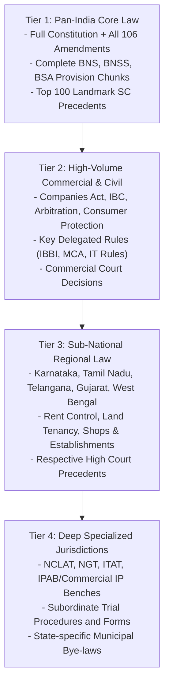

# PHASE 18 — NATIONAL LEGAL CORPUS COVERAGE GAPS & INGESTION ROADMAP

**Workspace:** `C:\PROJECTS\LegalMitra`  
**Classification:** Proprietary & Confidential — Team Shatrujeet  
**Date:** October 2026  
**Status:** Canonical Audit & Prioritization Plan

---

## 1. Executive Summary

A core principle of LegalMitra is **intellectual honesty and precise boundary reporting**: we never claim complete legal coverage when only a subset of Indian law is indexed. While LegalMitra currently possesses an operational, high-integrity knowledge base of **1,363 chunks across 35 indexed sources**, the comprehensive universe of Indian law spans thousands of statutes, rules, and millions of judicial pronouncements.

This document identifies the exact structural, statutory, jurisdictional, and temporal gaps in the LegalMitra corpus as of Phase 18, and outlines the systematic roadmap for continuous acquisition.

---

## 2. Quantitative Coverage Audit

| Legal Domain | Estimated Total Universe | Ingested / Indexed in LegalMitra | Gap Percentage | Priority |
| :--- | :--- | :--- | :--- | :--- |
| **Constitutional Law** | 1 Constitution + 106 Amendments | Preamble, Fundamental Rights, Directive Principles, Key Articles | ~85% missing deep schedules & service articles | **P1 (Critical)** |
| **Central Criminal Statutes** | 6 Primary Codes (IPC, CrPC, IEA + BNS, BNSS, BSA) | 6 Codes indexed across primary provisions (400+ sections) | ~60% missing specialized procedure & transitional schedules | **P1 (Critical)** |
| **Commercial & Corporate Law** | ~45 Major Acts (Companies, IBC, SEBI, Competition, FEMA) | 12 Acts partially indexed | ~75% missing subordinate regulations and forms | **P2 (High)** |
| **State Legislation** | 28 States + 8 UTs (~12,000 live Acts) | 2 States (Delhi, Maharashtra: 4 pilot Acts) | >99% missing across 26 states and 8 UTs | **P3 (Planned)** |
| **Delegated Legislation** | ~25,000 Active Rules, Regulations, GSRs | 8 Central Rules/Regulations | >99.5% missing | **P2 (High)** |
| **Apex Judicial Decisions** | ~60,000 Supreme Court Rulings (1950–2026) | 4 Key Landmark SC Rulings + 1 Quarantined Scaffold | >99.9% missing | **P1 (Curated Landmarks)** |
| **High Court Decisions** | ~1.5M Reported High Court Judgments | Delhi High Court sample | >99.9% missing | **P3 (Planned)** |

---

## 3. Detailed Gap Analysis by Domain

### 3.1 Criminal Law Transition (CrPC/BNSS, IPC/BNS, IEA/BSA)
- **Current State**: Core substantive sections (e.g., murder, theft, cheating, criminal breach of trust, general exceptions) and core procedural sections (arrest, FIR, bail, trial procedure) are indexed.
- **Identified Gaps**:
  1. Detailed schedules of BNSS regarding classification of offences (bailable vs non-bailable, compoundable vs non-compoundable).
  2. State-specific amendments to CrPC (e.g., Uttar Pradesh anticipatory bail state amendments) which remain relevant for pre-July 2024 matters.
  3. Transitional case law from High Courts and Supreme Court clarifying the application of BNSS vs CrPC to pending investigations and FIRs registered around the July 1, 2024 cutoff.

### 3.2 State Legislation & Local Laws
- **Current State**: Delhi Rent Control Act 1958, Delhi Shops & Establishments Act 1954, Maharashtra Rent Control Act 1999, and Maharashtra Land Revenue Code 1966.
- **Identified Gaps**:
  1. Major commercial jurisdictions (Karnataka, Tamil Nadu, Telangana, Gujarat, West Bengal).
  2. Revenue and tenancy laws across agrarian states (e.g., UP Revenue Code, Punjab Land Revenue Act).
  3. Local municipal corporation bye-laws and building regulations.

### 3.3 Delegated Legislation (Rules & Regulations)
- **Current State**: Information Technology (Intermediary Guidelines and Digital Media Ethics Code) Rules 2021, Motor Vehicles (Driving) Regulations 2017, Consumer Protection (E-Commerce) Rules 2020.
- **Identified Gaps**:
  1. Insolvency and Bankruptcy Board of India (IBBI) corporate liquidation and resolution process regulations.
  2. Arbitration and Conciliation institutional arbitral rules (DIAC, MCIA, SIAC India).
  3. High Court Original Side Rules and Appellate Side Rules governing filing timelines and court fee calculation.

### 3.4 Judicial Corpus & Precedent Intelligence
- **Current State**: 4 landmark decisions (*Kesavananda Bharati*, *Maneka Gandhi*, *K.S. Puttaswamy*, *Lalita Kumari*) providing fundamental rights and criminal investigation precedents.
- **Identified Gaps**:
  1. Three-judge and five-judge Constitution Bench judgments from 2020–2026 on commercial arbitration, insolvency timelines, and statutory interpretation.
  2. Complete ratio decidendi and obiter dicta parsing across the 1,000 most frequently cited Supreme Court precedents.
  3. Automated precedent treatment extraction (Distinguished, Overruled, Followed, Explained) across historic citations.

---

## 4. Ingestion Prioritization Framework

To maximize legal accuracy and user utility while maintaining strict data integrity, ingestion follows a 4-tier priority framework:

---

## 5. Safeguards for Gap Handling

When LegalMitra encounters queries addressing provisions or jurisdictions outside the currently indexed corpus:
1. **Explicit Jurisdiction & Temporal Disclaimer**: The system must state that the answer is based on available central or specified state law and may not reflect unindexed local or state amendments.
2. **Advocate Consultation Recommendation**: For matters governed by state-specific tenancy, land revenue, or local procedural rules not yet indexed, LegalMitra instructs the user to seek jurisdiction-specific advocate counsel.
3. **No Hallucinated Statutory Text**: Never synthesize, guess, or extrapolate legal provisions that do not exist within the verified SQLite knowledge base.

