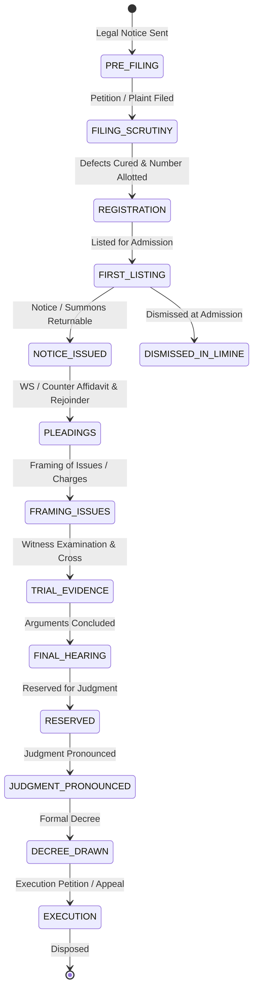

# PHASE 18 — COURT HEARING, CAUSE LIST & PROCEDURAL EVENT MODEL

**Workspace:** `C:\PROJECTS\LegalMitra`  
**Classification:** Proprietary & Confidential — Team Shatrujeet  
**Date:** October 2026  
**Status:** Canonical Reference

---

## 1. Executive Summary

Legal assistance platforms frequently fail Indian litigants and advocates by treating court practice as a single static judgment event. In reality, Indian litigation is a prolonged, multi-stage procedural journey characterized by daily cause lists, interim hearings, interlocutory applications, compliance orders, and sequential procedural stages.

Phase 18 introduces LegalMitra's **Court Hearing and Procedural Event Model**, providing structured representations for:
- **Daily Cause Lists**: Bench composition, item sequence, listing purpose, and advocate appearance.
- **Hearing Events & Orders**: Interim injunctions, notices, status quo, bail grants/rejections, evidence recordings, and adjournments.
- **Litigation Case Lifecycles**: Complete state machine tracking matters from filing through trial, decree, and execution.

---

## 2. Litigation Case Lifecycle State Machine

---

## 3. Hearing Classification & Disposition Typology

Litigation proceedings are modeled using two core enumerations implemented in `legalmitra/corpus/procedural_events.py`:

### 3.1 Hearing Types (`HearingType`)
1. `FIRST_LISTING_ADMISSION`: Initial hearing where court determines whether to issue notice or dismiss in limine.
2. `NOTICE_RETURNABLE`: Hearing where respondents appear pursuant to notice; service report verified.
3. `INTERLOCUTORY_APPLICATION`: Adjudication of stay, injunction, discovery, or modification applications.
4. `FRAMING_OF_ISSUES`: Determination of points of law and fact in dispute (Order XIV CPC).
5. `FRAMING_OF_CHARGES`: Formal reading of charges to accused in criminal trial (Section 228/240 CrPC; Section 251/263 BNSS).
6. `PROSECUTION_EVIDENCE` / `PLAINTIFF_EVIDENCE`: Examination-in-chief and cross-examination of primary witnesses.
7. `DEFENCE_EVIDENCE`: Production of defense witness testimonies.
8. `STATEMENT_UNDER_313`: Accused questioned on incriminating circumstances (Section 313 CrPC / Section 351 BNSS).
9. `FINAL_ARGUMENTS`: Comprehensive oral submissions by senior counsel / advocates.
10. `PRONOUNCEMENT_OF_JUDGMENT`: Formal reading of the operative order and signed judgment in open court.
11. `COMPLIANCE_REPORT`: Post-disposal monitoring of directions issued to executive authorities.

### 3.2 Order Disposition Typology (`OrderDispositionType`)
- **Interim / Interlocutory**:
  - `INTERIM_STAY_GRANTED`: Operation of impugned order or proceedings stayed pending further orders.
  - `STATUS_QUO_ORDERED`: Parties directed to maintain current physical or legal status of property/subject matter.
  - `NOTICE_ISSUED`: Notice to show cause issued; counter-affidavit directed within specified timeline.
  - `BAIL_GRANTED` / `BAIL_REJECTED`: Regular or interim bail determination.
  - `ANTICIPATORY_BAIL_GRANTED` / `ANTICIPATORY_BAIL_REJECTED`: Pre-arrest bail direction.
  - `ADJOURNED`: Case postponed to future date for specified purpose.
- **Final Disposals**:
  - `ALLOWED`: Relief prayed for granted.
  - `DISMISSED_ON_MERITS`: Substantive claim rejected after full consideration.
  - `DISPOSED_OF_WITH_DIRECTIONS`: Matter concluded with specific administrative or procedural mandates.
  - `DISMISSED_AS_WITHDRAWN`: Petitioner withdraws with or without liberty to file afresh.
  - `DECREED`: Formal civil adjudication in favor of plaintiff.

---

## 4. Integration with Court Data Services (eCourts)

The procedural event schema is structured to directly ingest:
1. **CNR Numbers (Case Natural Record)**: 16-character alphanumeric unique nationwide court case identifier (e.g., `DLHC010012342026`).
2. **eCourts Daily Cause List Scrapers**: Automated ingestion of daily boards to alert advocates of upcoming matters.
3. **Daily Order Sheets**: Chronological ordering of hearing summaries, next dates of hearing (NDOH), and next stage purposes.

