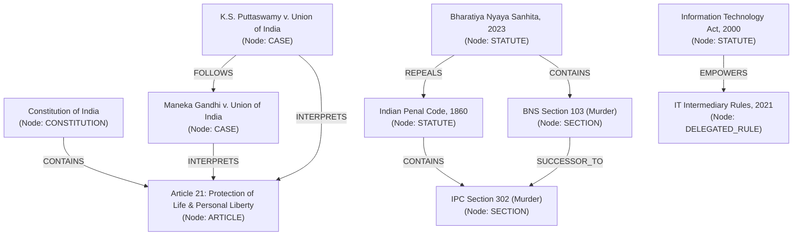

# PHASE 18 — NATIONAL LEGAL KNOWLEDGE GRAPH SPECIFICATION

**Workspace:** `C:\PROJECTS\LegalMitra`  
**Classification:** Proprietary & Confidential — Team Shatrujeet  
**Date:** October 2026  
**Status:** Canonical Reference

---

## 1. Executive Summary

Legal research cannot be reduced to isolated keyword or semantic searches over plain text. The Indian legal system operates as a **dense, interconnected multi-relational network** where:
- Statutes empower executive bodies to frame delegated rules.
- Amending Acts modify, insert, or substitute individual statutory sections.
- Successor codes repeal and replace century-old penal frameworks.
- Apex Court rulings interpret constitutional articles, overrule coordinate judgments, or affirm High Court decisions.
- Procedural provisions dictate the allowable actions at distinct stages of litigation.

LegalMitra's **National Legal Knowledge Graph (NLKG)** structures these multi-hop relationships into a formal graph index implemented in `legalmitra/caselaw/knowledge_graph.py`.

---

## 2. Graph Schema & Relational Ontology

---

## 3. Entity & Relation Taxonomies

### 3.1 Node Entities (`EntityType`)
1. `CONSTITUTION`: The supreme legal charter of India.
2. `ARTICLE`: Enacted articles and constitutional clauses.
3. `STATUTE`: Primary Acts of Parliament or State Legislatures.
4. `SECTION`: Specific statutory provision or sub-clause.
5. `DELEGATED_RULE`: Subordinate rules, regulations, statutory orders (SO), GSRs.
6. `COURT`: Specific judicial forum (Supreme Court of India, Delhi High Court, NCLAT, etc.).
7. `JUDGE`: Judicial officer or bench coram.
8. `CASE`: Reported judgment or judicial decision.
9. `LEGAL_CONCEPT`: Doctrinal terms (e.g., Basic Structure, Mens Rea, Strict Liability).
10. `PROCEDURAL_STAGE`: Litigation milestone (e.g., First Listing, Framing of Issues, Final Arguments).

### 3.2 Edge Types (`RelationType`)
- **Statutory Edges**:
  - `CONTAINS`: Parent statute encompasses section/schedule.
  - `EMPOWERS`: Statutory provision grants rule-making power.
  - `AMENDS`: Amending instrument modifies text of target section.
  - `REPEALS`: Enactment terminates legal validity of prior statute.
  - `SUCCESSOR_TO`: New Sanhita provision maps to historical code provision.
- **Judicial Edges**:
  - `CITES`: Case refers to another judgment or statute.
  - `INTERPRETS`: Case provides definitive legal construction of section/article.
  - `FOLLOWS`: Later case applies ratio of earlier case without divergence.
  - `DISTINGUISHES`: Later case declines to apply earlier case based on distinct factual matrix.
  - `OVERRULES`: Larger bench expressly strips earlier case of precedential authority.
  - `DECIDED_BY` / `HEARD_BY`: Links case to Court and Bench coram.
- **Practice Edges**:
  - `GOVERNS_STAGE`: Section regulates procedural step in court lifecycle.
  - `EXEMPLIFIES`: Case provides leading illustration of legal concept.

---

## 4. Operational Retrieval Use Cases

The NLKG enhances RAG retrieval through deterministic multi-hop traversals:
1. **Automated Successor Code Expansion**: When a user queries *"Bail conditions under Section 437 CrPC"*, graph traversal identifies `SUCCESSOR_TO -> Section 480 BNSS` and injects both the legacy framework and current operative section into retrieval context.
2. **Negative Precedent Filtering**: Before citing a case in answer generation, NLKG checks `is_case_overruled()`. If an `OVERRULES` edge is present, the case is suppressed or accompanied by a high-visibility warning.
3. **Statutory Subordinate Rule Discovery**: When querying an empowering section (e.g., Section 79 of IT Act), NLKG traverses `EMPOWERS` to retrieve the relevant intermediary guidelines automatically.

