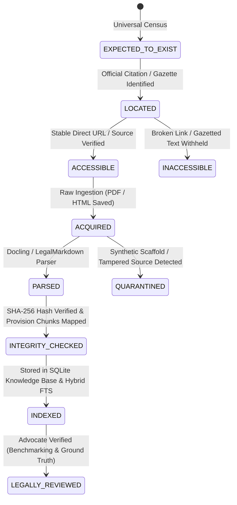

# PHASE 18 — NATIONAL INDIAN LEGAL UNIVERSE MAP & TAXONOMY

**Workspace:** `C:\PROJECTS\LegalMitra`  
**Classification:** Proprietary & Confidential — Team Shatrujeet  
**Date:** October 2026  
**Status:** Canonical Reference

---

## 1. Executive Summary

LegalMitra Phase 18 expands the legal research platform from a collection of ingested statutory and judicial documents into an ontological and systematically mapped **National Legal Universe**. The Indian legal ecosystem is multi-layered, polycentric, and temporally complex, comprising:
- **Constitutional Supremacy**: The Constitution of India (1950) with 106 Constitutional Amendment Acts, schedules, appendical orders, and doctrine of basic structure.
- **Primary Central Legislation**: Over 850 live Central Acts enacted by Parliament, alongside repealed historical statutes that govern pre-repeal causes of action.
- **Delegated Legislation**: Statutory rules, general statutory rules (GSR), statutory orders (SO), notifications, guidelines, and circulars issued by Ministries and statutory authorities (RBI, SEBI, CCI, IBBI).
- **Sub-National (State & Union Territory) Legislation**: 28 States and 8 Union Territories with distinct legislative assemblies and powers under Seventh Schedule List II (State List) and List III (Concurrent List).
- **Judicial Hierarchy**: The Supreme Court of India (Article 141 law of the land), 25 High Courts with supervisory and appellate jurisdiction (Article 226/227), Specialized National Tribunals (NCLAT, NCLT, NGT, ITAT, SAT, APTEL), and District & Subordinate Courts.
- **Quasi-Judicial & Regulatory Decisions**: Regulatory adjudications and administrative tribunals.

---

## 2. Document Families & Hierarchical Authority

The LegalMitra National Legal Universe classifies all legal instruments into six canonical document families (`DocumentFamily`) and eight distinct authority levels (`LegalAuthorityLevel`):

### 2.1 Document Families
| Family Code | Description | Typical Sources | Binding Nature |
| :--- | :--- | :--- | :--- |
| `CONSTITUTION` | Foundational charter of India | Legislative Department, Constitution of India (as amended) | Supreme Law (grundnorm) |
| `CENTRAL_ACT` | Acts passed by the Parliament of India | India Code, Gazette of India (Extraordinary Part II Sec 1) | Pan-India statutory validity (subject to territory/subject matter) |
| `STATE_ACT` | Acts passed by State/UT Legislatures | State Gazettes, State Law Portals, India Code State portals | Territorial validity within enacting State/UT |
| `DELEGATED_LEGISLATION` | Rules, Regulations, Orders under parent Acts | Gazette of India Part II Sec 3, State Gazettes, eGazette | Subordinate binding force; ultra vires parent Act if contradictory |
| `JUDICIAL_PRECEDENT` | Judgments & Final Orders of Courts of Record | SCI (SCR / e-SCR), High Courts, Indian Kanoon, eCourts | Article 141 (SC binding on all courts); Article 227 (HC binding on subordinates) |
| `PROCEDURAL_REGULATORY` | Cause lists, interim orders, regulatory circulars | eCourts, High Court portals, Ministry circulars | Procedural compliance and advisory administrative force |

### 2.2 Hierarchy of Legal Authority Levels
1. **Level 1 (`L1_CONSTITUTIONAL`)**: The Constitution of India. Overrides any conflicting statute or rule.
2. **Level 2 (`L2_CENTRAL_PRIMARY`)**: Central Acts of Parliament (e.g., Bharatiya Nyaya Sanhita, Bharatiya Nagarik Suraksha Sanhita, Companies Act 2013).
3. **Level 3 (`L3_STATE_PRIMARY`)**: State Acts enacted by State Legislatures on List II and List III subjects (e.g., Delhi Rent Control Act, Maharashtra Land Revenue Code).
4. **Level 4 (`L4_DELEGATED_CENTRAL`)**: Rules and Regulations framed under Central Acts (e.g., IT Intermediary Guidelines Rules 2021).
5. **Level 5 (`L5_DELEGATED_STATE`)**: Rules and notifications framed under State statutes.
6. **Level 6 (`L6_JUDICIAL_APEX`)**: Supreme Court of India rulings. Precedents under Article 141 constitute binding law on all Indian courts and tribunals.
7. **Level 7 (`L7_JUDICIAL_HIGH_COURT`)**: High Court decisions. Binding within the respective State/UT territory; persuasive across other High Courts.
8. **Level 8 (`L8_TRIBUNAL_SUBORDINATE`)**: Orders of Tribunals (NCLAT, NGT, ITAT) and District Courts.

---

## 3. Ingestion Lifecycle State Machine

To guarantee auditability and eliminate confusion between *catalogued* instruments and *fully verified text*, every legal unit transitions through an explicit 10-stage lifecycle:

1. **`EXPECTED_TO_EXIST`**: Known to exist by statutory mandate (e.g., rules required by an Act section), but not yet catalogued with a precise gazette notice.
2. **`LOCATED`**: Official gazette notification or parliamentary bill number identified.
3. **`ACCESSIBLE`**: Available through an authoritative public endpoint (`egazette.gov.in`, `indiacode.nic.in`, `main.sci.gov.in`, `delhihighcourt.nic.in`).
4. **`ACQUIRED`**: Raw document fetched and archived in `data/` with source provenance metadata.
5. **`PARSED`**: Converted into structured text preserving provisions, schedules, tables, and enactments.
6. **`INTEGRITY_CHECKED`**: Cryptographic hash verified; cross-referenced for section continuity and omission detection.
7. **`INDEXED`**: Chunked, embedded, and indexed into `data/legalmitra_kb.db` with temporal validity tags.
8. **`LEGALLY_REVIEWED`**: Verified by licensed Indian advocates for substantive accuracy and question-answer reliability.
9. **`INACCESSIBLE`**: Document known but unreachable (e.g., unpublished executive order, damaged gazette folio).
10. **`QUARANTINED`**: Synthetic scaffolds or mock test artifacts segregated from production retrieval (e.g., `IND-JUD-DEL-2024-BAIL`).

---

## 4. Current National Legal Universe Registry

The canonical inventory resides in `data/09_national_corpus/legal_universe_inventory.json` (machine-readable metadata) and `data/09_national_corpus/legal_universe_inventory.csv` (tabular registry).

### 4.1 Summary of Catalogued Items (Phase 18 Baseline)
- **Total Universe Entries Catalogued**: 50 primary instruments across all major branches.
- **Indexed Sources in Active KB**: 35 sources (1,363 active chunks).
- **Planned / Expected Central Acts**: Modern Criminal Laws (BNS 2023, BNSS 2023, BSA 2023), Commercial Laws (Companies Act 2013, Arbitration & Conciliation Act 1996, IBC 2016), Information Technology & Privacy (IT Act 2000, DPDP Act 2023).
- **Repealed Historical Acts (Preserved for Pre-2024 Causes of Action)**: IPC 1860, CrPC 1973, Indian Evidence Act 1872.
- **Sub-National Coverage**: Delhi (Delhi Rent Control Act 1958, Delhi Shops & Establishments Act 1954), Maharashtra (Maharashtra Rent Control Act 1999, Maharashtra Land Revenue Code 1966).
- **Landmark Precedents**: *Kesavananda Bharati* (Basic Structure), *Maneka Gandhi* (Article 21 Procedure Established by Law), *K.S. Puttaswamy* (Right to Privacy), *D.K. Basu* (Arrest Guidelines), *Lalita Kumari* (Mandatory FIR), *Arnesh Kumar* (Bail Guidelines).

---

## 5. Provenance & Verification Guidelines

Every entry in the legal universe must link to an immutable source record containing:
1. `source_id`: Standardized naming convention (e.g., `IND-ACT-CENTRAL-YYYY-NNN`).
2. `official_citation`: Volume, publication, or Act number (e.g., Act No. 45 of 1860; AIR 1973 SC 1461).
3. `enactment_date` & `commencement_date`: Exact gazette notifications.
4. `source_url`: Verifiable government or official court repository URL.
5. `sha256_hash`: Document hash for cryptographic integrity.
6. `bitemporal_validity`: Valid start/end time and system ingestion timestamp.

This taxonomy guarantees that LegalMitra answers are grounded strictly in authentic, verifiable Indian legal sources with full temporal and jurisdictional awareness.

