# PHASE 18 — LITIGATION & PRACTICE KNOWLEDGE MAP

**Workspace:** `C:\PROJECTS\LegalMitra`  
**Classification:** Proprietary & Confidential — Team Shatrujeet  
**Date:** October 2026  
**Status:** Canonical Reference

---

## 1. Executive Summary

Legal practice in India demands practical navigation across civil, criminal, and constitutional court procedures. Ordinary citizens and junior advocates encounter severe hurdles understanding filing prerequisites, court fee calculations, limitation periods, affidavit formalities, and the progression of hearings.

This document establishes the **LegalMitra Litigation & Practice Knowledge Map**, standardizing procedural workflows across Indian courts and tribunals.

---

## 2. Practical Litigation Workflows

```mermaid
flowchart TD
    subgraph CriminalFlow["Criminal Procedure (BNSS / CrPC)"]
        C1["Incident / Cognizable Offence"] --> C2["Zero FIR / e-FIR / Regular FIR (s. 173 BNSS)"]
        C2 --> C3["Investigation & Notice (s. 35 BNSS / 41A CrPC)"]
        C3 --> C4["Bail Application (s. 480/482/483 BNSS)"]
        C4 --> C5["Police Report / Chargesheet (s. 193 BNSS)"]
        C5 --> C6["Cognizance & Framing of Charges (s. 251/263 BNSS)"]
        C6 --> C7["Trial (Prosecution & Defence Evidence)"]
        C7 --> C8["Statement of Accused (s. 351 BNSS / 313 CrPC)"]
        C8 --> C9["Judgment & Sentence"]
    end

    subgraph CivilFlow["Civil Procedure (CPC 1908)"]
        CV1["Cause of Action & Legal Notice"] --> CV2["Plaint Drafted & Court Fees Paid"]
        CV2 --> CV3["Filing & Scrutiny of Defects"]
        CV3 --> CV4["Summons Issued to Defendant (Order V)"]
        CV4 --> CV5["Written Statement (Order VIII - 30/120 days)"]
        CV5 --> CV6["Admission & Denial / Framing of Issues (Order XIV)"]
        CV6 --> CV7["Evidence by Way of Affidavit (Order XVIII)"]
        CV7 --> CV8["Cross Examination of Witnesses"]
        CV8 --> CV9["Final Arguments & Decree (Order XX)"]
    end
```

---

## 3. Statutory Timelines & Limitation Safeguards

Procedural accuracy requires strict adherence to statutory deadlines governed by the **Limitation Act, 1963** and procedural codes:

| Action / Filing | Governing Provision | Prescribed Limitation Period | Condonation of Delay |
| :--- | :--- | :--- | :--- |
| **Written Statement in Commercial Suit** | Order VIII Rule 1 CPC (amended by Commercial Courts Act) | 30 days mandatory; forfeits right after 120 days total | Strict; no extension beyond 120 days |
| **Appeal to High Court (Civil)** | Limitation Act Article 116 | 90 days from decree | Section 5 condonation on sufficient cause |
| **Appeal against Sentence of Death** | Limitation Act Article 115(a) | 30 days | Section 5 available |
| **Anticipatory Bail Application** | Section 482 BNSS / 438 CrPC | Any time upon reasonable apprehension before arrest | Not governed by Limitation Act |
| **Cheque Dishonour Notice** | Section 138 Negotiable Instruments Act | 30 days from receipt of memo of dishonour | Strict condition precedent |
| **Cheque Dishonour Complaint** | Section 142 Negotiable Instruments Act | 30 days after expiry of 15-day notice payment window | Proviso allows delay condonation |
| **Consumer Complaint (District Commission)** | Section 69 Consumer Protection Act, 2019 | 2 years from date on which cause of action arose | Condonable on sufficient grounds |

---

## 4. Practical Litigant Guidance & Boundary Safeguards

1. **Procedural Assistance vs. Legal Representation**:
   - LegalMitra explains procedural stages, requisite forms, and necessary attachments (vakalatnama, court fee stamp, welfare stamp, affidavit of service).
   - LegalMitra explicitly reminds litigants that drafting pleadings for filing before High Courts or the Supreme Court requires an authorized Advocate on Record (AOR) or enrolled practitioner.
2. **e-Filing Compliance**:
   - Outlines digital requirements across Delhi High Court e-Filing 3.0, Supreme Court e-Filing portal, and eCourts services (digital signature token, searchable PDF/A format, bookmarking).

