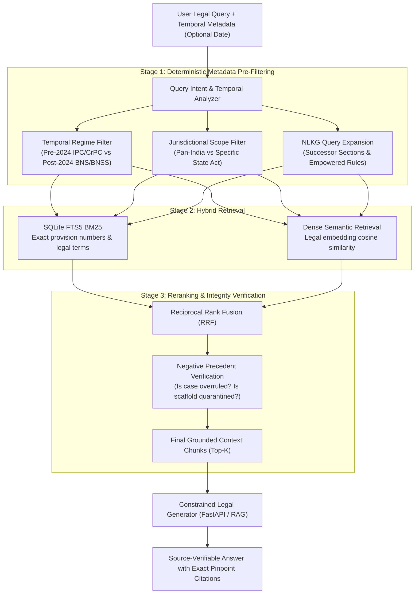

# PHASE 18 — RETRIEVAL & CITATION ARCHITECTURE SPECIFICATION

**Workspace:** `C:\PROJECTS\LegalMitra`  
**Classification:** Proprietary & Confidential — Team Shatrujeet  
**Date:** October 2026  
**Status:** Canonical Reference

---

## 1. Executive Summary

Legal research demands a retrieval architecture far more rigorous than generic web RAG systems. A legal researcher cannot tolerate hallucinations, citation drift, repealed statutes quoted as active law, or subordinate court decisions presented as overruling apex precedents.

Phase 18 establishes the **LegalMitra Multi-Stage Retrieval & Authoritative Citation Architecture**, combining:
1. **Hybrid Retrieval**: Full-Text Search (SQLite FTS5 BM25) + Dense Vector Embeddings.
2. **Deterministic Pre- & Post-Filtering**: Temporal boundaries, jurisdictional boundaries, and precedent validity checks.
3. **Graph-Augmented Query Expansion**: Automatic successor code bridging (`IPC <-> BNS`, `CrPC <-> BNSS`, `IEA <-> BSA`).
4. **Authoritative Bluebook / Indian Neutral Citation Standards**: Exact section, Act, year, court, and paragraph pin-pointing.

---

## 2. Multi-Stage Retrieval Pipeline



---

## 3. Strict Precedent & Quarantine Filtering Rules

1. **Quarantine Exclusion**:
   - Chunks or sources tagged `is_synthetic_scaffold = 1` (e.g., `IND-JUD-DEL-2024-BAIL`) are hard-filtered out of all production candidate pools:
     ```sql
     AND is_synthetic_scaffold = 0
     ```
2. **Overruled Precedent Suppression**:
   - If a judicial chunk originates from a decision marked `OVERRULED` by a subsequent larger bench, it is excluded from positive assertion or accompanied by a mandatory caveat alert.
3. **Bench Strength Weighting**:
   - In coordinate conflict scenarios, rulings by larger benches (e.g., 5-judge Constitution bench) are ranked strictly higher than smaller benches (2-judge division bench).

---

## 4. Citation Standards for Legal Answers

All citations produced by LegalMitra must adhere to the Indian Legal Citation Standard:

### 4.1 Statutory Citation Format
- **Format**: `[Act Title], [Year], [Section Number], [Sub-section / Proviso]`
- **Examples**:
  - `Bharatiya Nyaya Sanhita, 2023, Section 103(1)`
  - `Code of Criminal Procedure, 1973, Section 438 [Repealed w.e.f. 1 July 2024; see BNSS Section 482]`
  - `Information Technology (Intermediary Guidelines and Digital Media Ethics Code) Rules, 2021, Rule 3(1)(b)`

### 4.2 Judicial Precedent Citation Format
- **Format**: `[Petitioner] v. [Respondent], ([Year]) [Volume] [Reporter] [Page], at [Paragraph Number]`
- **Examples**:
  - *Kesavananda Bharati v. State of Kerala*, (1973) 4 SCC 225
  - *Lalita Kumari v. Govt. of U.P.*, (2014) 2 SCC 1, at ¶ 120
  - *Satender Kumar Antil v. CBI*, (2022) 10 SCC 51, at ¶ 73

---

## 5. Verification & Grounding Guarantee

Every fact, statutory penalty, or legal test returned in an answer must have direct line-level provenance in the retrieved chunks. If the retrieved context is insufficient to answer the query, LegalMitra is programmed to output:
> *"The available indexed legal sources do not contain sufficient verified provisions to answer this query with legal certainty. Please consult a licensed advocate."*
No speculative legal text is ever generated.

