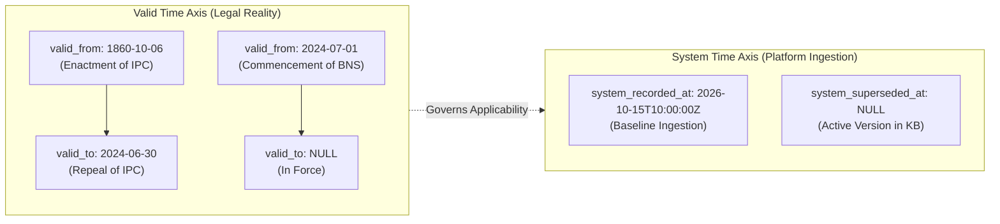

# PHASE 18 — BITEMPORAL LAW MODEL & CRIMINAL CODE TRANSITIONS

**Workspace:** `C:\PROJECTS\LegalMitra`  
**Classification:** Proprietary & Confidential — Team Shatrujeet  
**Date:** October 2026  
**Status:** Canonical Reference

---

## 1. Executive Summary

Legal reasoning is inherently temporal. An act committed on 15 June 2024 cannot be prosecuted under the Bharatiya Nyaya Sanhita, 2023, because Article 20(1) of the Indian Constitution strictly prohibits ex-post facto criminal penalties. Conversely, a trial initiated in August 2024 for an offence committed in 2022 raises nuanced procedural questions under Section 531 of the Bharatiya Nagarik Suraksha Sanhita, 2023 (BNSS).

To eliminate legal hallucinations and temporal anachronisms, LegalMitra Phase 18 implements a **formal Bitemporal Data Model** combined with an **Auditable Criminal Code Transition Registry**.

---

## 2. Bitemporal Architecture: Valid Time vs. System Time

LegalMitra distinguishes two independent temporal axes for every legal chunk and relationship:



### 2.1 Valid Time (`valid_from`, `valid_to`)
- **`valid_from`**: The exact calendar date on which the statutory provision or judicial precedent came into force in the real world (via gazette commencement notification or date of judgment delivery).
- **`valid_to`**: The exact calendar date on which the provision ceased to be operative (repeal date, sunset clause expiry, or substitution date). Set to `NULL` if currently in force.

### 2.2 System Time (`system_recorded_at`, `system_superseded_at`)
- **`system_recorded_at`**: The UTC timestamp when LegalMitra ingested and verified the text.
- **`system_superseded_at`**: The timestamp when a record was corrected, updated, or re-parsed due to an erratum or superior gazette edition. Ensures full audit rollback.

---

## 3. Criminal Law Transition Regime (1 July 2024 Cutoff)

On **1 July 2024**, India's new criminal codes came into force:
- **Bharatiya Nyaya Sanhita, 2023 (BNS)** replaced the Indian Penal Code, 1860 (IPC).
- **Bharatiya Nagarik Suraksha Sanhita, 2023 (BNSS)** replaced the Code of Criminal Procedure, 1973 (CrPC).
- **Bharatiya Sakshya Adhiniyam, 2023 (BSA)** replaced the Indian Evidence Act, 1872 (IEA).

### 3.1 Transition Logic & Article 20(1) Safeguards
Under Article 20(1) of the Constitution:
> *"No person shall be convicted of any offence except for violation of a law in force at the time of the commission of the act charged as an offence, nor be subjected to a penalty greater than that which might have been inflicted under the law in force at the time of the commission of the offence."*

Therefore:
1. **Offence Date Prior to 1 July 2024**:
   - Substantive liability, elements of offence, and punishments are governed **strictly by IPC 1860**.
   - BNS 2023 cannot be applied retrospectively.
2. **Offence Date On or After 1 July 2024**:
   - Substantive offences are charged under **BNS 2023**.
3. **Pending Investigations, Trials, and Inquiries**:
   - **Section 531(2)(a) BNSS** provides an express savings clause:
     > *"If, immediately before the date on which this Sanhita comes into force, there is any appeal, application, trial, inquiry or investigation pending, then, such appeal, application, trial, inquiry or investigation shall be disposed of, continued, held or conducted, in accordance with the provisions of the Code of Criminal Procedure, 1973, as in force immediately before such commencement, as if this Sanhita had not come into force."*
   - Consequently, FIRs registered prior to 1 July 2024 continue under CrPC procedural rules.

---

## 4. Provision-Level Transition Registry

The following table reflects core mappings implemented in `legalmitra/corpus/temporal_versioning.py`:

| Historic Code & Section | Subject / Offence | New Code & Section | Equivalence Type | Key Differences / Notes |
| :--- | :--- | :--- | :--- | :--- |
| **IPC Section 302** | Murder | **BNS Section 103** | `EQUIVALENT` | Section 103(1) re-enacts Section 302; Section 103(2) adds mob lynching provisions. |
| **IPC Section 304A** | Death by negligence | **BNS Section 106** | `SUCCESSOR_PROVISION` | Section 106(1) provides up to 5 yrs; Section 106(2) hit-and-run provisions held in abeyance. |
| **IPC Section 420** | Cheating | **BNS Section 318(4)** | `SUCCESSOR_PROVISION` | Cheating consolidated under Section 318; sub-clause (4) corresponds to 420. |
| **IPC Section 378** | Theft | **BNS Section 303** | `SUCCESSOR_PROVISION` | Proviso allows community service for first-time petty theft under ₹5,000. |
| **IPC Section 498A** | Cruelty by husband/relatives | **BNS Section 85** | `EQUIVALENT` | Substantive elements identical; renumbered into Chapter V. |
| **CrPC Section 154** | FIR | **BNSS Section 173** | `SUCCESSOR_PROVISION` | Expressly introduces Zero FIR and e-FIR with 3-day signature window; preliminary inquiry. |
| **CrPC Section 437** | Regular Bail (Magistrate) | **BNSS Section 480** | `EQUIVALENT` | Substantive conditions for bail before Magistrate preserved. |
| **CrPC Section 438** | Anticipatory Bail | **BNSS Section 482** | `EQUIVALENT` | High Court / Sessions Court pre-arrest bail powers preserved. |
| **CrPC Section 439** | Special Bail Powers (Sessions/HC) | **BNSS Section 483** | `EQUIVALENT` | Direct equivalent. |
| **CrPC Section 436A** | Undertrial Detention Maximum | **BNSS Section 479** | `SUCCESSOR_PROVISION` | First-time offenders eligible for bail after 1/3rd detention period. |
| **IEA Section 65B** | Electronic Evidence Admissibility | **BSA Section 63** | `SUCCESSOR_PROVISION` | Electronic records elevated to primary status; expanded certificate guidelines. |

---

## 5. Temporal Query Resolution Algorithm

When a user submits a legal query:
1. **Extract Incident Date**: If the user mentions an offence or transaction date (e.g., "The incident happened on 15 March 2024"), parse the date.
2. **Determine Temporal Regime**:
   - `incident_date < 2024-07-01` -> Query IPC / CrPC / IEA knowledge chunks.
   - `incident_date >= 2024-07-01` -> Query BNS / BNSS / BSA knowledge chunks.
   - If unspecified -> Retrieve current law (BNS/BNSS) while providing explicit transitional notes cross-referencing IPC/CrPC counterparts.
3. **Filter KB Chunks**: Apply SQL temporal constraint:
   ```sql
   WHERE (valid_from <= :incident_date OR valid_from IS NULL)
     AND (valid_to >= :incident_date OR valid_to IS NULL)
   ```
4. **Enrich Answer with Transition Context**: If an old section is queried (e.g., "What is Section 420?"), provide the historic definition, indicate its repeal as of 1 July 2024, and cross-reference Section 318(4) of BNS 2023.

