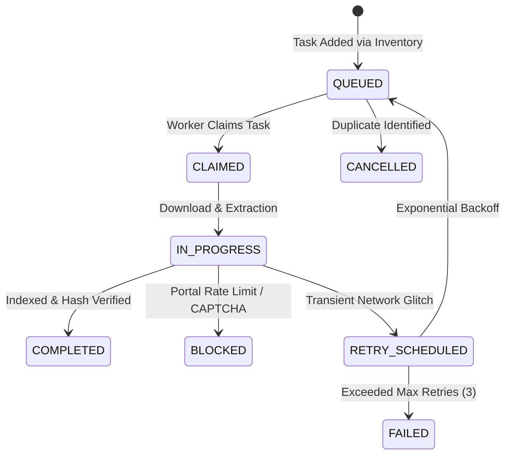

# PHASE 19 — ACQUISITION PRIORITIZATION & QUEUE OPERATIONS SPECIFICATION

**Workspace:** `C:\PROJECTS\LegalMitra`  
**Classification:** Proprietary & Confidential — Team Shatrujeet  
**Date:** October 2026  
**Status:** Canonical Reference

---

## 1. Executive Summary

Indiscriminate bulk scraping of legal portals frequently results in low-value gazette noise, unformatted judicial orders, or duplicated historical enactments. LegalMitra enforces an **explainable, deterministic acquisition priority algorithm** implemented in `legalmitra/corpus/acquisition_queue.py`.

The acquisition queue guarantees that highest-impact statutory gaps (such as missing criminal law sections or landmark constitutional precedents) are acquired and indexed before specialized administrative notices.

---

## 2. Priority Scoring Formula & Rationale

Every legal instrument in the national inventory receives a composite priority score $S \in [0, 100]$:

$$\text{Priority Score} = \min\left(100, (\text{Authority Weight} \times \text{Domain Multiplier}) + \text{Coverage Gap Bonus}\right)$$

### 2.1 Authority Weight ($W_{\text{auth}}$)
- `SUPREME_CONSTITUTIONAL`: 40.0
- `BINDING_CENTRAL_STATUTE`: 35.0
- `BINDING_SUPREME_COURT_ART141`: 35.0
- `BINDING_STATE_STATUTE`: 25.0
- `TERRITORIALLY_BINDING_HIGH_COURT`: 25.0
- `BINDING_DELEGATED_LEGISLATION`: 20.0
- `STATUTORY_EXECUTIVE_ORDER`: 20.0
- `PERSUASIVE_PRECEDENT`: 15.0
- `UNVERIFIED_SCAFFOLD`: **0.0 (Strict Quarantine: Never Prioritized)**

### 2.2 Domain Multipliers ($M_{\text{domain}}$)
- `Constitutional Law`, `Criminal Law`, `Criminal Procedure`: $1.25\times$
- `Commercial Law`, `Technology Law`, `Data Protection`: $1.15\times$
- `Housing & Tenancy`: $1.05\times$
- `General Civil Law`: $1.00\times$

### 2.3 Coverage Gap Bonus ($B_{\text{gap}}$)
- Item currently unindexed (`chunks_indexed == 0`): $+20.0$ bonus.
- Item partially indexed (seeking remaining provisions): $+5.0$ bonus.

---

## 3. Queue Lifecycle Operations

---

## 4. Balanced Expansion Portfolio

The queue ensures a balanced distribution across all acquisition runs:
1. **Tier 1 (Pan-India Core)**: Central penal and civil reform statutes (NI Act, TPA, Commercial Courts Act, BNS/BSA completion).
2. **Tier 2 (Constitutional Ratio)**: Key Constitution Bench holdings (*Kesavananda*, *Maneka Gandhi*, *Lalita Kumari*).
3. **Tier 3 (State Portals)**: Regional coverage expansion beyond Delhi and Maharashtra.
4. **Tier 4 (Court Rules)**: Original side and procedural rules governing court deadlines.

