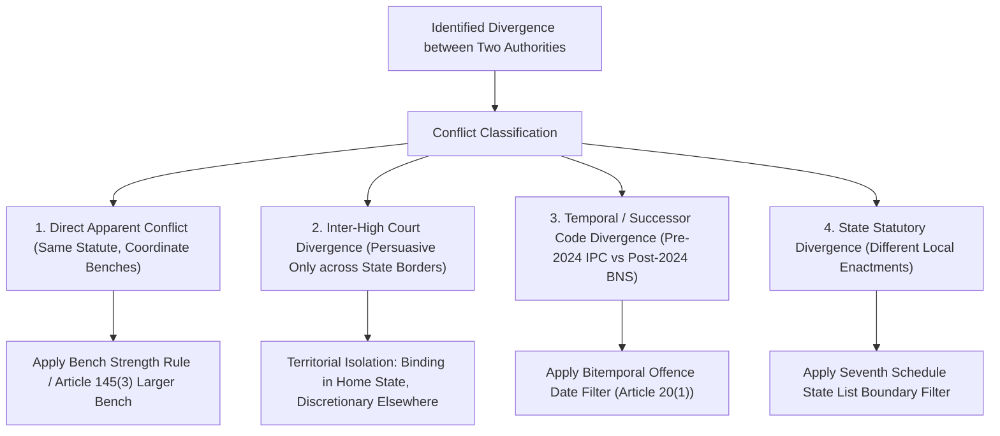

# PHASE 19 — CONFLICTING AUTHORITY & JURISDICTIONAL RESOLUTION

**Workspace:** `C:\PROJECTS\LegalMitra`  
**Classification:** Proprietary & Confidential — Team Shatrujeet  
**Date:** October 2026  
**Status:** Canonical Reference

---

## 1. Executive Summary

A common hazard in Indian legal informatics is presenting High Court decisions from distinct jurisdictions as directly conflicting without examining whether:
- The High Courts were interpreting different State-amended statutes (e.g. Maharashtra Rent Control Act vs Delhi Rent Control Act).
- The decisions were rendered on distinct factual matrices (distinguishable on facts).
- A larger Supreme Court bench has already resolved the divergence.

Phase 19 establishes the **LegalMitra Conflicting Authority Resolution Architecture**.

---

## 2. Taxonomy of Legal Conflicts

---

## 3. Doctrinal Rules for Conflict Resolution

### 3.1 The Bench Strength & Coordinate Bench Doctrine
Under *Union of India v. Raghubir Singh* (1989) 2 SCC 754:
1. Larger bench binds smaller bench: A 3-judge bench decision prevails over a conflicting 2-judge bench decision.
2. Coordinate bench equality: A 2-judge bench cannot overrule another 2-judge bench. If in doubt, the second bench must refer the question to the Chief Justice for Constitution of a 3-judge bench.
3. Chronological priority for coordinate benches: Until resolved by a larger bench, subordinate courts should follow the earlier binding coordinate ruling unless the later bench considers and distinguishes the earlier decision.

### 3.2 Inter-High Court Persuasive Force
Under Article 227 of the Constitution:
- A decision of the High Court of Delhi is binding on all District Courts, Tribunals, and Magistrates in the National Capital Territory of Delhi.
- It is of persuasive value only before the High Court of Judicature at Bombay or Karnataka High Court.
- LegalMitra flags inter-High Court differences as **persuasive regional divergences** rather than binding conflicts.

---

## 4. Transparent Uncertainty Safeguards

If a genuine legal conflict exists between coordinate benches of the Supreme Court that has not been resolved by a Constitution Bench:
- LegalMitra abstains from declaring one authority "correct".
- It retrieves both authorities, explains the ratio of each, identifies the pending reference order, and warns the user:
  > *"Notice: A split of authority exists between coordinate benches on this question. Counsel must consult the latest cause list and reference proceedings before the Chief Justice of India."*

