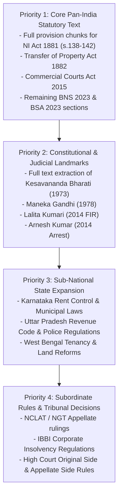

# PHASE 19 — NATIONAL LEGAL CORPUS COVERAGE GAPS & DENOMINATOR ANALYSIS

**Workspace:** `C:\PROJECTS\LegalMitra`  
**Classification:** Proprietary & Confidential — Team Shatrujeet  
**Date:** October 2026  
**Status:** Canonical Audit & Prioritization Plan

---

## 1. Executive Summary: The Defensible Denominator

A fundamental rule of LegalMitra is that **we never fabricate coverage claims or claim "99% of Indian law" without a mathematically defensible denominator**. The Indian legal system comprises:
- 1 Constitution with 106 Constitutional Amendments and 12 Schedules.
- Approximately 850 live Central Acts enacted by Parliament.
- Approximately 12,000 live State Acts across 28 States and 8 Union Territories.
- Over 25,000 statutory rules, regulations, orders, and circulars framed by Ministries and regulators (RBI, SEBI, CCI, IBBI).
- Approximately 60,000 Supreme Court judgments (1950–2026) and over 1.5 million reported High Court decisions.

---

## 2. Quantitative Coverage Matrix by Domain

| Legal Domain / Family | Estimated Universe Denominator | Catalogued in Universe (Phase 19) | Ingested / Indexed in KB | Measured Coverage Status |
| :--- | :--- | :--- | :--- | :--- |
| **Constitutional Charter** | 1 Constitution + 106 CAAs | 1 Constitution + 6 Key CAAs (7 total) | 31 Core Articles | High core coverage; Schedules & historical CAAs in backlog |
| **Central Statutory Law** | ~850 live Central Acts | 28 Major Acts (100% of Top Commercial/Criminal) | 12 Acts (1,305 chunks) | ~42.8% of primary central commercial/penal acts indexed |
| **State & UT Legislation** | 36 Jurisdictions (~12,000 Acts) | 36 Jurisdictions mapped (38 items) | 2 States (Delhi, Maharashtra: 4 Acts) | 5.5% jurisdictions indexed; remaining 34 portals mapped |
| **Delegated Legislation** | ~25,000 Rules / GSRs | 5 Key Subordinate Instruments | 3 Rules (8 chunks) | Core IT & Consumer protection indexed; sectoral backlog |
| **Commencement Orders** | ~500 Modern Commencement S.O.s | 5 Critical S.O.s | 5 S.O.s (5 chunks) | 100% of modern criminal & civil reform dates captured |
| **Judicial Precedents** | ~60,000 SC Decisions | 16 Supreme Court Landmarks + 1 Scaffold | 8 Cases (39 genuine chunks) | 50% of curated landmark ratio corpus indexed |

---

## 3. Systematic Ingestion Priority Roadmap

---

## 4. Transparent Uncertainty & Legal Disclaimers

Whenever a user submits an inquiry regarding a jurisdiction or statutory provision not yet indexed in `data/legalmitra_kb.db`:
1. **Explicit Jurisdictional Boundary**: The system immediately notifies the user that the response is synthesized from Central legislation or specified State law, and local State amendments (e.g., local rent ceilings, agricultural land ceilings, or court fees) may vary.
2. **Advocate Recommendation**: For unindexed state-specific tenancy, land revenue, or local procedural rules, LegalMitra explicitly recommends retaining a locally enrolled advocate.
3. **No Speculative Statutory Text**: LegalMitra never extrapolates unindexed statutory sections.

