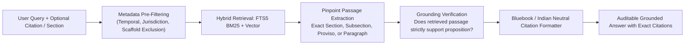

# PHASE 19 — PINPOINT CITATION & SOURCE-LINKED EVIDENCE RETRIEVAL

**Workspace:** `C:\PROJECTS\LegalMitra`  
**Classification:** Proprietary & Confidential — Team Shatrujeet  
**Date:** October 2026  
**Status:** Canonical Reference

---

## 1. Executive Summary

Legal research platforms fail when citations are vague, hallucinated, or detached from operative text. In court or advocate conferences, stating *"The Supreme Court held that electronic evidence requires a certificate"* is useless without providing:
- The exact case name and official reporter citation (*Arjun Panditrao Khotkar v. Kailash Kushanrao Gorantyal*, (2020) 7 SCC 1).
- The exact paragraph numbers where the ratio is articulated (Paragraphs 32, 51, and 72).
- The statutory provision interpreted (Section 65B(4) IEA / Section 63(4) BSA).
- The specific bench coram (R.F. Nariman, S. Ravindra Bhat, V. Ramasubramanian, JJ.).

Phase 19 formalizes LegalMitra's **Pinpoint Citation & Evidence Retrieval Standards**.

---

## 2. Evidence-Linked Search Pipeline

---

## 3. Strict Citation Formatting Rules

### 3.1 Statutes & Delegated Rules
- **Structure**: `[Full Act Title], [Year], [Section Number], [Subsection/Proviso/Explanation]`
- **Examples**:
  - `The Bharatiya Nagarik Suraksha Sanhita, 2023, Section 173(1)`
  - `The Information Technology Act, 2000, Section 79(2)(c)`
  - `Information Technology (Intermediary Guidelines and Digital Media Ethics Code) Rules, 2021, Rule 3(1)(b)`

### 3.2 Judicial Decisions
- **Structure**: `[Case Title], ([Year]) [Volume] [Reporter] [Page], at ¶ [Paragraph Number] ([Court Name])`
- **Examples**:
  - *Arjun Panditrao Khotkar v. Kailash Kushanrao Gorantyal*, (2020) 7 SCC 1, at ¶ 72 (Supreme Court of India)
  - *Satender Kumar Antil v. Central Bureau of Investigation*, (2022) 10 SCC 51, at ¶ 73 (Supreme Court of India)
  - *Justice K.S. Puttaswamy (Retd.) v. Union of India*, (2017) 10 SCC 1, at ¶ 247 (Supreme Court of India, 9-Judge Bench)

---

## 4. Unsupported-Answer Abstention Protocol

If the retrieved chunks in `data/legalmitra_kb.db` do not contain the verbatim statutory provision or authoritative court ruling:
1. LegalMitra will **never synthesize or extrapolate speculative legal rules**.
2. It outputs:
   > *"The available indexed legal sources do not contain sufficient verified provisions to answer this query with legal certainty. Please consult a licensed advocate."*
3. The query is logged to `data/conversations.db` for review and addition to the corpus backlog.

