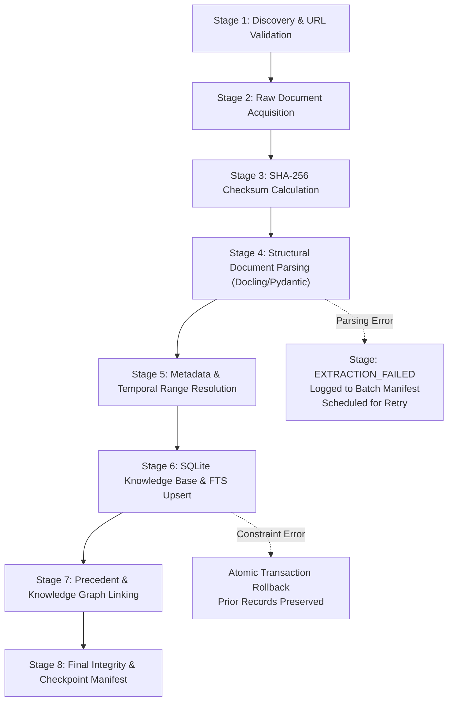

# PHASE 19 — RESUMABLE NATIONAL CORPUS INGESTION PIPELINE SPECIFICATION

**Workspace:** `C:\PROJECTS\LegalMitra`  
**Classification:** Proprietary & Confidential — Team Shatrujeet  
**Date:** October 2026  
**Status:** Canonical Reference

---

## 1. Executive Summary

Ingestion at national scale requires strict operational safety controls. Network timeouts, unreadable OCR scans, or database lock errors must never corrupt previously verified records or duplicate chunks in search indexes.

LegalMitra's **National Corpus Pipeline (`legalmitra/ingestion/national_corpus_pipeline.py`)** provides:
1. Multi-stage checkpointing (`PipelineStage` state machine).
2. Resumability from the exact last verified checkpoint.
3. Cryptographic SHA-256 calculation for every source file.
4. Idempotent upserts into the SQLite knowledge base.
5. Dry-run mode (`--dry-run`) reporting planned actions without modifying production databases.
6. JSON batch manifests preserving execution history in `data/09_national_corpus/batches/`.

---

## 2. Ingestion Pipeline Stages



---

## 3. Manifest & Audit Trail

Every batch run generates a formal manifest file:
- Location: `data/09_national_corpus/batches/manifest_{batch_id}.json`
- Manifest Fields:
  - `batch_id`: Unique execution identifier.
  - `started_at` & `completed_at`: UTC ISO 8601 timestamps.
  - `dry_run`: Boolean indicator.
  - `documents_submitted`, `documents_indexed`, `chunks_created`: Quantitative metrics.
  - `quarantined_count`: Number of quarantined test fixtures segregated.
  - `checkpoints`: Granular stage transitions per document.
  - `document_hashes`: SHA-256 mapping for every processed document.

---

## 4. CLI Execution Commands

Operators execute batches using `scripts/run_national_corpus_batch.py`:
- Dry-run mode:
  ```powershell
  python scripts/run_national_corpus_batch.py --dry-run
  ```
- Full production ingestion:
  ```powershell
  python scripts/run_national_corpus_batch.py --batch-id BATCH-2026-EXPANSION-01 --category all
  ```

