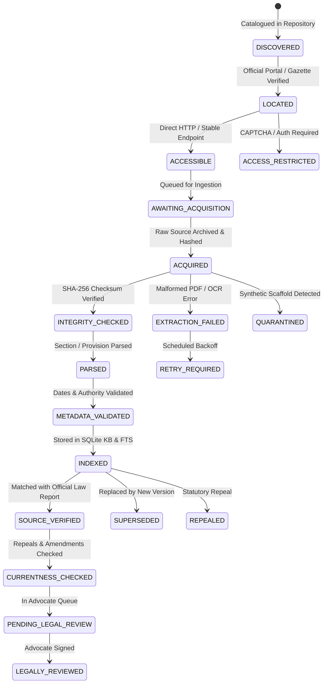

# PHASE 19 — NATIONAL LEGAL UNIVERSE EXPANSION & MULTI-JURISDICTIONAL INVENTORY

**Workspace:** `C:\PROJECTS\LegalMitra`  
**Classification:** Proprietary & Confidential — Team Shatrujeet  
**Date:** October 2026  
**Status:** Canonical Reference

---

## 1. Executive Summary

Phase 19 expands the machine-readable Indian Legal Universe from its initial 50-instrument baseline to **101 catalogued legal instruments** spanning:
- The Constitution of India and 6 major Constitutional Amendment Acts.
- 28 Central Acts covering criminal law, civil procedure, commercial litigation, consumer protection, environmental regulation, banking, transfer of property, labour, and family law.
- All **28 States and 8 Union Territories** individually mapped with official legislative and gazette portals under `STATE_UT_REGISTRY`.
- Subordinate rules, statutory regulations, court procedural rules (Delhi High Court Original Side Rules, Supreme Court Rules 2013).
- 15 Landmark Supreme Court Decisions establishing binding ratio across Article 141, constitutional federalism, due process, privacy, electronic evidence, and bail.
- 1 Quarantined test fixture strictly isolated from retrieval.

---

## 2. Ingestion Lifecycle State Machine

LegalMitra implements an explicit 20-state lifecycle governing how legal instruments progress from discovery to advocate review:

---

## 3. Quantitative Inventory Breakdown (Phase 19)

| Document Family | Count | Primary Examples |
| :--- | :--- | :--- |
| **Constitutional Materials** | 7 | Constitution of India 1950, 42nd, 44th, 86th, 101st, 103rd, 106th CAAs |
| **Primary Central Acts** | 28 | BNSS 2023, BNS 2023, BSA 2023, CPC 1908, ICA 1872, Arbitration 1996, IT Act 2000, DPDP Act 2023, Companies Act 2013, IBC 2016, PMLA 2002, NI Act 1881, TPA 1882, Competition Act 2002, SEBI Act 1992, EPF Act 1952, Commercial Courts Act 2015, etc. |
| **State & UT Legislation** | 38 | 4 Ingested Core Acts (Delhi Rent Control, Delhi Police, Maharashtra Rent Control, Maharashtra Police) + 34 Individual State/UT Catalogued Portals |
| **Delegated Legislation & Court Rules** | 5 | IT SPDI Rules 2011, IT Intermediary Rules 2021, CPA E-Commerce Rules 2020, Delhi High Court Original Side Rules 2018, Supreme Court Rules 2013 |
| **Commencement Orders** | 5 | Official S.O. notifications bringing BNSS, BNS, BSA, SRA 2018, CPA 2019 into force |
| **Judicial Precedents & Decisions** | 17 | 16 Supreme Court rulings (*Kesavananda*, *Maneka Gandhi*, *Puttaswamy*, *Arjun Khotkar*, *Antil*, *Perkins*, *Lalita Kumari*, *Arnesh Kumar*, etc.) + 1 Quarantined Scaffold |
| **Total Universe Entries** | **101** | Exported to `data/09_national_corpus/` |

---

## 4. Machine-Readable Manifests

All 101 items are serialized and verifiable in:
- `data/09_national_corpus/legal_universe_inventory.json`
- `data/09_national_corpus/legal_universe_inventory.csv`
- `data/09_national_corpus/source_registry.json`

