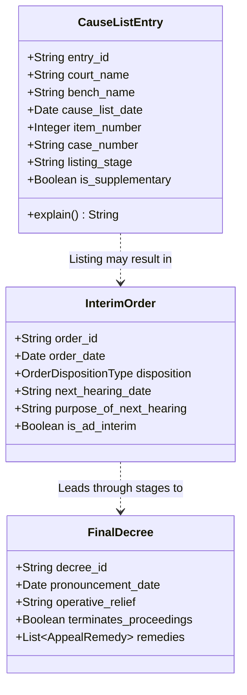

# PHASE 19 — PROCEDURAL HISTORY & CAUSE LIST SERVICE

**Workspace:** `C:\PROJECTS\LegalMitra`  
**Classification:** Proprietary & Confidential — Team Shatrujeet  
**Date:** October 2026  
**Status:** Canonical Reference

---

## 1. Executive Summary

Legal assistance platforms frequently misinform litigants by conflating a **listing on a daily cause list** with a **concluded hearing** or treating an **ad-interim stay** as a **final judgment**.

LegalMitra's **Source-Backed Case History Architecture (`legalmitra/corpus/procedural_events.py`)** explicitly represents the Indian litigation journey across distinct procedural milestones with full evidentiary backing.

---

## 2. Distinction Between Cause Lists, Orders, and Decrees

1. **Cause List Entry $\neq$ Concluded Hearing**:
   - A cause list entry proves that a matter was scheduled for consideration before a designated bench on a specified date.
   - It does not prove that the item was reached, that oral arguments occurred, or that an order was passed (cases are frequently "passed over" or "adjourned on request").
2. **Interim Order $\neq$ Final Decree**:
   - An ad-interim ex-parte injunction under Order XXXIX Rules 1 & 2 CPC operates strictly until the next date of hearing or disposal of the application.
   - It does not represent an adjudication on the merits of the suit.
3. **Daily Order Sheet**:
   - Contains operative directions, appearances of counsel, and next date of hearing (NDOH).
   - Serves as the primary source of truth for ongoing case tracking.

---

## 3. Case Natural Record (CNR) Linking

Every procedural record connects to the 16-character alphanumeric national CNR number standardized by the e-Courts Mission Mode Project:
- Example: `DLHC010045122026` (High Court of Delhi, 2026).
- Preserves complete chronology: Filing $\to$ Scrutiny $\to$ First Listing $\to$ Notice $\to$ Pleadings $\to$ Issues $\to$ Evidence $\to$ Final Arguments $\to$ Judgment $\to$ Execution.

---

## 4. Evidentiary Boundary Reporting

When procedural data is missing from public court records:
- LegalMitra outputs: *"Procedural records between [Date 1] and [Date 2] are not published on the official court web portal. The displayed timeline reflects verified entries only."*
- Never manufactures hypothetical hearing dates.

