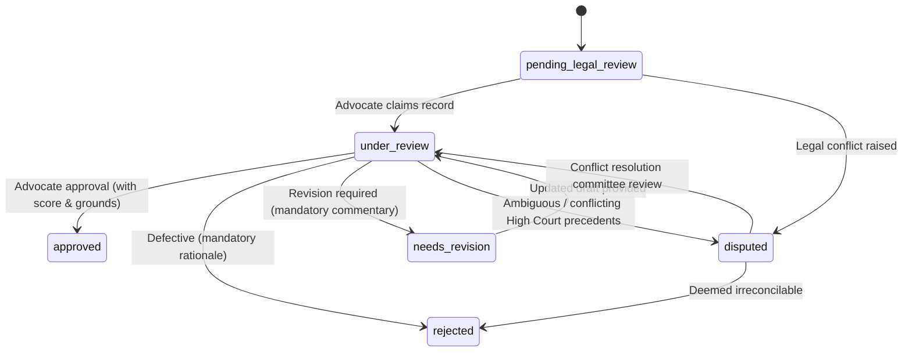

# LegalMitra Phase 23 Advocate Review Workflow Specification
**Workspace:** `C:\PROJECTS\LegalMitra`  
**Repository:** `https://github.com/DebugDroid-15/LegalMitra`  
**Owner:** Team Shatrujeet — Amar Khera, Ananya Rout, Lucky Kumar, Omm Prakash Sahoo  
**Date:** October 2026  
**Classification:** Proprietary and Confidential  

---

## 1. Executive Summary & Purpose

Legal accuracy in Indian jurisprudence cannot be established solely through automated metrics or synthetic self-evaluation. The LegalMitra Advocate Review Workflow provides an auditable, role-governed lifecycle through which qualified legal professionals review, validate, challenge, or reject system outputs.

---

## 2. Role-Based Access Control (RBAC) Matrix

| User Role | Can Start Review | Can Submit Decision | Can Dispute | Can Export Package | Can Import Package |
| :--- | :---: | :---: | :---: | :---: | :---: |
| **`ADVOCATE_REVIEWER`** | YES | YES | YES | NO | NO |
| **`SENIOR_ADVOCATE`** | YES | YES | YES | NO | NO |
| **`LEGAL_RESEARCHER`** | NO | NO | NO | YES | NO |
| **`AUDITOR`** | NO | NO | YES | YES | YES |
| **`SYSTEM_ADMIN`** | NO | NO | NO | YES | YES |

---

## 3. Advocate Credential Requirements

All final decisions (`APPROVED`, `REJECTED`, `NEEDS_REVISION`) require a valid `AdvocateCredentials` payload:
- **Full Name:** Minimum 3 characters (e.g. "Adv. Rajesh Kumar").
- **Bar Council Registration Number:** Must follow the official format `<State>/<Number>/<Year>` (e.g. `D/1945/2012`).
- **State Bar Council:** Enrolling council (e.g. "Bar Council of Delhi", "Bar Council of Maharashtra & Goa").
- **Enrollment Year:** Verified year between 1950 and current calendar year.

---

## 4. State Machine & Permitted Transitions

### Transition Enforcement Rules:
1. **No Direct Approval from Pending:** Records cannot jump directly from `pending_legal_review` to `approved` without an intermediate `under_review` state and bar credentials.
2. **Mandatory Rejection / Revision Commentary:** Any negative decision requires at least 15 characters of legal rationale.
3. **Score Range Constraint:** Scores, when supplied, must fall strictly within the 1.0 to 5.0 range.

