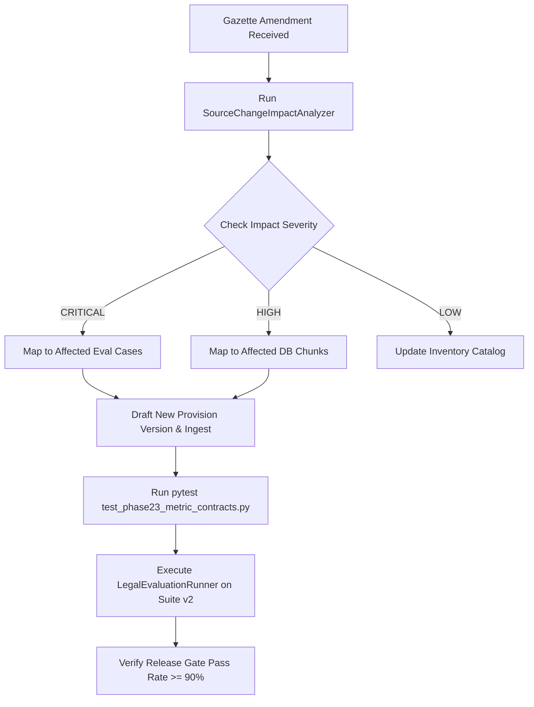

# LegalMitra Phase 23 Source Change Impact & Regression Protocol
**Workspace:** `C:\PROJECTS\LegalMitra`  
**Repository:** `https://github.com/DebugDroid-15/LegalMitra`  
**Owner:** Team Shatrujeet — Amar Khera, Ananya Rout, Lucky Kumar, Omm Prakash Sahoo  
**Date:** October 2026  
**Classification:** Proprietary and Confidential  

---

## 1. Objective & Architecture

Indian statutory law evolves constantly through gazette notifications, central amendments, state amendments, and judicial struck-down rulings. When a statute changes, LegalMitra must not blindly update text without understanding the downstream ripple effects on:
1. Active knowledge chunks in `legal_chunks`.
2. Existing golden evaluation benchmarks in `data/13_evaluation/`.
3. Advocate review queues and tracking registers.

The `SourceChangeImpactAnalyzer` (`legalmitra/corpus/impact_analyzer.py`) formalizes this mapping.

---

## 2. Severity Classification Matrix

| Severity | Definition | Trigger Conditions | Action Required |
| :--- | :--- | :--- | :--- |
| **`CRITICAL`** | Directly alters a benchmark case or golden citation | Section modified is present in `target_sections_or_paras` or `golden_citations` in `evaluation_cases_v2.json` | Re-run full evaluation suite; update golden assertions if statutory text changed |
| **`HIGH`** | Modifies active corpus chunks without existing benchmark case | Section matches retrievable chunks in `legal_chunks` (`is_synthetic_scaffold=0`) | Ingest amendment, increment version, run retrieval sanity test |
| **`MEDIUM`** | Modifies subordinate rules or delegated legislation | Rule/notification modified without parent Act amendment | Update subordinate rules registry |
| **`LOW`** | Modifies catalogued inventory entry not yet ingested | Entity only registered in Tier 1 (`legal_universe_inventory.json`) | Update inventory metadata |

---

## 3. Regression Execution Workflow

Upon receiving a gazette amendment notification:

---

## 4. Verification & Testing

The impact analyzer is verified by automated tests in `tests/test_phase23_impact_analyzer.py`:
- `test_bnss_section_482_amendment_impact`: Correctly identifies `EVAL-STAT-001` with `CRITICAL` severity.
- `test_delhi_rent_control_section_14_impact`: Correctly identifies `EVAL-STAT-002` with `CRITICAL` severity.
- `test_unindexed_statute_impact`: Safely defaults to `LOW` severity and zero chunk matches.

