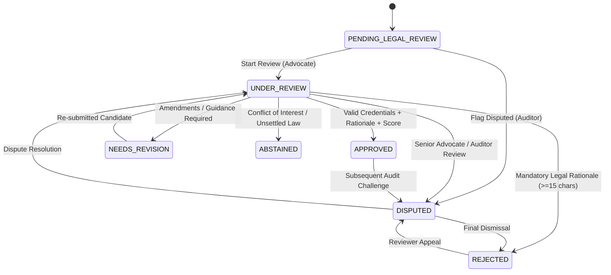

# LEGALMITRA PHASE 26: ADVOCATE REVIEW WORKFLOW & OPERATIONS ARCHITECTURE

**Classification:** Proprietary & Confidential — Team Shatrujeet  
**Phase:** 26 — Human Legal Review Operations, Structured Statutory Modeling & High Court Precedent Expansion  
**Owner:** Team Shatrujeet (Amar Khera, Ananya Rout, Lucky Kumar, Omm Prakash Sahoo)  
**Date:** October 2026  
**Status:** Implemented & Operational  

---

## 1. Executive Summary

LegalMitra enforces a strict, tamper-proof operational boundary separating automated machine pipeline execution from licensed advocate adjudication. Under no circumstances may machine confidence scores, test passes, or heuristic classifiers mark a legal QA example as "approved".

In Workstream A of Phase 26, the review lifecycle in `legalmitra/review/workflow.py` was extended to support the full spectrum of legal adjudication:
- Roles: `ADVOCATE_REVIEWER`, `SENIOR_ADVOCATE`, `LEGAL_RESEARCHER`, `AUDITOR`, `SYSTEM_ADMIN`.
- Decisions: `APPROVED`, `REJECTED`, `NEEDS_REVISION`, `DISPUTED`, and `ABSTAINED` (for conflicts of interest or unsettled jurisprudence).
- Mandatory server-side authorization: Bar Council credential validation, conflict of interest declarations, legal correctness scoring (1-5), and minimum 15-character legal rationale.

---

## 2. Review Lifecycle & State Transition Graph

---

## 3. Review Submission Schema & Validation Rules

The `ReviewSubmission` model enforces seven mandatory parameters:
1. `example_id`: Unique identifier referencing the candidate record.
2. `target_status`: Allowed target in `ReviewStatus` (`approved`, `rejected`, `needs_revision`, `abstained`, `disputed`).
3. `reviewer`: Validated `AdvocateCredentials` containing:
   - Full practitioner name (minimum 3 characters).
   - Bar Council Enrollment Number (regex format `State/Number/Year`, e.g., `D/1945/2012`).
   - State Bar Council name (e.g., *Bar Council of Delhi*, *Bar Council of Maharashtra & Goa*).
   - Enrollment year (1950 <= Year <= Current Year).
4. `rationale`: Verbatim legal justification citing primary legal authorities or procedural reasons.
5. `score`: Numeric evaluation score bounded between `1.0` and `5.0`.
6. `conflict_of_interest_declared`: Boolean declaration ensuring practitioner independence.
7. `audit_log`: Immutable, append-only record written to `data/06_review/audit/workflow_audit_log.jsonl`.

---

## 4. Preservation of Pending-Review Status

All 40 existing candidates across Package A (20 Pilot records) and Package B (20 candidate expansion records) remain strictly in `pending_legal_review` status:
- Total pending candidates: **40/40**.
- Promoted without licensed advocate sign-off: **0**.
- Verification command: `python scripts/verify_review_packages.py` exits 0.
