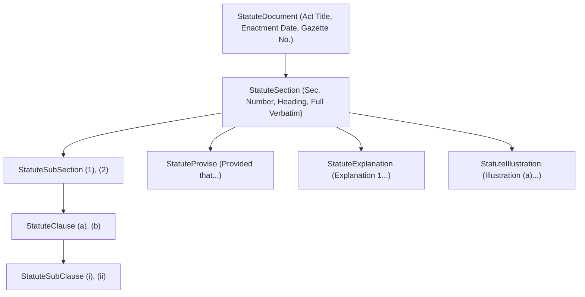

# LEGALMITRA PHASE 26: FIRST-CLASS STATUTORY STRUCTURE & HIERARCHICAL MODELING

**Classification:** Proprietary & Confidential — Team Shatrujeet  
**Phase:** 26 — Human Legal Review Operations, Structured Statutory Modeling & High Court Precedent Expansion  
**Date:** October 2026  
**Status:** Implemented & Verified  

---

## 1. Executive Summary

Indian legislative drafting follows a disciplined hierarchical architecture characterized by Sections, Subsections `(1), (2)`, Clauses `(a), (b)`, Subclauses `(i), (ii)`, Provisos (`"Provided that..."`), Explanations (`"Explanation.—"`), and Illustrations (`"Illustration (a)"`).

In Workstream B of Phase 26, LegalMitra strengthened its first-class statutory data model in `legalmitra/schemas/statute.py` and `legalmitra/knowledge/knowledge_base.py`. Rather than flattening entire statutory codes into coarse monolithic strings, the engine indexes both:
1. **Full Section Blocks**: Preserving total statutory context for holistic legal inquiries.
2. **First-Class Sub-Entities**: Distinct searchable entries for `subsection`, `proviso`, `explanation`, and `illustration` with exact parent-child foreign key tracking.

---

## 2. Structural Schema & Node Types

---

## 3. Storage Hierarchy & BM25/FTS5 Search Fidelity

Every sub-entity chunk in `legal_chunks` is assigned an immutable deterministic key and hierarchy level:
- Section: `{source_id}:SEC:{section_number}` (`hierarchy_level = 'section'`)
- Subsection: `{source_id}:SEC:{section_number}:SUB:{sub_num}` (`hierarchy_level = 'subsection'`)
- Proviso: `{source_id}:SEC:{section_number}:PROVISO:{idx}` (`hierarchy_level = 'proviso'`)
- Explanation: `{source_id}:SEC:{section_number}:EXP:{id}` (`hierarchy_level = 'explanation'`)
- Illustration: `{source_id}:SEC:{section_number}:ILL:{id}` (`hierarchy_level = 'illustration'`)

### Precision Retrieval Verification:
- **Targeted Proviso Queries**: Queries seeking exceptions (e.g. *Section 7(1) RTI 48-hour life or liberty timeline*, *Section 482 BNSS provisos*) match the specific proviso chunk directly, while maintaining parent references to the overarching Act and Section.
- **Illustration Queries**: Statutory illustrations enacted by Parliament (e.g., Section 25 BSA, Section 106 BNS) are retrieved as distinct illustrative guidance under `ChunkHierarchy.ILLUSTRATION`.
