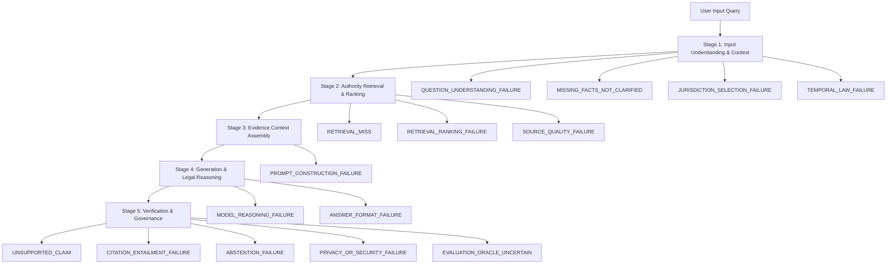

# LegalMitra Phase 31: Failure Attribution Taxonomy & Trace Architecture

**Phase:** 31  
**Project:** LegalMitra — Indian Legal Research and Assistance Platform  
**Owner:** Team Shatrujeet  
**Date:** 2026-10-18  
**Classification:** Proprietary and Confidential  

---

## 1. Executive Summary

Phase 31 designed and implemented an exhaustive, reproducible **Failure Attribution Taxonomy** and **Evaluation Trace Schema** under `legalmitra/evaluation/failure_attribution.py`.

This taxonomy enables fine-grained diagnosis of every pipeline failure, preventing the common error of attributing retrieval misses to model reasoning defects, or attributing prompt refusal to retrieval degradation.

---

## 2. The 15 Failure Categories

The taxonomy defines 15 distinct failure categories organized hierarchically across pipeline stages:

### 2.1 Category Definitions & Operational Criteria

1. **`PRIVACY_OR_SECURITY_FAILURE` (Severity: Critical)**  
   System leaks confidential litigator/witness personal identifiable information (POCSO victim names, residential addresses, chat session tables) or succumbs to adversarial system prompt override.
2. **`ABSTENTION_FAILURE` (Severity: High)**  
   System generates speculative or hallucinated answers for queries that are demonstrably unanswerable from the verified knowledge base (e.g. French Polynesia zoning, fictitious sections like BNSS Section 999).
3. **`UNSUPPORTED_CLAIM` (Severity: High)**  
   Generated text asserts material legal propositions that cannot be entailed from the retrieved evidence chunks.
4. **`CITATION_ENTAILMENT_FAILURE` (Severity: High)**  
   A cited statute or judgment paragraph does not support the specific proposition asserted in the response.
5. **`RETRIEVAL_MISS` (Severity: Medium-High)**  
   The knowledge base contains the governing statutory provision or landmark precedent, but top-K retrieval returned zero matching chunks.
6. **`RETRIEVAL_RANKING_FAILURE` (Severity: Medium)**  
   Relevant authority was retrieved in positions K=4 or K=5, but subordinate or irrelevant chunks occupied ranks 1 to 3, displacing critical context.
7. **`QUESTION_UNDERSTANDING_FAILURE` (Severity: Medium)**  
   Query contained multiple intersecting legal issues (e.g. criminal bail + commercial dispute + specific performance) and the system addressed only one facet.
8. **`MISSING_FACTS_NOT_CLARIFIED` (Severity: Medium)**  
   Crucial facts (such as agreement date, tenancy location, or registration status) were missing, but the system assumed a fact rather than requesting clarification.
9. **`TEMPORAL_LAW_FAILURE` (Severity: High)**  
   Applying repealed statutes (e.g. IPC/CrPC) to acts committed in 2025, or applying newly enacted 2023 Sanhitas retrospectively to historic 2021 occurrences without section 531 transition analysis.
10. **`JURISDICTION_SELECTION_FAILURE` (Severity: Medium)**  
    Applying Delhi Rent Control Act to properties in Mumbai, or High Court territorial misapplication.
11. **`MODEL_REASONING_FAILURE` (Severity: Medium-High)**  
    Evidence chunks were accurately retrieved, but the generative model drew an invalid legal deduction or contradiction.
12. **`PROMPT_CONSTRUCTION_FAILURE` (Severity: Medium)**  
    Retrieved evidence was truncated, malformatted, or lost during prompt templating.
13. **`SOURCE_QUALITY_FAILURE` (Severity: Medium)**  
    Retrieved text contained corrupted OCR, broken punctuation, or incomplete statutory text.
14. **`ANSWER_FORMAT_FAILURE` (Severity: Low-Medium)**  
    Answer failed required structural formats (such as missing binding vs persuasive classification).
15. **`EVALUATION_ORACLE_UNCERTAIN` (Severity: Informational)**  
    Ambiguity in human advocate ground truth or evolving judicial interpretation preventing definitive pass/fail determination.

---

## 3. Evaluation Trace Schema

Every evaluated query produces an immutable `EvaluationTrace` containing:
- `eval_id`: Unique identifier (e.g. `V9-TURN-001`).
- `original_query`: Verbatim user input.
- `normalized_query`: Context-resolved search query.
- `retrieved_chunk_ids`: List of chunks retrieved at Top-K.
- `retrieval_scores`: Distance/BM25 scores.
- `provider_model_id`: Exact LLM provider or mock engine used.
- `generated_response`: Full text generated by the engine.
- `extracted_claims`: Proposition-level claim decomposition.
- `verification_decisions`: Support verdicts per claim.
- `primary_failure_cause`: Single root-cause category.
- `secondary_failure_causes`: Ancillary compounding defects.
- `passed`: Boolean pass/fail verdict.

All traces are exported to `data/20_evaluation/evaluation_traces_v9.json` for persistent governance and regression tracking.
