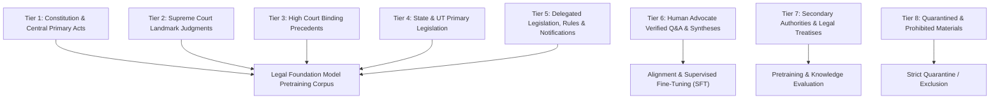

# LegalMitra Phase 31: Legal Data Governance & Ingestion Architecture

**Phase:** 31  
**Project:** LegalMitra — Indian Legal Research and Assistance Platform  
**Owner:** Team Shatrujeet  
**Date:** 2026-10-18  
**Classification:** Proprietary and Confidential  

---

## 1. Executive Summary

Training an original foundation model for Indian law requires strict data governance to ensure statutory validity, temporal integrity, judicial hierarchy, and ethical compliance.

Phase 31 specifies the comprehensive **8-Tier Indian Legal Training Data Taxonomy**, data quality filtration, deduplication rules, and synthetic quarantine governance.

---

## 2. The 8-Tier Indian Legal Data Taxonomy

Training data is partitioned into eight prioritized governance tiers:

### 2.1 Tier Specifications

| Tier | Corpus Description | Weighting / Priority | Governance Control |
|---|---|---|---|
| **Tier 1** | Constitution of India, Central Acts (BNSS, BNS, BSA, CPC, CrPC, SRA, Arb Act, DPDP, IT Act) | **Weight: 1.0 (Highest)** | Bitwise verification against official Gazette of India |
| **Tier 2** | Supreme Court Judgments (Reported in SCR, SCC, AIR, e-SCR) | **Weight: 0.9** | Ratio decidendi vs obiter dictum parsing |
| **Tier 3** | High Court Judgments across all 25 State/UT High Courts | **Weight: 0.75** | Explicit territorial jurisdiction tagging |
| **Tier 4** | State Acts and Union Territory Legislation (Rent Control, Police Acts) | **Weight: 0.7** | State boundary isolation |
| **Tier 5** | Statutory Rules, Regulations, Commencement Notifications | **Weight: 0.6** | Temporal effect and amendment synchronization |
| **Tier 6** | Advocate-Reviewed Legal Analyses, Golden Q&A Pairs | **Weight: 1.0 (SFT Only)** | Dual-advocate signed approvals required |
| **Tier 7** | Law Commission of India Reports, Parliamentary Standing Committee Debates | **Weight: 0.5** | Persuasive historical aid; labeled as non-binding |
| **Tier 8** | Quarantined Testing Scaffolds, Unredacted Minor POCSO Records, Overruled Dogma | **EXCLUDED (0.0)** | Automated regex and metadata quarantine gate |

---

## 3. Data Cleansing & Quarantine Governance

1. **Synthetic Scaffold Exclusion:**
   - Any record with `is_synthetic_scaffold = 1` or metadata containing `IND-JUD-DEL-2024-BAIL` is strictly blocked at the SQL query level.
2. **Privacy Redaction:**
   - Automated regex scrubbing removes victim names, contact numbers, and residential addresses in compliance with Section 74 of the POCSO Act and Section 74 of the Juvenile Justice Act.
3. **Exact & Near-Deduplication:**
   - MinHash LSH and SHA-256 fingerprinting deduplicate repeated headnotes and statutory preambles, preventing loss of diversity during autoregressive pretraining.
4. **Multilingual & Script Governance:**
   - Full Unicode UTF-8 encoding supporting Devanagari script for Hindi, Marathi, and Sanskrit legal terms (e.g. *अनुच्छेद*, *धारा*, *न्यायालय*, *मानहानि*).
