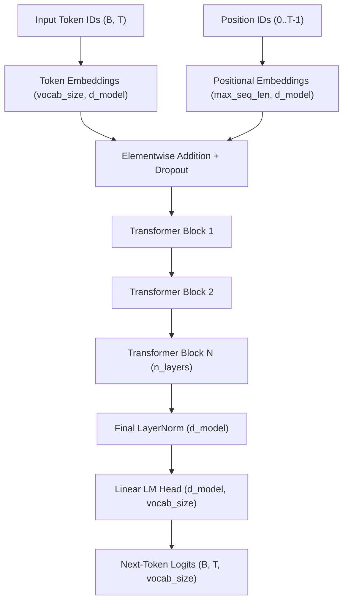

# LegalMitra Phase 31: Original Foundation Model Specification

**Phase:** 31  
**Project:** LegalMitra — Indian Legal Research and Assistance Platform  
**Owner:** Team Shatrujeet  
**Date:** 2026-10-18  
**Classification:** Proprietary and Confidential  

---

## 1. Executive Summary

Phase 31 specifies the complete architectural blueprint for training an **Original Indian Legal Foundation Model** from randomly initialized weights.

The model is strictly independent:
- **Zero Pretrained Weights:** No weights loaded from HuggingFace, OpenAI, Meta, Mistral, or external repositories.
- **Zero Pretrained Embeddings:** Vocabulary embeddings initialized entirely from scratch.
- **Custom Indian Legal Tokenizer:** Domain-specific subwords and special tokens.

---

## 2. Transformer Architecture Blueprint

### 2.1 Core Mathematical Components

1. **Decoder-Only Causal Architecture:**
   - Autoregressive next-token prediction with lower-triangular causal attention mask $M \in \{0, -\infty\}^{T \times T}$.
2. **Pre-Layer Normalization (Pre-LN):**
   - Normalization applied before self-attention and MLP:
     $$\mathbf{x}^{(l)}_{\text{mid}} = \mathbf{x}^{(l-1)} + \text{CausalSelfAttn}(\text{LayerNorm}(\mathbf{x}^{(l-1)}))$$
     $$\mathbf{x}^{(l)} = \mathbf{x}^{(l)}_{\text{mid}} + \text{MLP}(\text{LayerNorm}(\mathbf{x}^{(l)}_{\text{mid}}))$$
   - Prevents vanishing/exploding gradients during deep backpropagation without requiring auxiliary warmup hacks.
3. **Multi-Head Self-Attention:**
   - Scaled Dot-Product Attention:
     $$\text{Attention}(Q, K, V) = \text{softmax}\left(\frac{QK^T}{\sqrt{d_k}} + M\right) V$$
4. **Feed-Forward Network (FFN):**
   - Position-wise two-layer MLP with GELU non-linearity:
     $$\text{MLP}(\mathbf{z}) = W_2 \cdot \text{GELU}(W_1 \mathbf{z} + b_1) + b_2$$
     with hidden expansion ratio $\frac{d_{\text{ff}}}{d_{\text{model}}} = 4.0$.
5. **Strict Random Weight Initialization:**
   - Linear projection weights: $W \sim \mathcal{N}\left(0, 0.02^2\right)$
   - Biases initialized to zero: $\mathbf{b} = \mathbf{0}$
   - LayerNorm: $\gamma = 1.0, \beta = 0.0$.

---

## 3. Parameter Scaling Options

| Hyperparameter | Option A (Prototype / Measured GPU) | Option B (Small Legal Research LLM) | Option C (Full Foundation Model) |
|---|---|---|---|
| **Vocabulary Size ($V$)** | 1,024 | 16,384 | 32,768 |
| **Hidden Dimension ($d_{\text{model}}$)** | 128 | 768 | 2,048 |
| **Layers ($n_{\text{layers}}$)** | 4 | 12 | 24 |
| **Attention Heads ($n_{\text{heads}}$)** | 4 | 12 | 16 |
| **FFN Dimension ($d_{\text{ff}}$)** | 512 | 3,072 | 8,192 |
| **Max Context ($T$)** | 128 tokens | 1,024 tokens | 4,096 tokens |
| **Total Parameters** | **~938,752 (0.94 M)** | **~125 Million (125 M)** | **~1.3 Billion (1.3 B)** |
| **Target Execution Platform** | **Local RTX 2050 (4 GB VRAM)** | Workstation (24–48 GB VRAM) | Distributed Cluster (8x A100/H100) |
| **Status in Phase 31** | **FULLY IMPLEMENTED & TRAINED** | Architecture Specified | Architectural Roadmap |

---

## 4. Indian Legal Vocabulary & Special Tokens

The custom tokenizer includes dedicated Indian legal control tokens:
- `<sec>`: Section delimiter
- `<court>`: Court delimiter (Supreme Court, High Court)
- `<prov>`: Proviso delimiter
- `<act>`: Enactment name boundary
- Full Unicode range `[\u0900-\u097F]` for Devanagari script.
