# LegalMitra Phase 31: Training Pipeline Design Specification

**Phase:** 31  
**Project:** LegalMitra — Indian Legal Research and Assistance Platform  
**Owner:** Team Shatrujeet  
**Date:** 2026-10-18  
**Classification:** Proprietary and Confidential  

---

## 1. Executive Summary

Phase 31 designed and implemented an end-to-end, deterministic training pipeline for pretraining decoder-only transformers on Indian legal corpora.

Located entirely in the self-contained research namespace `research/original_model/`, the pipeline provides deterministic data chunking, next-token causal loss tracking, gradient clipping, and checkpoint serialization without any external runtime dependencies.

---

## 2. End-to-End Pipeline Architecture

```mermaid
flowchart LR
    KB[("legalmitra_kb.db")] --> SQL["extract_verified_legal_texts() (Quarantine Active)"]
    SQL --> Split["Deterministic 90/10 Split (seed=42)"]
    Split --> TrainTexts["Train Texts (1,340 chunks)"]
    Split --> ValTexts["Val Texts (149 chunks)"]

    TrainTexts --> TokTrain["Train BPE Tokenizer (1024 vocab)"]
    TokTrain --> SaveTok["Save tokenizer.json"]
    SaveTok --> Encode["Fast Memoized BPE Encode"]

    Encode --> TrainDS["LegalDataset (Tensor Chunks, T=128)"]
    Encode --> ValDS["LegalDataset (Tensor Chunks, T=128)"]

    TrainDS --> DataLoader["PyTorch DataLoader (Batch=8)"]
    DataLoader --> Model["LegalDecoderTransformer (Option A, 0.94M)"]
    Model --> Loss["Causal CrossEntropyLoss"]
    Loss --> Backprop["Backward Pass + ClipNorm (1.0)"]
    Backprop --> Optimizer["AdamW (lr=3e-4, wd=0.01)"]
    Optimizer --> Checkpoint["Save prototype_step_N.pt Checkpoint"]
```

---

## 3. Key Pipeline Specifications

### 3.1 Deterministic Dataset Splitting & Hashing
- **Source:** `data/legalmitra_kb.db`, querying `legal_chunks` where `is_synthetic_scaffold = 0`.
- **Split Ratio:** Exactly 90% training, 10% validation.
- **Corpus Fingerprint:** SHA-256 digest recorded in `research/original_model/dataset_manifest.json`.

### 3.2 Subword BPE Tokenization
- Trained natively from character frequencies across evenly spaced representative legal texts.
- Uses rank-lookup memoized encoding to eliminate quadratic merge overhead in Python.
- Special legal delimiter tokens preserved at fixed token IDs.

### 3.3 Optimization & Numerical Stability
- **Optimizer:** AdamW with $\beta_1 = 0.9, \beta_2 = 0.98, \epsilon = 10^{-8}, \text{weight\_decay} = 0.01$.
- **Learning Rate:** Base $3 \times 10^{-4}$ with linear warmup and cosine decay.
- **Gradient Clipping:** Maximum $L_2$ norm capped at $1.0$ via `torch.nn.utils.clip_grad_norm_`.
- **Loss Function:** Autoregressive cross-entropy with shift-by-one causal alignment.

### 3.4 Checkpoint Management & Round-Trip Verification
- Checkpoints serialize:
  - Model weights (`model_state_dict`)
  - Optimizer states (`optimizer_state_dict`)
  - Hyperparameter configuration (`config`)
  - Step counter, initial loss, and final loss.
- Automated reload verification tests that re-instantiated models load weights with zero state-dict mismatches.
