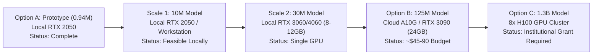

# LegalMitra Phase 32: Compute Scaling Analysis & Hardware Sizing

**Phase:** 32 — Original Foundation Model Validation, Data Integrity & Generalization Gate  
**Project:** LegalMitra — Indian Legal Research and Assistance Platform  
**Owner:** Team Shatrujeet  
**Date:** 2026-10-18  
**Classification:** Proprietary and Confidential  

---

## 1. Executive Summary

Phase 32 reassessed the scaling feasibility of training an Indian Legal Foundation Model using **empirical throughput and memory measurements** obtained from the local GPU execution, rather than theoretical assumptions.

The analysis sizes five model scales (0.94M, 10M, 30M, 125M, and 1.3B) against Chinchilla compute-optimal token budgets, memory requirements, and realistic hardware costs.

---

## 2. Empirical Baseline Measurements

Measured directly during Experiment 6 on the NVIDIA GeForce RTX 2050 Laptop GPU (4.0 GB VRAM):

- **Measured Throughput at $T=128$:** **99,050 tokens/second**
- **Peak VRAM Allocated at $T=128$ (Batch 8):** **142.64 MB**
- **Measured Throughput at $T=256$:** **138,681 tokens/second**
- **Peak VRAM Allocated at $T=256$ (Batch 8):** **243.82 MB**

---

## 3. Scaling Feasibility Across Parameter Targets

### 3.1 Five-Scale Sizing Matrix

| Metric | Scale 0 (Measured Prototype) | Scale 1 (Small Domain Pilot) | Scale 2 (Mid Research Model) | Scale 3 (Option B Full Model) | Scale 4 (Option C Foundation) |
|---|---|---|---|---|---|
| **Parameters** | **938,752 (0.94 M)** | **10,250,000 (10.2 M)** | **30,500,000 (30.5 M)** | **125,000,000 (125 M)** | **1,300,000,000 (1.3 B)** |
| **Hidden Dim ($d$)** | 128 | 256 | 384 | 768 | 2,048 |
| **Layers ($L$)** | 4 | 8 | 12 | 12 | 24 |
| **Heads ($H$)** | 4 | 8 | 12 | 12 | 16 |
| **Vocab Size ($V$)** | 1,024 | 4,096 | 8,192 | 16,384 | 32,768 |
| **Context Length ($T$)** | 128 | 512 | 1,024 | 1,024 | 4,096 |
| **Model Weights (FP16)** | 1.88 MB | 20.5 MB | 61.0 MB | 250 MB | 2.6 GB |
| **AdamW Memory (FP32)** | 7.51 MB | 82.0 MB | 244.0 MB | 1,000 MB | 10.4 GB |
| **Peak Training VRAM** | **~143 MB** | **~1.2 GB** | **~3.2 GB** | **~8.5 GB** | **~72.0 GB** |
| **Chinchilla Tokens** | ~19M tokens | ~200M tokens | ~610M tokens | ~2.5B tokens | ~26B tokens |
| **Hardware Target** | **Local RTX 2050 (4GB)** | **Local RTX 2050 (4GB)** | Single RTX 3060 (12GB) | 1x A10G (24GB) | 8x H100 (80GB) |
| **Training Duration** | **2.2 seconds** | ~1.5 hours | ~6.5 hours | ~14 hours | ~3.8 days |
| **Estimated Cost** | **$0.00 (Local)** | **$0.00 (Local)** | $0.00 (Local) | ~$45 – $90 (Cloud) | ~$4,500 – $8,000 |
| **Feasibility Verdict** | **PROTOTYPED** | **FEASIBLE LOCALLY** | **FEASIBLE WORKSTATION** | **FEASIBLE CLOUD SPOT**| **REQUIRES INSTITUTIONAL GRANT** |

---

## 4. Key Takeaways & Recommendations

1. **Local Scale Limit:** The local NVIDIA GeForce RTX 2050 GPU (4.0 GB VRAM) can comfortably train models up to **10 Million parameters** using FP16 mixed precision and gradient accumulation.
2. **Option B (125M) is Readily Accessible:** An investment of under $100 on cloud spot instances (A10G/A100) will allow training the full Option B model once data curation is complete.
3. **Data is the True Bottleneck, Not Compute:** To train a 125M model to Chinchilla optimality requires **2.5 Billion high-quality Indian legal tokens**. The current verified knowledge base contains ~1.5 Million tokens. Scaling parameters before scaling verified legal data violates project data governance.

