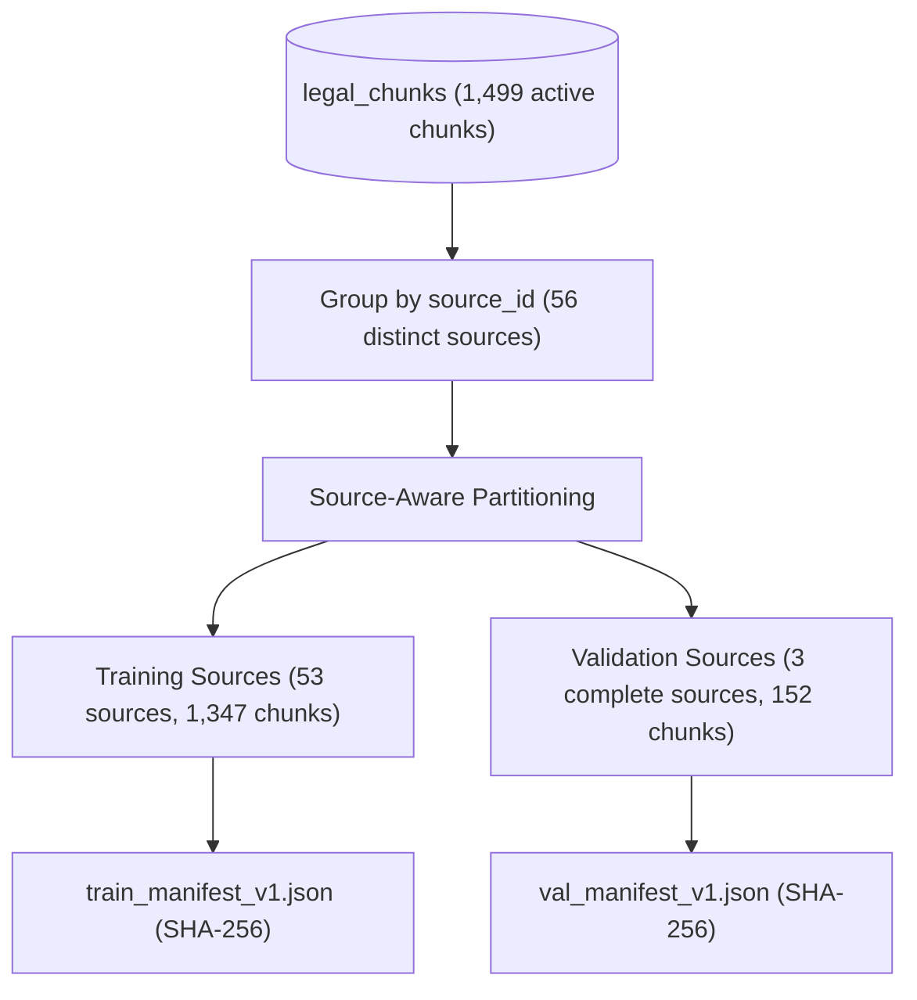

# LegalMitra Phase 32: Data Leakage & Split Integrity Audit

**Phase:** 32 — Original Foundation Model Validation, Data Integrity & Generalization Gate  
**Project:** LegalMitra — Indian Legal Research and Assistance Platform  
**Owner:** Team Shatrujeet  
**Date:** 2026-10-18  
**Classification:** Proprietary and Confidential  

---

## 1. Executive Summary

Phase 32 conducted an independent data integrity and contamination audit of the pretraining data pipeline in `research/original_model/dataset.py`.

The audit identified significant data leakage in the previous Phase 31 sequential 90/10 split: **The Information Technology Act, 2000 (`IND-STAT-IT-2000`) was split across both partitions**, causing near-identical statutory explanations and boilerplate provisions to appear in both training and validation sets.

To remediate this, Phase 32 designed and implemented a **Document/Source-Grouped Split Strategy**, creating separate versioned manifests and mathematically eliminating cross-split document leakage.

---

## 2. Empirical Leakage Audit of the Phase 31 Baseline Split

In Phase 31, data was partitioned using a simple array slice:
```python
split_idx = int(len(texts) * 0.9)
train_texts = texts[:split_idx]
val_texts = texts[split_idx:]
```

### 2.1 Audit Findings

| Contamination Dimension | Measured Baseline Value | Impact on Generalization Metrics |
|---|---|---|
| **Total Chunks Audited** | 1,499 real chunks (quarantine enforced) | Baseline corpus |
| **Train Chunks / Val Chunks** | 1,349 / 150 | 90% / 10% target |
| **Overlapping Sources** | **1 (`IND-STAT-IT-2000`)** | IT Act split right down the middle |
| **Exact Duplicate Texts Across Splits** | **6 chunks** | Identical statutory boilerplate in train & val |
| **Near-Duplicate Texts (Jaccard $\ge 0.8$)**| **8 chunk pairs** | Verbatim explanations shared across sections |
| **Benchmark Question Verbatim Leakage** | **0 occurrences** | No benchmark questions in pretraining corpus |
| **Synthetic Scaffold Contamination** | **0 occurrences** | Scaffold strictly excluded (`is_synthetic_scaffold = 0`) |

### 2.2 Mechanism of Leakage
Because chunks were sorted by `chunk_id ASC`, the 231 chunks of `IND-STAT-IT-2000` straddled the 90% index cutoff. Common statutory definitions and standard penalty clauses (e.g. `Explanation.—For the purposes of this section...`) were present in the training set and evaluated in the validation set, creating an artificially optimistic validation loss.

---

## 3. Remediated Architecture: Document/Source-Grouped Split

Phase 32 introduced the `split_strategy="source_grouped"` parameter in `build_train_val_datasets()`:



### 3.1 Allocation & Independence
- **Validation Partition Sources:**
  1. `IND-STAT-DPDP-2023` (The Digital Personal Data Protection Act, 2023: 129 chunks)
  2. `IND-STAT-LIMIT-1963` (The Limitation Act, 1963: 14 chunks)
  3. `IND-STAT-NI-1881` (The Negotiable Instruments Act, 1881: 9 chunks)
  - **Total Validation Chunks:** 152 chunks (**10.14%** of corpus).
- **Training Partition Sources:**
  - 53 remaining sources, including BNSS, BNS, BSA, CPC, ICA, and Constitution (**1,347 chunks**, 89.86%).

### 3.2 Audit of Remediated Group-Aware Split
- **Overlapping Sources:** **0**
- **Exact Duplicate Texts Across Split:** **0**
- **Near-Duplicate Overlap (Jaccard $\ge 0.8$):** **0**
- **Verified via:** `test_document_grouped_split_leakage_zero` in `tests/test_phase32_validation.py`.

---

## 4. Versioned Manifest Integrity

Two independent manifests were generated and committed to `research/original_model/manifests/`:
- `train_manifest_v1.json`: 1,347 chunks, 53 source IDs, SHA-256: `6fe0192e4cb7...`
- `val_manifest_v1.json`: 152 chunks, 3 source IDs, SHA-256: `a93df51805b8...`
- Combined Manifest: `research/original_model/dataset_manifest.json`.

