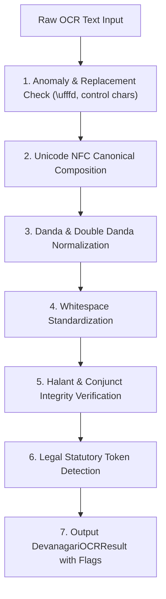

# PHASE 40 — DEVANAGARI OCR NORMALIZATION & QA ARCHITECTURE DESIGN

## 1. Context & Technical Challenges

A significant portion of Indian judicial literature—particularly from the High Courts of Allahabad, Patna, Madhya Pradesh, Rajasthan, and thousands of subordinate district courts across the Hindi belt—originates in Hindi and Sanskritized Devanagari legal script.

Raw optical character recognition (OCR) of these documents suffers from endemic corruption:
1. **Ligature & Conjunct Fractures**: Broken halant/virama markers (e.g., `द्` + `ध` rendered as broken independent consonants).
2. **Replacement Characters**: Presence of Unicode `\ufffd` indicating byte decoding failure.
3. **Punctuation Corruption**: Latin pipe symbols (`|`, `||`) erroneously substituted for Devanagari Danda (`।`, U+0964) and Double Danda (`॥`, U+0965), often with irregular whitespace.
4. **Numeral Confusion**: Inconsistent mixing of Devanagari numerals (`०-९`) and Latin Arabic numerals (`0-9`).
5. **Critical Statutory Token Corruption**: Subtle character alterations distorting core legal terms like जमानत (bail), अभियुक्त (accused), or धारा (section).

---

## 2. Non-Destructive Architectural Paradigm

To protect evidentiary integrity, LegalMitra implements a **strictly non-destructive architecture** in [`DevanagariOCREngine`](file:///c:/PROJECTS/LegalMitra/legalmitra/judicial/devanagari_ocr.py):
- The original raw OCR text is stored immutably in `raw_ocr_text`.
- The normalized representation is stored in `normalized_text`.
- Quality signals, anomalies, ligature warnings, and human review flags are stored alongside in metadata.

---

## 3. Seven-Step Normalization Pipeline

### Detailed Rules
1. **NFC Normalization**: Applies standard Unicode Normalization Form C (`unicodedata.normalize("NFC", text)`), resolving precomposed characters and vowel signs (matras).
2. **Danda Attachment**: Ensures danda attaches directly to the preceding word without leading whitespace (`की।`), and leaves a single space following the danda if followed by another word.
3. **Pipe Symbol Conversion**: Replaces isolated ASCII pipes surrounded by Devanagari characters with standard Unicode Devanagari danda.
4. **Legal Token Vocab Preservation**: Scans and verifies 20 essential judicial tokens:
   - जमानत (bail)
   - दोषसिद्धि (conviction)
   - बरी (acquittal)
   - अपील (appeal)
   - याचिका (petition)
   - अभियुक्त (accused)
   - अभियोजन (prosecution)
   - उच्चतम न्यायालय (Supreme Court)
   - उच्च न्यायालय (High Court)
   - सत्र न्यायालय (Sessions Court)
   - धारा (section)
   - अनुच्छेद (article)
   - प्रावधान (provision)
   - संविधान (constitution)
   - दण्ड प्रक्रिया संहिता (CrPC)
   - भारतीय दण्ड संहिता (IPC)
   - साक्ष्य (evidence)
   - तथ्य (facts)
   - निर्णय (judgment)
   - आदेश (order)
5. **Human Review Escalation**: When `\ufffd` or orphaned halant marks are detected, `requires_human_review` is set to `True`.
