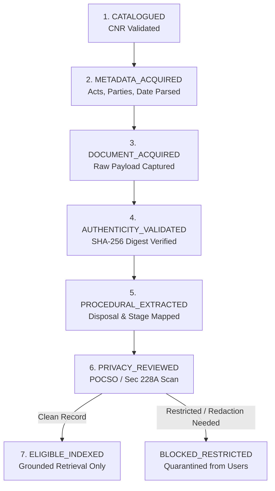

# PHASE 40 — ECOURTS CIS INGESTION PROTOCOL & GOVERNANCE

## 1. Overview & Institutional Reality

The **eCourts Integrated Case Management Information System (CIS)** represents the digital backbone of over 3,000 court complexes and 19,000 district and subordinate court halls across India.

### Access Boundaries & Ethical Posture
- **Public Web Interface**: The public portal (`services.ecourts.gov.in`) enforces visual CAPTCHAs and per-IP query quotas to prevent bulk scraping and automated harvesting.
- **LegalMitra Compliance**: LegalMitra refuses to employ automated OCR CAPTCHA-bypass scripts or proxy-rotation botnets. Doing so would violate the integrity of judicial IT infrastructure.
- **Ingestion Route**: LegalMitra ingests subordinate records through:
  1. Offline, authorized eCommittee Open Access case datasets;
  2. Institutional eCommittee API gateways (under administrative token authorization);
  3. Pre-validated court fixture dumps for testing and calibration.

---

## 2. 16-Character CNR Decomposition Standard

The Case Number Record (CNR) is the unique national identifier assigned to every filing across district and subordinate courts. The [`ECourtsProtocolValidator`](file:///c:/PROJECTS/LegalMitra/legalmitra/judicial/ecourts_protocol.py) enforces the standard 16-character alphanumeric regex:

```regex
^([A-Z]{2})([A-Z]{2})([A-Z0-9]{2})(\d{6})(\d{4})$
```

| Component | Width | Description | Example |
| :--- | :--- | :--- | :--- |
| **State Code** | 2 chars | Two-letter state identifier | `DL` (Delhi), `MH` (Maharashtra) |
| **District Code** | 2 chars | Two-letter district court identifier | `TH` (Tis Hazari), `CC` (City Civil) |
| **Establishment Code** | 2 chars | Court complex or court room ID | `01`, `02` |
| **Case Number** | 6 digits | Sequential case registration index | `001234` |
| **Filing Year** | 4 digits | Registration calendar year (1950–2030) | `2023` |

Example: `DLTH010012342023` -> Delhi, Tis Hazari, Complex 01, Case #1234 of 2023.

---

## 3. Seven-Stage Ingestion Pipeline

Every subordinate court record must transition through a strict 7-stage workflow before it can be made available for retrieval:



---

## 4. Privacy & Pretraining Gating Safeguards

1. **Section 74 POCSO & Section 228A IPC**: Any subordinate record containing sexual offence allegations, minor child victim references, or matrimonial in-camera proceedings is automatically diverted to `BLOCKED_RESTRICTED`.
2. **Absolute Pretraining Exclusion**: Under LegalMitra core governance invariants, **all subordinate court records have `is_training_eligible = False`**. Subordinate court records are strictly barred from being used in pretraining or fine-tuning foundation models. They may only be accessed via grounded RAG retrieval once fully cleared through stage 7.
