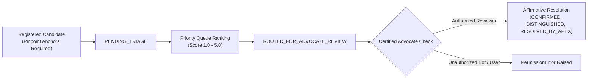

# PHASE 40 — PRECEDENT CONFLICT TRIAGE WORKFLOW & GOVERNANCE

## 1. Doctrinal Motivation: The Co-Equal High Court Dilemma

Under the Constitution of India, High Courts possess co-equal constitutional status under Article 214 and 227. While decisions of one High Court carry binding authority over subordinate courts within its state, they possess only **persuasive authority** before other High Courts (*V.M. Salgaocar & Bros v. CIT* (2000) 5 SCC 373).

Consequently, genuine divergent interpretations frequently arise between High Courts on central statutes (e.g., Section 138 Negotiable Instruments Act, Section 9 Arbitration Act, Section 14 IBC vs PMLA).

### Ethical & Legal Invariant
> **No automated software or machine learning model may decide which High Court precedent "wins" or overrules another.**
> Resolving, distinguishing, or reconciling precedent conflicts requires certified human legal review. Attempts by unauthenticated users or bots to resolve conflicts trigger an immediate `PermissionError`.

---

## 2. Taxonomy of Judicial Precedent Divergence

The [`PrecedentConflictTriageManager`](file:///c:/PROJECTS/LegalMitra/legalmitra/judicial/conflict_triage.py) categorizes candidate divergences into six distinct categories:

1. `CO_EQUAL_HIGH_COURT_CONFLICT`: Genuine jurisprudential divergence between two High Courts of equal bench strength on identical statutory wording.
2. `INTRA_COURT_CO_EQUAL_BENCH_DIVERGENCE`: Two coordinate benches of the same High Court expressing conflicting views (must be referred to Chief Justice for Larger Bench).
3. `FACTUALLY_DISTINGUISHABLE`: Apparent conflict resolved by analyzing material differences in contract wording, pleadings, or factual findings.
4. `STATUTORY_VERSION_DIVERGENCE`: Divergence arising because decisions were rendered under different legislative versions (e.g., pre-2015 vs post-2015 Arbitration Act).
5. `RATIO_VS_OBITER_AMBIGUITY`: Apparent conflict caused by confusing the binding ratio decidendi with passing judicial observations (obiter dicta).
6. `RESOLVED_BY_SUBSEQUENT_APEX_DECISION`: Conflict that was subsequently addressed and authoritatively settled by the Supreme Court of India under Article 141.

---

## 3. Triage Lifecycle & Authorization Gate

### Evidentiary Anchoring Requirement
To eliminate speculative or frivolous conflict submissions, every registered candidate **must provide exact pinpoint paragraph or page anchors** for both competing decisions (e.g., `[2008] DHC 1088, Para 21`). Omitting either anchor raises a `ValueError`.

---

## 4. Phase 40 Conflict Register Holdings

The baseline register [`data/21_judicial_infrastructure/precedent_conflict_register.json`](file:///c:/PROJECTS/LegalMitra/data/21_judicial_infrastructure/precedent_conflict_register.json) tracks 6 foundational conflicts:

1. **`CONF-2026-001` (Priority 4.5)**: Sec 138 NI Act territorial jurisdiction (Bombay HC vs Delhi HC) -> `RESOLVED_BY_APEX_COURT` (*Dashrath Rupsingh Rathod* and 2015 legislative amendment).
2. **`CONF-2026-002` (Priority 4.8)**: Sec 18 SC/ST Act pre-arrest bail (Bombay HC vs Rajasthan HC) -> `RESOLVED_BY_APEX_COURT` (*Prathvi Raj Chauhan v. UOI* (2020)).
3. **`CONF-2026-003` (Priority 4.0)**: Sec 9 Arbitration Act interim relief post-tribunal constitution (Delhi HC vs Bombay HC) -> `ROUTED_FOR_ADVOCATE_REVIEW`.
4. **`CONF-2026-004` (Priority 4.9)**: IBC Moratorium vs PMLA Attachment (Delhi HC vs NCLAT) -> `CONFIRMED_GENUINE_CONFLICT` (Awaiting Supreme Court three-judge decision).
5. **`CONF-2026-005` (Priority 3.2)**: Sec 125 CrPC vs Sec 24 HMA Maintenance (Allahabad HC vs MP HC) -> `RESOLVED_FACTUALLY_DISTINGUISHED` (*Rajnesh v. Neha* national guidelines).
6. **`CONF-2026-006` (Priority 4.6)**: CGST Sec 16(2)(c) Input Tax Credit Reversal (Madras HC vs Patna HC) -> `PENDING_TRIAGE`.
