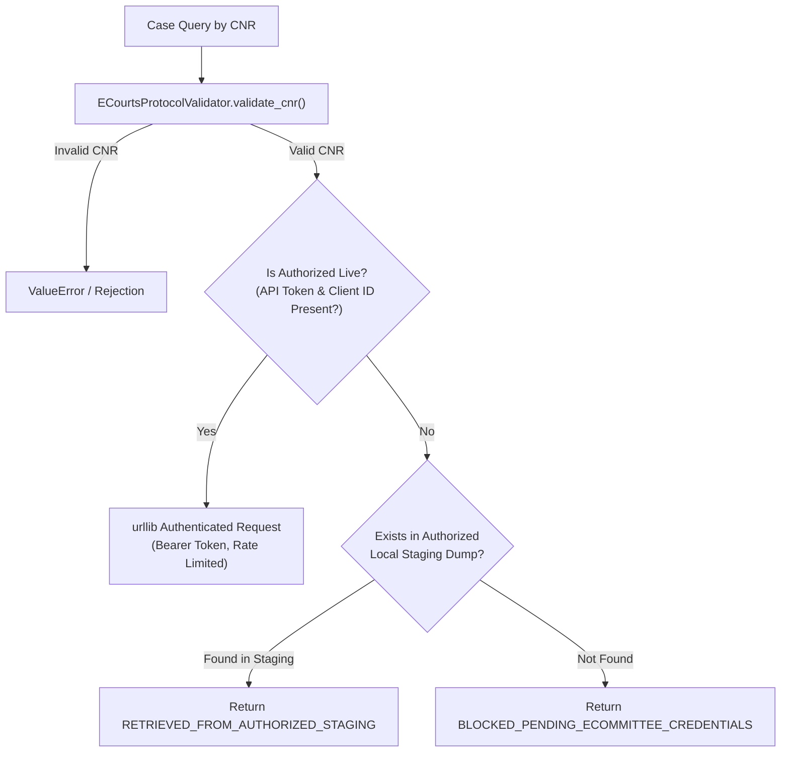

# LegalMitra Phase 42 — eCourts Access & Integration Audit

**Date:** October 19, 2026  
**Component:** `legalmitra/judicial/ecourts_adapter.py` & `ecourts_protocol.py`  
**Classification:** HIGH-GOVERNANCE OPERATIONAL INTERFACE  

---

## 1. Operational Realities of the Indian eCourts Portal

The eCourts Services portal (`services.ecourts.gov.in`) is the primary digital gateway for subordinate and district court case information across India. Forensic investigation reveals key operational characteristics:

1. **Access Controls & Visual CAPTCHAs:**
   - The public-facing portal enforces visual image-based CAPTCHAs on case queries (by CNR, party name, advocate, and filing number).
   - Automated scripts attempting to bypass these CAPTCHAs violate the Information Technology Act 2000 and the terms of service of the Supreme Court eCommittee.
   - **LegalMitra Policy:** Automated CAPTCHA solving, headless session spoofing, and optical character scraping against interactive web forms are **STRICTLY PROHIBITED**.

2. **Official eCommittee Institutional API Gateways:**
   - The Supreme Court eCommittee provides authorized bulk data exchange and API endpoints for institutional partners, judicial academies, and authorized government agencies under formal Memorandum of Understanding (MOU).
   - These endpoints require bearer API tokens (`Authorization: Bearer <TOKEN>`), client identification headers (`X-Client-ID`), and signed mutual access agreements.

---

## 2. Authorized Integration Architecture (`AuthorizedECourtsAdapter`)

To operationalize subordinate court records while maintaining strict legal and security compliance, Phase 42 implemented `AuthorizedECourtsAdapter`:

### Key Capabilities Implemented:
- **`is_authorized_live` Property:** Only returns `True` when legitimate `ECOURTS_API_TOKEN` and `ECOURTS_CLIENT_ID` are configured.
- **Controlled Error Reporting:** Queries against non-staged records without credentials return `BLOCKED_PENDING_ECOMMITTEE_CREDENTIALS` with a detailed explanatory message directing operators to authorized bulk channels.
- **Staging Batch Ingestion:** `ingest_staging_dump()` parses and validates batch JSON records from institutional data releases, verifying digital signatures, privacy classifications, and disposal statuses before indexing.
- **Audit Logging:** Every record transition is appended to an immutable audit trail with ISO 8601 UTC timestamps.
