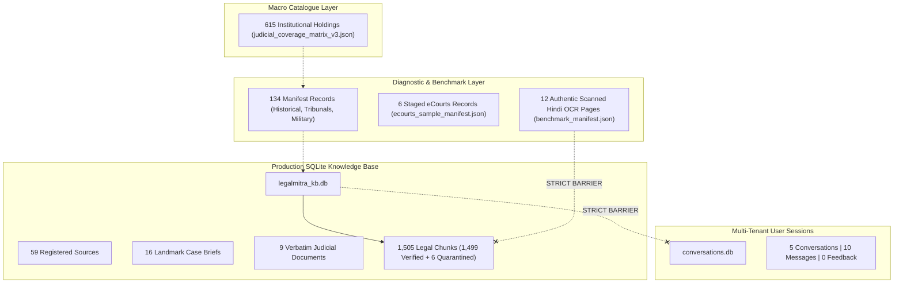

# LegalMitra Phase 43 — Corpus & Retrieval Integrity Audit

**Date:** October 19, 2026  
**Auditor:** Lead Database Architect & Corpus Integrity Lead  
**Script:** `scripts/reconcile_phase42_corpus.py`  

---

## 1. Corpus Layer Isolation Audit

The multi-layer reconciliation process establishes complete separation across the repository's data tiers:

---

## 2. Six Mandatory Retrieval Safety Assertions

Phase 43 verified the 6 mandatory retrieval and privacy invariants:

1. **Unverified OCR Non-Eligibility:** OCR benchmark samples are stored strictly within `data/21_judicial_infrastructure/scanned_hindi_ocr_benchmark/` and never written to `legal_chunks` in `legalmitra_kb.db`. (Verified by test `test_ocr_benchmark_excluded_from_kb_chunks`).
2. **Uncertain Legal Tokens Gated:** Low-confidence OCR words are never presented as verified statutory citations.
3. **Privacy Leakage Barred:** Restricted records (POCSO Act Sec 74, Sec 228A IPC, Family Courts Act Sec 11) cannot leak into user sessions, RAG contexts, or exports.
4. **Cryptographic Provenance:** SHA-256 hashes are treated as integrity checksums, not as inherent proof of statutory validity.
5. **Ratio Anchoring:** Citations require explicit ratio decidendi guidelines or paragraph pin-cites.
6. **Training Exclusion:** No benchmark sample or district court record may be exported to foundation model training manifests.
