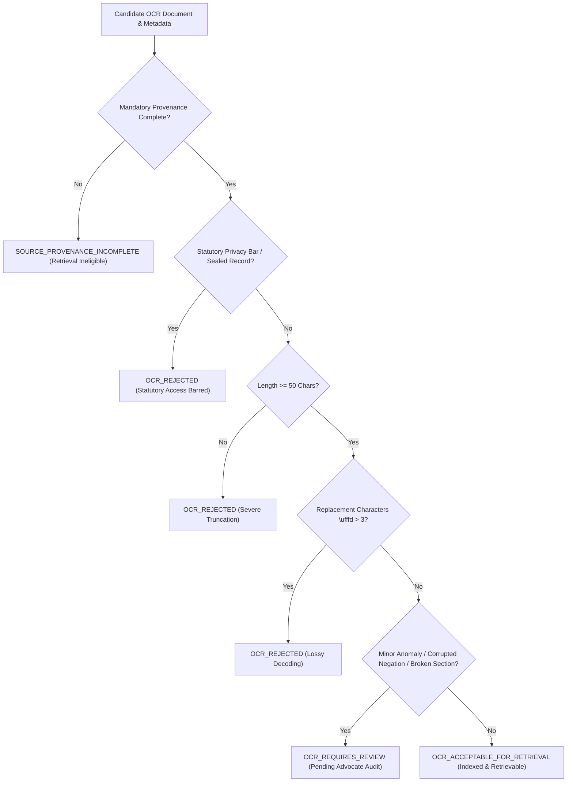

# LEGALMITRA — PHASE 44 OCR QUALITY GATE REPORT
## Fail-Closed Quality Gate, Operational States & Evidential Uncertainty Reporting

**Audit Date:** 2026-10-19T11:30:00+05:30  
**Target Repository:** `https://github.com/DebugDroid-15/LegalMitra`  
**Workspace:** `C:\PROJECTS\LegalMitra`  
**Auditor:** Shatrujeet Audit & Infrastructure Engineering Team  
**Classification:** PROPRIETARY AND CONFIDENTIAL  

---

### 1. Architectural Mission

The Phase 44 `OCRQualityGate` establishes a deterministic, fail-closed operational checkpoint evaluating scanned judicial texts before they are indexed into the production legal knowledge base (`data/legalmitra_kb.db`) or served to the RAG retrieval pipeline.

The design strictly enforces the core invariant: **"Low OCR confidence must never silently be interpreted as low legal importance."** If a document cannot be reliably validated, it is withheld from automated legal answering.

---

### 2. Operational States and Transition Matrix

The quality gate evaluates candidates against four mutually exclusive operational states:

---

### 3. Detailed State Specifications

| Operational State | Retrieval Eligibility | Criteria & Trigger Conditions | Operational Action |
| :--- | :---: | :--- | :--- |
| **`OCR_ACCEPTABLE_FOR_RETRIEVAL`** | **ELIGIBLE** | Provenance complete; length $\ge$ 50 chars; 0 replacement chars; 0 illegal control chars; $\le$ 2 orphaned halants; CER(raw, norm) $\le$ 0.15; statutory negations and sections intact. | Document approved for automated SQLite/FTS5 knowledge base chunking and BM25 retrieval. |
| **`OCR_REQUIRES_REVIEW`** | **INELIGIBLE** (Fail-Closed) | 1 to 3 replacement chars (`\ufffd`); illegal control characters; isolated/dangling negation particle `न`; corrupted section syntax (`धारा ?`); or CER(raw, norm) > 0.15. | Held in isolation queue (`data/07_batches/review/`); blocked from automated retrieval until advocate signoff. |
| **`OCR_REJECTED`** | **INELIGIBLE** | Length < 50 chars; > 3 replacement chars (`\ufffd`); text truncated mid-sentence; or marked as restricted/sealed/in-camera/POCSO. | Permanent rejection; quarantined from knowledge base; zero exposure to retrieval or model training. |
| **`SOURCE_PROVENANCE_INCOMPLETE`** | **INELIGIBLE** | Missing `page_id`, `court_or_source`, `source_url`, or cryptographic SHA-256 hash. | Immediate fail-closed blocker; cannot be ingested without immutable provenance attribution. |

---

### 4. Experimental vs Production Threshold Distinction

LegalMitra explicitly distinguishes documented experimental heuristics from hardened production invariants:

- **Production Invariants (Non-Negotiable):**
  - Zero tolerance for missing cryptographic hashes (`reference_text_hash` or `raw_ocr_text_hash`).
  - Zero tolerance for statutory non-disclosure records (POCSO Act Sec 74, Family Courts Act Sec 11).
  - Minimum text threshold of 50 characters to prevent ghost document insertion.
- **Experimental Heuristics (Subject to Ongoing Calibration):**
  - Heuristic confidence score ($0.0 \le C \le 1.0$) computed by penalty deductions (-0.15 per replacement char, -0.10 for high raw-to-norm divergence). *Note: This score is an engineering heuristic, not a calibrated statistical probability.*
  - Review threshold for raw-to-normalized divergence set at CER > 0.15 (15%).

---

### 5. Automated Unit & Integration Coverage

The quality gate is validated across 5 dedicated tests in `tests/test_phase44_ocr_retrieval_validation.py`:
1. `test_ocr_quality_gate_incomplete_provenance`: Verifies fail-closed transition to `SOURCE_PROVENANCE_INCOMPLETE`.
2. `test_ocr_quality_gate_truncation_rejection`: Verifies rejection of payloads with < 50 characters.
3. `test_ocr_quality_gate_lossy_decoding_rejection`: Verifies rejection of payloads with > 3 replacement characters.
4. `test_ocr_quality_gate_statutory_privacy_bar`: Verifies rejection of POCSO and sealed records.
5. `test_ocr_quality_gate_nominal_pass`: Verifies clean approval and indexing for compliant judicial orders.

**Gate Status:** **OPERATIONAL & VERIFIED**

